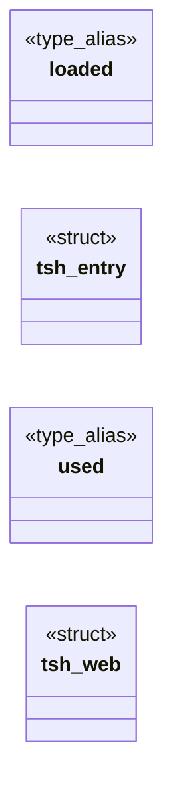
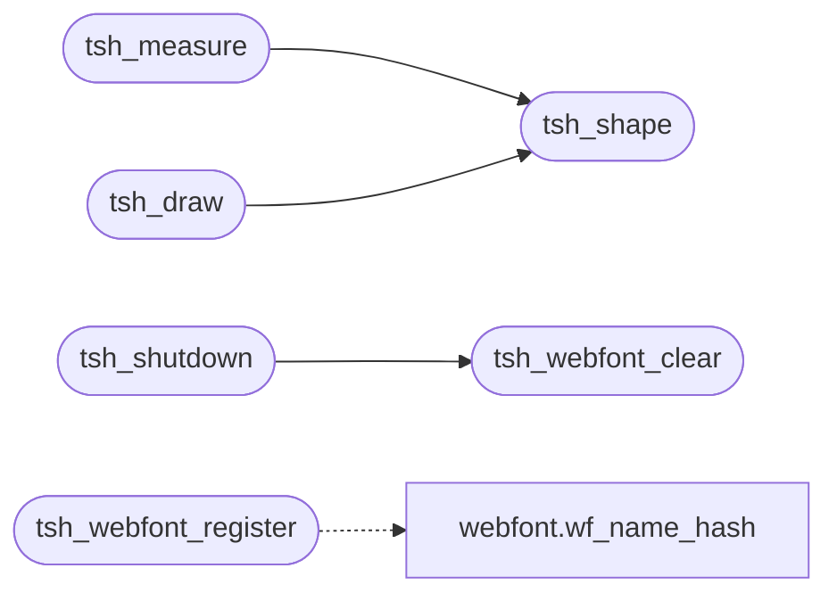

# `src/text_shape.c`

> Source: [src/text_shape.c:1](../../src/text_shape.c#L1) | language `c` | coverage 58.8% | [API index](../index.md)

## Contents

- **Structs:** [`tsh_entry`](#tsh_entry), [`tsh_web`](#tsh_web)
- **Type Aliases:** [`loaded`](#loaded), [`used`](#used)
- **Functions:** [`slice`](#slice), [`tsh_webfont_register`](#tsh_webfont_register), [`tsh_webfont_clear`](#tsh_webfont_clear), [`tsh_ready`](#tsh_ready), [`tsh_shape`](#tsh_shape), [`tsh_measure`](#tsh_measure), [`tsh_draw`](#tsh_draw), [`tsh_shutdown`](#tsh_shutdown)
- **Macros:** [`_POSIX_C_SOURCE`](#_posix_c_source), [`TSH_MAX_FONT_BYTES`](#tsh_max_font_bytes), [`TSH_CACHE_SLOTS`](#tsh_cache_slots), [`TSH_WEB_SLOTS`](#tsh_web_slots)

## Type Diagram



## Call Graph

Solid arrows stay in this module, dashed arrows leave it.



## Structs

<a id="tsh_entry"></a>

### `tsh_entry`

`struct` | [src/text_shape.c:35](../../src/text_shape.c#L35)

```c
typedef struct tsh_entry
```

---

<a id="tsh_web"></a>

### `tsh_web`

`struct` | [src/text_shape.c:171](../../src/text_shape.c#L171)

```c
typedef struct tsh_web
```

---

## Type Aliases

<a id="loaded"></a>

### `loaded`

`type_alias` | [src/text_shape.c:34](../../src/text_shape.c#L34)

```c
typedef struct tsh_entry { int loaded;
```

One resolved face per (family, bold, italic). family is a CSS_FF_* bucket * (0..CSS_FF_FANTASY); idx = family*4 + bold*2 + italic. define TSH_CACHE_SLOTS ((CSS_FF_FANTASY + 1) * 4)

---

<a id="used"></a>

### `used`

`type_alias` | [src/text_shape.c:170](../../src/text_shape.c#L170)

```c
typedef struct tsh_web { int used;
```

Per-document @font-face table (spec/webfont.md): registered by the trusted parent from policy-gated fetches, keyed by (name hash, bold, italic).

Memory only, freed by tsh_webfont_clear (navigation) and tsh_shutdown. Never the * worker: shaping a registered face runs on the painter side like every face. define TSH_WEB_SLOTS 16

---

## Functions

<a id="slice"></a>

### `slice`

`function` | [src/text_shape.c:193](../../src/text_shape.c#L193)

```c
* woff2 slice (spec/webfont.md);
```

**Parameters**

| Name | Type | Default | Description |
|---|---|---|---|
| `md` | `spec/webfont.` |  |  |

**Returns:** `* woff2`

---

<a id="tsh_webfont_register"></a>

### `tsh_webfont_register`

`function` | [src/text_shape.c:247](../../src/text_shape.c#L247)

```c
int tsh_webfont_register(const char *name, const unsigned char *bytes, size_t nbytes, int bold, int italic)
```

Registers one fetched @font-face for this document (spec/webfont.md): name is the author family (hashed with wf_name_hash), bytes the validated font program (copied; caller keeps ownership).

Re-registering a key replaces it. Returns 0 on success, -1 fail-closed (NULL/empty/oversize args, bad magic, unparseable bytes, table full). Trusted side only; never the worker.

**Parameters**

| Name | Type | Default | Description |
|---|---|---|---|
| `name` | `char *` |  |  |
| `bytes` | `unsigned char *` |  |  |
| `nbytes` | `size_t` |  |  |
| `bold` | `int` |  |  |
| `italic` | `int` |  |  |

**Returns:** `int`

> **Inherited:** Documentation from [`tsh_webfont_register`](#tsh_webfont_register) (include/text_shape.h:77).

*Calls:* [`wf_name_hash`](include.webfont.h.md#wf_name_hash)

---

<a id="tsh_webfont_clear"></a>

### `tsh_webfont_clear`

`function` | [src/text_shape.c:281](../../src/text_shape.c#L281)

```c
void tsh_webfont_clear(void)
```

Drops every registered webfont (document teardown / navigation).

Idempotent, NULL-safe by construction (no args). tsh_shutdown also clears the table.

> **Inherited:** Documentation from [`tsh_webfont_clear`](#tsh_webfont_clear) (include/text_shape.h:83).

*Called by:* [`tsh_shutdown`](#tsh_shutdown)

---

<a id="tsh_ready"></a>

### `tsh_ready`

`function` | [src/text_shape.c:310](../../src/text_shape.c#L310)

```c
int tsh_ready(void)
```

1 once a fallback (sans) font resolves; lazily initialises on first call.

0 means no font backend: the caller must use the toy-API path.

**Returns:** `int`

> **Inherited:** Documentation from [`tsh_ready`](#tsh_ready) (include/text_shape.h:52).

---

<a id="tsh_shape"></a>

### `tsh_shape`

`function` | [src/text_shape.c:315](../../src/text_shape.c#L315)

```c
tsh_status tsh_shape(const tsh_font *f, double px, const char *text, size_t len, cairo_glyph_t *out, size_t cap, size_t *out_n, double *out_adv)
```

**Parameters**

| Name | Type | Default | Description |
|---|---|---|---|
| `f` | `tsh_font *` |  |  |
| `px` | `double` |  |  |
| `text` | `char *` |  |  |
| `len` | `size_t` |  |  |
| `out` | `cairo_glyph_t *` |  |  |
| `cap` | `size_t` |  |  |
| `out_n` | `size_t *` |  |  |
| `out_adv` | `double *` |  |  |

**Returns:** `tsh_status`

*Called by:* [`LLVMFuzzerTestOneInput`](fuzz.fuzz_text_shape.c.md#llvmfuzzertestoneinput), [`tsh_draw`](#tsh_draw), [`tsh_measure`](#tsh_measure)

---

<a id="tsh_measure"></a>

### `tsh_measure`

`function` | [src/text_shape.c:360](../../src/text_shape.c#L360)

```c
double tsh_measure(const tsh_font *f, double px, const char *text, size_t len)
```

Total advance (px) of [text,len).

Returns < 0.0 on any failure so the caller can fall back to the toy-API measurement.

**Parameters**

| Name | Type | Default | Description |
|---|---|---|---|
| `f` | `tsh_font *` |  |  |
| `px` | `double` |  |  |
| `text` | `char *` |  |  |
| `len` | `size_t` |  |  |

**Returns:** `double`

> **Inherited:** Documentation from [`tsh_measure`](#tsh_measure) (include/text_shape.h:64).

*Calls:* [`tsh_shape`](#tsh_shape)

---

<a id="tsh_draw"></a>

### `tsh_draw`

`function` | [src/text_shape.c:367](../../src/text_shape.c#L367)

```c
tsh_status tsh_draw(cairo_t *cr, const tsh_font *f, double px, double x, double baseline, const char *text, size_t len)
```

**Parameters**

| Name | Type | Default | Description |
|---|---|---|---|
| `cr` | `cairo_t *` |  |  |
| `f` | `tsh_font *` |  |  |
| `px` | `double` |  |  |
| `x` | `double` |  |  |
| `baseline` | `double` |  |  |
| `text` | `char *` |  |  |
| `len` | `size_t` |  |  |

**Returns:** `tsh_status`

*Calls:* [`tsh_shape`](#tsh_shape)

*Called by:* [`LLVMFuzzerTestOneInput`](fuzz.fuzz_text_shape.c.md#llvmfuzzertestoneinput)

---

<a id="tsh_shutdown"></a>

### `tsh_shutdown`

`function` | [src/text_shape.c:389](../../src/text_shape.c#L389)

```c
void tsh_shutdown(void)
```

Releases cached faces / blobs / FreeType library (leak hygiene; tests).

> **Inherited:** Documentation from [`tsh_shutdown`](#tsh_shutdown) (include/text_shape.h:86).

*Calls:* [`tsh_webfont_clear`](#tsh_webfont_clear)

---

## Macros

<a id="_posix_c_source"></a>

### `_POSIX_C_SOURCE`

`macro` | [src/text_shape.c:12](../../src/text_shape.c#L12)

```c
#define _POSIX_C_SOURCE
```

---

<a id="tsh_max_font_bytes"></a>

### `TSH_MAX_FONT_BYTES`

`macro` | [src/text_shape.c:29](../../src/text_shape.c#L29)

```c
#define TSH_MAX_FONT_BYTES
```

A single font file should never exceed this (CJK faces are the large case).

---

<a id="tsh_cache_slots"></a>

### `TSH_CACHE_SLOTS`

`macro` | [src/text_shape.c:33](../../src/text_shape.c#L33)

```c
#define TSH_CACHE_SLOTS
```

One resolved face per (family, bold, italic). family is a CSS_FF_* bucket (0..CSS_FF_FANTASY); idx = family*4 + bold*2 + italic.

---

<a id="tsh_web_slots"></a>

### `TSH_WEB_SLOTS`

`macro` | [src/text_shape.c:169](../../src/text_shape.c#L169)

```c
#define TSH_WEB_SLOTS
```

Per-document @font-face table (spec/webfont.md): registered by the trusted parent from policy-gated fetches, keyed by (name hash, bold, italic).

Memory only, freed by tsh_webfont_clear (navigation) and tsh_shutdown. Never the worker: shaping a registered face runs on the painter side like every face.

---
