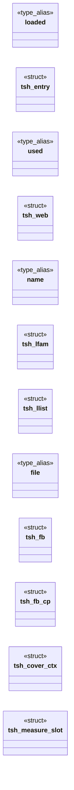
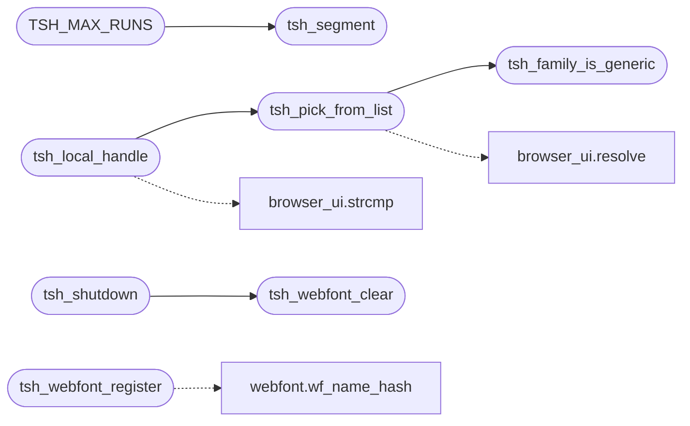

# `src/text_shape.c`

> Source: [src/text_shape.c:1](../../src/text_shape.c#L1) | language `c` | coverage 47.7% | [API index](../index.md)

## Contents

- **Structs:** [`tsh_entry`](#tsh_entry), [`tsh_web`](#tsh_web), [`tsh_lfam`](#tsh_lfam), [`tsh_llist`](#tsh_llist), [`tsh_fb`](#tsh_fb), [`tsh_fb_cp`](#tsh_fb_cp), [`tsh_cover_ctx`](#tsh_cover_ctx), [`tsh_measure_slot`](#tsh_measure_slot)
- **Type Aliases:** [`loaded`](#loaded), [`used`](#used), [`name`](#name), [`file`](#file)
- **Functions:** [`characters`](#characters), [`slice`](#slice), [`blob`](#blob), [`tsh_webfont_register`](#tsh_webfont_register), [`tsh_webfont_clear`](#tsh_webfont_clear), [`tsh_family_is_generic`](#tsh_family_is_generic), [`tsh_pick_from_list`](#tsh_pick_from_list), [`tsh_pick_family`](#tsh_pick_family), [`tsh_local_handle`](#tsh_local_handle), [`tsh_ready`](#tsh_ready), [`tsh_shape`](#tsh_shape), [`tsh_segment`](#tsh_segment), [`tsh_measure`](#tsh_measure), [`tsh_draw`](#tsh_draw), [`tsh_face`](#tsh_face), [`tsh_shutdown`](#tsh_shutdown)
- **Macros:** [`_POSIX_C_SOURCE`](#_posix_c_source), [`TSH_MAX_FONT_BYTES`](#tsh_max_font_bytes), [`TSH_CACHE_SLOTS`](#tsh_cache_slots), [`TSH_WEB_SLOTS`](#tsh_web_slots), [`TSH_WGHT_REGULAR`](#tsh_wght_regular), [`TSH_WGHT_BOLD`](#tsh_wght_bold), [`TSH_VAR_AXES_MAX`](#tsh_var_axes_max), [`TSH_SUBS_MAX`](#tsh_subs_max), [`TSH_BLANK_GLYPH`](#tsh_blank_glyph), [`TSH_FB_SLOTS`](#tsh_fb_slots), [`TSH_FB_BLOCKS`](#tsh_fb_blocks), [`TSH_FB_CP_SLOTS`](#tsh_fb_cp_slots), [`TSH_MAX_RUNS`](#tsh_max_runs), [`TSH_MEASURE_SLOTS`](#tsh_measure_slots), [`TSH_MEASURE_TEXT_MAX`](#tsh_measure_text_max)

## Type Diagram



## Call Graph

Solid arrows stay in this module, dashed arrows leave it.



## Structs

<a id="tsh_entry"></a>

### `tsh_entry`

`struct` | [src/text_shape.c:39](../../src/text_shape.c#L39)

```c
typedef struct tsh_entry
```

---

<a id="tsh_web"></a>

### `tsh_web`

`struct` | [src/text_shape.c:229](../../src/text_shape.c#L229)

```c
typedef struct tsh_web
```

---

<a id="tsh_lfam"></a>

### `tsh_lfam`

`struct` | [src/text_shape.c:586](../../src/text_shape.c#L586)

```c
typedef struct tsh_lfam
```

---

<a id="tsh_llist"></a>

### `tsh_llist`

`struct` | [src/text_shape.c:592](../../src/text_shape.c#L592)

```c
typedef struct tsh_llist
```

---

<a id="tsh_fb"></a>

### `tsh_fb`

`struct` | [src/text_shape.c:788](../../src/text_shape.c#L788)

```c
typedef struct tsh_fb
```

---

<a id="tsh_fb_cp"></a>

### `tsh_fb_cp`

`struct` | [src/text_shape.c:804](../../src/text_shape.c#L804)

```c
typedef struct
```

Per-code-point verdicts of fb_entry.

The block cache above only remembers which face a 256-code-point block asked for first; a code point that face lacks used to go back to fontconfig on every occurrence (Wikipedia: a third of its render time). Direct-mapped, * stale entries simply miss. define TSH_FB_CP_SLOTS 1024u

---

<a id="tsh_cover_ctx"></a>

### `tsh_cover_ctx`

`struct` | [src/text_shape.c:932](../../src/text_shape.c#L932)

```c
typedef struct tsh_cover_ctx
```

---

<a id="tsh_measure_slot"></a>

### `tsh_measure_slot`

`struct` | [src/text_shape.c:1063](../../src/text_shape.c#L1063)

```c
typedef struct
```

Memoized measures.

A page measures the same words over and over (every line break decision, every flex basis probe), and each miss is a HarfBuzz shape plus fontconfig coverage lookups. * Direct-mapped; the key is the RESOLVED face, so two descriptors that land on one face share. define TSH_MEASURE_SLOTS 4096u define TSH_MEASURE_TEXT_MAX 48u

---

## Type Aliases

<a id="loaded"></a>

### `loaded`

`type_alias` | [src/text_shape.c:38](../../src/text_shape.c#L38)

```c
typedef struct tsh_entry { int loaded;
```

One resolved face per (family, bold, italic). family is a CSS_FF_* bucket * (0..CSS_FF_FANTASY); idx = family*4 + bold*2 + italic. define TSH_CACHE_SLOTS ((CSS_FF_FANTASY + 1) * 4)

---

<a id="used"></a>

### `used`

`type_alias` | [src/text_shape.c:228](../../src/text_shape.c#L228)

```c
typedef struct tsh_web { int used;
```

Per-document @font-face table (spec/webfont.md): registered by the trusted parent from policy-gated fetches, keyed by (name hash, bold, italic).

Memory only, freed by tsh_webfont_clear (navigation) and tsh_shutdown. Never the * worker: shaping a registered face runs on the painter side like every face. define TSH_WEB_SLOTS 32

---

<a id="name"></a>

### `name`

`type_alias` | [src/text_shape.c:585](../../src/text_shape.c#L585)

```c
typedef struct tsh_lfam { char name[TSH_FAMILY_MAX];
```

---

<a id="file"></a>

### `file`

`type_alias` | [src/text_shape.c:787](../../src/text_shape.c#L787)

```c
typedef struct tsh_fb { char file[512];
```

Fallback faces, one per font file fontconfig picked (bold/italic folded into the match).

The block cache maps (code point >> 8, bold) to a slot + 1, or -1 * for "no installed face covers this block" (0 = not asked yet). define TSH_FB_SLOTS 24 define TSH_FB_BLOCKS (0x110000u >> 8)

---

## Functions

<a id="characters"></a>

### `characters`

`function` | [src/text_shape.c:138](../../src/text_shape.c#L138)

```c
* hold characters ('-', ':') that the pattern syntax treats specially. */ static int load_entry_file(tsh_entry *e, const char *path, int index);
```

**Parameters**

| Name | Type | Default | Description |
|---|---|---|---|
| `'-'` |  |  |  |
| `':'` |  |  |  |

**Returns:** `* hold`

---

<a id="slice"></a>

### `slice`

`function` | [src/text_shape.c:251](../../src/text_shape.c#L251)

```c
* woff2 slice (spec/webfont.md);
```

**Parameters**

| Name | Type | Default | Description |
|---|---|---|---|
| `md` | `spec/webfont.` |  |  |

**Returns:** `* woff2`

---

<a id="blob"></a>

### `blob`

`function` | [src/text_shape.c:333](../../src/text_shape.c#L333)

```c
* blob (it shaped every character to .notdef): its face is built over the tables * FreeType already decoded. A bare sfnt keeps the blob path. */ int container = (nbytes >= 4 && copy[0] == 'w' && copy[
```

**Parameters**

| Name | Type | Default | Description |
|---|---|---|---|
| `notdef` | `it shaped every character to .` |  |  |

**Returns:** `its face is built over the tables * FreeType already decoded. A bare sfnt keeps the blob path. */ int container`

*Called by:* [`PQS_CT_LEN`](include.pq_seal.h.md#pqs_ct_len)

---

<a id="tsh_webfont_register"></a>

### `tsh_webfont_register`

`function` | [src/text_shape.c:371](../../src/text_shape.c#L371)

```c
int tsh_webfont_register(const char *name, const unsigned char *bytes, size_t nbytes, int bold, int italic)
```

Registers one fetched @font-face for this document (spec/webfont.md): name is the author family (hashed with wf_name_hash), bytes the validated font program (copied; caller keeps ownership).

Re-registering a key replaces it. Returns 0 on success, -1 fail-closed (NULL/empty/oversize args, bad magic, unparseable bytes, table full). Trusted side only; never the worker.

**Parameters**

| Name | Type | Default | Description |
|---|---|---|---|
| `name` | `char *` |  |  |
| `bytes` | `unsigned char *` |  |  |
| `nbytes` | `size_t` |  |  |
| `bold` | `int` |  |  |
| `italic` | `int` |  |  |

**Returns:** `int`

> **Inherited:** Documentation from [`tsh_webfont_register`](#tsh_webfont_register) (include/text_shape.h:114).

*Calls:* [`wf_name_hash`](include.webfont.h.md#wf_name_hash)

---

<a id="tsh_webfont_clear"></a>

### `tsh_webfont_clear`

`function` | [src/text_shape.c:428](../../src/text_shape.c#L428)

```c
void tsh_webfont_clear(void)
```

Drops every registered webfont (document teardown / navigation).

Idempotent, NULL-safe by construction (no args). tsh_shutdown also clears the table.

> **Inherited:** Documentation from [`tsh_webfont_clear`](#tsh_webfont_clear) (include/text_shape.h:120).

*Called by:* [`tsh_shutdown`](#tsh_shutdown)

---

<a id="tsh_family_is_generic"></a>

### `tsh_family_is_generic`

`function` | [src/text_shape.c:468](../../src/text_shape.c#L468)

```c
int tsh_family_is_generic(const char *name)
```

1 for a CSS generic family keyword (serif, sans-serif, monospace, cursive, fantasy, system-ui, ui-*, emoji, math, fangsong), case-insensitive.

Pure.

**Parameters**

| Name | Type | Default | Description |
|---|---|---|---|
| `name` | `char *` |  |  |

**Returns:** `int`

> **Inherited:** Documentation from [`tsh_family_is_generic`](#tsh_family_is_generic) (include/text_shape.h:52).

*Called by:* [`tsh_pick_from_list`](#tsh_pick_from_list)

---

<a id="tsh_pick_from_list"></a>

### `tsh_pick_from_list`

`function` | [src/text_shape.c:480](../../src/text_shape.c#L480)

```c
int tsh_pick_from_list(const char *list, tsh_name_resolver resolve, void *ctx, char *out, size_t cap)
```

**Parameters**

| Name | Type | Default | Description |
|---|---|---|---|
| `list` | `char *` |  |  |
| `resolve` | `tsh_name_resolver` |  |  |
| `ctx` | `void *` |  |  |
| `out` | `char *` |  |  |
| `cap` | `size_t` |  |  |

**Returns:** `int`

*Calls:* [`resolve`](gui.browser_ui.c.md#resolve), [`tsh_family_is_generic`](#tsh_family_is_generic)

*Called by:* [`tsh_local_handle`](#tsh_local_handle)

---

<a id="tsh_pick_family"></a>

### `tsh_pick_family`

`function` `const` | [src/text_shape.c:501](../../src/text_shape.c#L501)

```c
const char *tsh_pick_family(const char *req, const char *const *subs, const int *strong, size_t n, int (*installed)(const char *name, void *ctx), void *ctx)
```

The acceptance rule for one requested name given fontconfig's substituted family list subs[0..n) and their bindings (strong[k] != 0 for a strong/same binding): req itself when installed, else the first INSTALLED entry of the leading run of strong substitutes; a weak substitute ends the run.

Returns the chosen name or NULL. Pure (installed is injected).

**Parameters**

| Name | Type | Default | Description |
|---|---|---|---|
| `req` | `char *` |  |  |
| `subs` | `char *const *` |  |  |
| `strong` | `int *` |  |  |
| `n` | `size_t` |  |  |
| `ctx` | `int (*installed)(const char *name, void * )` |  |  |
| `ctx` | `void *` |  |  |

**Returns:** `char *`

> **Inherited:** Documentation from [`tsh_pick_family`](#tsh_pick_family) (include/text_shape.h:68).

---

<a id="tsh_local_handle"></a>

### `tsh_local_handle`

`function` | [src/text_shape.c:621](../../src/text_shape.c#L621)

```c
int tsh_local_handle(const char *list)
```

Handle (>0) for an author family list that resolves to a local family, cached per list; 0 when nothing resolves, the list is NULL/empty, or a cap is hit (the caller then uses the bucket).

Trusted side only.

**Parameters**

| Name | Type | Default | Description |
|---|---|---|---|
| `list` | `char *` |  |  |

**Returns:** `int`

> **Inherited:** Documentation from [`tsh_local_handle`](#tsh_local_handle) (include/text_shape.h:75).

*Calls:* [`strcmp`](gui.browser_ui.c.md#strcmp), [`tsh_pick_from_list`](#tsh_pick_from_list)

---

<a id="tsh_ready"></a>

### `tsh_ready`

`function` | [src/text_shape.c:672](../../src/text_shape.c#L672)

```c
int tsh_ready(void)
```

1 once a fallback (sans) font resolves; lazily initialises on first call.

0 means no font backend: the caller must use the toy-API path.

**Returns:** `int`

> **Inherited:** Documentation from [`tsh_ready`](#tsh_ready) (include/text_shape.h:89).

---

<a id="tsh_shape"></a>

### `tsh_shape`

`function` | [src/text_shape.c:677](../../src/text_shape.c#L677)

```c
tsh_status tsh_shape(const tsh_font *f, double px, const char *text, size_t len, cairo_glyph_t *out, size_t cap, size_t *out_n, double *out_adv)
```

**Parameters**

| Name | Type | Default | Description |
|---|---|---|---|
| `f` | `tsh_font *` |  |  |
| `px` | `double` |  |  |
| `text` | `char *` |  |  |
| `len` | `size_t` |  |  |
| `out` | `cairo_glyph_t *` |  |  |
| `cap` | `size_t` |  |  |
| `out_n` | `size_t *` |  |  |
| `out_adv` | `double *` |  |  |

**Returns:** `tsh_status`

---

<a id="tsh_segment"></a>

### `tsh_segment`

`function` | [src/text_shape.c:759](../../src/text_shape.c#L759)

```c
int tsh_segment(const char *text, size_t len, tsh_cover_fn cover, void *ctx, tsh_run *runs, size_t cap)
```

**Parameters**

| Name | Type | Default | Description |
|---|---|---|---|
| `text` | `char *` |  |  |
| `len` | `size_t` |  |  |
| `cover` | `tsh_cover_fn` |  |  |
| `ctx` | `void *` |  |  |
| `runs` | `tsh_run *` |  |  |
| `cap` | `size_t` |  |  |

**Returns:** `int`

*Called by:* [`TSH_MAX_RUNS`](#tsh_max_runs)

---

<a id="tsh_measure"></a>

### `tsh_measure`

`function` | [src/text_shape.c:1073](../../src/text_shape.c#L1073)

```c
double tsh_measure(const tsh_font *f, double px, const char *text, size_t len)
```

Total advance (px) of [text,len).

Returns < 0.0 on any failure so the caller can fall back to the toy-API measurement.

**Parameters**

| Name | Type | Default | Description |
|---|---|---|---|
| `f` | `tsh_font *` |  |  |
| `px` | `double` |  |  |
| `text` | `char *` |  |  |
| `len` | `size_t` |  |  |

**Returns:** `double`

> **Inherited:** Documentation from [`tsh_measure`](#tsh_measure) (include/text_shape.h:101).

---

<a id="tsh_draw"></a>

### `tsh_draw`

`function` | [src/text_shape.c:1108](../../src/text_shape.c#L1108)

```c
tsh_status tsh_draw(cairo_t *cr, const tsh_font *f, double px, double x, double baseline, const char *text, size_t len)
```

**Parameters**

| Name | Type | Default | Description |
|---|---|---|---|
| `cr` | `cairo_t *` |  |  |
| `f` | `tsh_font *` |  |  |
| `px` | `double` |  |  |
| `x` | `double` |  |  |
| `baseline` | `double` |  |  |
| `text` | `char *` |  |  |
| `len` | `size_t` |  |  |

**Returns:** `tsh_status`

---

<a id="tsh_face"></a>

### `tsh_face`

`function` | [src/text_shape.c:1115](../../src/text_shape.c#L1115)

```c
cairo_font_face_t *tsh_face(const tsh_font *f)
```

The cairo face tsh_draw paints f with (webfont, local family or bucket), or NULL when no face resolves.

Borrowed: owned by the cache, valid until tsh_shutdown / tsh_webfont_clear. The painter selects it so cairo's font extents -- line-height: normal, ascent, descent -- are the metrics of the face that is actually drawn, not of the generic stand-in (CSS 2.1 10.8.1).

**Parameters**

| Name | Type | Default | Description |
|---|---|---|---|
| `f` | `tsh_font *` |  |  |

**Returns:** `cairo_font_face_t *`

> **Inherited:** Documentation from [`tsh_face`](#tsh_face) (include/text_shape.h:127).

---

<a id="tsh_shutdown"></a>

### `tsh_shutdown`

`function` | [src/text_shape.c:1121](../../src/text_shape.c#L1121)

```c
void tsh_shutdown(void)
```

Releases cached faces / blobs / FreeType library (leak hygiene; tests).

> **Inherited:** Documentation from [`tsh_shutdown`](#tsh_shutdown) (include/text_shape.h:143).

*Calls:* [`tsh_webfont_clear`](#tsh_webfont_clear)

---

## Macros

<a id="_posix_c_source"></a>

### `_POSIX_C_SOURCE`

`macro` | [src/text_shape.c:12](../../src/text_shape.c#L12)

```c
#define _POSIX_C_SOURCE
```

---

<a id="tsh_max_font_bytes"></a>

### `TSH_MAX_FONT_BYTES`

`macro` | [src/text_shape.c:33](../../src/text_shape.c#L33)

```c
#define TSH_MAX_FONT_BYTES
```

A single font file should never exceed this (CJK faces are the large case).

---

<a id="tsh_cache_slots"></a>

### `TSH_CACHE_SLOTS`

`macro` | [src/text_shape.c:37](../../src/text_shape.c#L37)

```c
#define TSH_CACHE_SLOTS
```

One resolved face per (family, bold, italic). family is a CSS_FF_* bucket (0..CSS_FF_FANTASY); idx = family*4 + bold*2 + italic.

---

<a id="tsh_web_slots"></a>

### `TSH_WEB_SLOTS`

`macro` | [src/text_shape.c:227](../../src/text_shape.c#L227)

```c
#define TSH_WEB_SLOTS
```

Per-document @font-face table (spec/webfont.md): registered by the trusted parent from policy-gated fetches, keyed by (name hash, bold, italic).

Memory only, freed by tsh_webfont_clear (navigation) and tsh_shutdown. Never the worker: shaping a registered face runs on the painter side like every face.

---

<a id="tsh_wght_regular"></a>

### `TSH_WGHT_REGULAR`

`macro` | [src/text_shape.c:267](../../src/text_shape.c#L267)

```c
#define TSH_WGHT_REGULAR
```

Weights a variable face is instanced at (spec/webfont.md): the regular and the bold key of the registry.

---

<a id="tsh_wght_bold"></a>

### `TSH_WGHT_BOLD`

`macro` | [src/text_shape.c:268](../../src/text_shape.c#L268)

```c
#define TSH_WGHT_BOLD
```

---

<a id="tsh_var_axes_max"></a>

### `TSH_VAR_AXES_MAX`

`macro` | [src/text_shape.c:269](../../src/text_shape.c#L269)

```c
#define TSH_VAR_AXES_MAX
```

---

<a id="tsh_subs_max"></a>

### `TSH_SUBS_MAX`

`macro` | [src/text_shape.c:528](../../src/text_shape.c#L528)

```c
#define TSH_SUBS_MAX
```

---

<a id="tsh_blank_glyph"></a>

### `TSH_BLANK_GLYPH`

`macro` | [src/text_shape.c:743](../../src/text_shape.c#L743)

```c
#define TSH_BLANK_GLYPH
```

---

<a id="tsh_fb_slots"></a>

### `TSH_FB_SLOTS`

`macro` | [src/text_shape.c:785](../../src/text_shape.c#L785)

```c
#define TSH_FB_SLOTS
```

Fallback faces, one per font file fontconfig picked (bold/italic folded into the match).

The block cache maps (code point >> 8, bold) to a slot + 1, or -1 for "no installed face covers this block" (0 = not asked yet).

---

<a id="tsh_fb_blocks"></a>

### `TSH_FB_BLOCKS`

`macro` | [src/text_shape.c:786](../../src/text_shape.c#L786)

```c
#define TSH_FB_BLOCKS
```

---

<a id="tsh_fb_cp_slots"></a>

### `TSH_FB_CP_SLOTS`

`macro` | [src/text_shape.c:803](../../src/text_shape.c#L803)

```c
#define TSH_FB_CP_SLOTS
```

Per-code-point verdicts of fb_entry.

The block cache above only remembers which face a 256-code-point block asked for first; a code point that face lacks used to go back to fontconfig on every occurrence (Wikipedia: a third of its render time). Direct-mapped, stale entries simply miss.

---

<a id="tsh_max_runs"></a>

### `TSH_MAX_RUNS`

`macro` | [src/text_shape.c:988](../../src/text_shape.c#L988)

```c
#define TSH_MAX_RUNS
```

*Calls:* [`tsh_segment`](#tsh_segment)

---

<a id="tsh_measure_slots"></a>

### `TSH_MEASURE_SLOTS`

`macro` | [src/text_shape.c:1061](../../src/text_shape.c#L1061)

```c
#define TSH_MEASURE_SLOTS
```

Memoized measures.

A page measures the same words over and over (every line break decision, every flex basis probe), and each miss is a HarfBuzz shape plus fontconfig coverage lookups. Direct-mapped; the key is the RESOLVED face, so two descriptors that land on one face share.

---

<a id="tsh_measure_text_max"></a>

### `TSH_MEASURE_TEXT_MAX`

`macro` | [src/text_shape.c:1062](../../src/text_shape.c#L1062)

```c
#define TSH_MEASURE_TEXT_MAX
```

---
