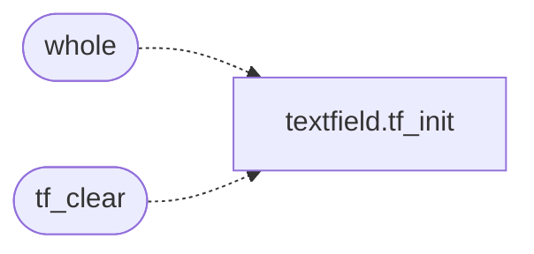

# `src/textfield.c`

> Source: [src/textfield.c:1](../../src/textfield.c#L1) | language `c` | coverage 46.2% | [API index](../index.md)

## Contents

- **Functions:** [`whole`](#whole), [`tf_clear`](#tf_clear), [`tf_set`](#tf_set), [`tf_insert`](#tf_insert), [`tf_backspace`](#tf_backspace), [`tf_delete`](#tf_delete), [`tf_move`](#tf_move), [`tf_home`](#tf_home), [`tf_end`](#tf_end), [`tf_text`](#tf_text), [`tf_len`](#tf_len), [`tf_cursor`](#tf_cursor)

## Call Graph

Solid arrows stay in this module, dashed arrows leave it.



## Functions

<a id="whole"></a>

### `whole`

`function` | [src/textfield.c:6](../../src/textfield.c#L6)

```c
* the buffer is rejected whole (fail closed), never applied partially. */ #include "textfield.h...
```

**Parameters**

| Name | Type | Default | Description |
|---|---|---|---|
| `closed` | `fail` |  |  |

**Returns:** `* the buffer is rejected`

*Calls:* [`tf_init`](include.textfield.h.md#tf_init)

---

<a id="tf_clear"></a>

### `tf_clear`

`function` | [src/textfield.c:20](../../src/textfield.c#L20)

```c
void tf_clear(tf_field *f)
```

Empties the field (cursor at 0).

NULL-safe.

**Parameters**

| Name | Type | Default | Description |
|---|---|---|---|
| `f` | `tf_field *` |  |  |

> **Inherited:** Documentation from [`tf_clear`](#tf_clear) (include/textfield.h:45).

*Calls:* [`tf_init`](include.textfield.h.md#tf_init)

---

<a id="tf_set"></a>

### `tf_set`

`function` | [src/textfield.c:24](../../src/textfield.c#L24)

```c
tf_status tf_set(tf_field *f, const char *s)
```

**Parameters**

| Name | Type | Default | Description |
|---|---|---|---|
| `f` | `tf_field *` |  |  |
| `s` | `char *` |  |  |

**Returns:** `tf_status`

---

<a id="tf_insert"></a>

### `tf_insert`

`function` | [src/textfield.c:35](../../src/textfield.c#L35)

```c
tf_status tf_insert(tf_field *f, char c)
```

**Parameters**

| Name | Type | Default | Description |
|---|---|---|---|
| `f` | `tf_field *` |  |  |
| `c` | `char` |  |  |

**Returns:** `tf_status`

---

<a id="tf_backspace"></a>

### `tf_backspace`

`function` | [src/textfield.c:47](../../src/textfield.c#L47)

```c
void tf_backspace(tf_field *f)
```

Deletes the byte before the cursor (no-op at the start).

NULL-safe.

**Parameters**

| Name | Type | Default | Description |
|---|---|---|---|
| `f` | `tf_field *` |  |  |

> **Inherited:** Documentation from [`tf_backspace`](#tf_backspace) (include/textfield.h:53).

---

<a id="tf_delete"></a>

### `tf_delete`

`function` | [src/textfield.c:55](../../src/textfield.c#L55)

```c
void tf_delete(tf_field *f)
```

Deletes the byte at the cursor (no-op at the end).

NULL-safe.

**Parameters**

| Name | Type | Default | Description |
|---|---|---|---|
| `f` | `tf_field *` |  |  |

> **Inherited:** Documentation from [`tf_delete`](#tf_delete) (include/textfield.h:56).

---

<a id="tf_move"></a>

### `tf_move`

`function` | [src/textfield.c:62](../../src/textfield.c#L62)

```c
void tf_move(tf_field *f, long delta)
```

Moves the cursor by delta, saturating to [0, len].

NULL-safe.

**Parameters**

| Name | Type | Default | Description |
|---|---|---|---|
| `f` | `tf_field *` |  |  |
| `delta` | `long` |  |  |

> **Inherited:** Documentation from [`tf_move`](#tf_move) (include/textfield.h:59).

---

<a id="tf_home"></a>

### `tf_home`

`function` | [src/textfield.c:73](../../src/textfield.c#L73)

```c
void tf_home(tf_field *f)
```

Moves the cursor to the start / end.

NULL-safe.

**Parameters**

| Name | Type | Default | Description |
|---|---|---|---|
| `f` | `tf_field *` |  |  |

> **Inherited:** Documentation from [`tf_home`](#tf_home) (include/textfield.h:62).

---

<a id="tf_end"></a>

### `tf_end`

`function` | [src/textfield.c:78](../../src/textfield.c#L78)

```c
void tf_end(tf_field *f)
```

**Parameters**

| Name | Type | Default | Description |
|---|---|---|---|
| `f` | `tf_field *` |  |  |

---

<a id="tf_text"></a>

### `tf_text`

`function` `const` | [src/textfield.c:83](../../src/textfield.c#L83)

```c
const char *tf_text(const tf_field *f)
```

Read accessors.

NULL-safe (return ""/0).

**Parameters**

| Name | Type | Default | Description |
|---|---|---|---|
| `f` | `tf_field *` |  |  |

**Returns:** `char *`

> **Inherited:** Documentation from [`tf_text`](#tf_text) (include/textfield.h:66).

---

<a id="tf_len"></a>

### `tf_len`

`function` | [src/textfield.c:87](../../src/textfield.c#L87)

```c
size_t tf_len(const tf_field *f)
```

**Parameters**

| Name | Type | Default | Description |
|---|---|---|---|
| `f` | `tf_field *` |  |  |

**Returns:** `size_t`

---

<a id="tf_cursor"></a>

### `tf_cursor`

`function` | [src/textfield.c:91](../../src/textfield.c#L91)

```c
size_t tf_cursor(const tf_field *f)
```

**Parameters**

| Name | Type | Default | Description |
|---|---|---|---|
| `f` | `tf_field *` |  |  |

**Returns:** `size_t`

---
