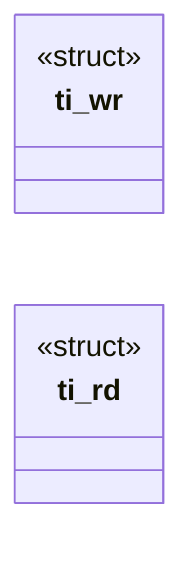

# `src/tls_impersonate.c`

> Source: [src/tls_impersonate.c:1](../../src/tls_impersonate.c#L1) | language `c` | coverage 10.0% | [API index](../index.md)

## Contents

- **Structs:** [`ti_wr`](#ti_wr), [`ti_rd`](#ti_rd)
- **Functions:** [`ti_should_impersonate`](#ti_should_impersonate), [`ti_encode_req`](#ti_encode_req), [`ti_decode_req`](#ti_decode_req), [`ti_req_free`](#ti_req_free), [`ti_encode_resp`](#ti_encode_resp), [`ti_decode_resp`](#ti_decode_resp), [`ti_resp_free`](#ti_resp_free)

## Type Diagram



## Structs

<a id="ti_wr"></a>

### `ti_wr`

`struct` | [src/tls_impersonate.c:33](../../src/tls_impersonate.c#L33)

```c
typedef struct { uint8_t *p; size_t cap; size_t off; int ovf; } ti_wr;
```

---

<a id="ti_rd"></a>

### `ti_rd`

`struct` `const` | [src/tls_impersonate.c:63](../../src/tls_impersonate.c#L63)

```c
typedef struct { const uint8_t *p; size_t len; size_t off; int err; } ti_rd;
```

---

## Functions

<a id="ti_should_impersonate"></a>

### `ti_should_impersonate`

`function` | [src/tls_impersonate.c:18](../../src/tls_impersonate.c#L18)

```c
int ti_should_impersonate(int host_in_allowlist, int host_js_enabled, int user_opt_in)
```

The double opt-in + user-flag gate (pure).

Returns 1 IFF all three signals are set: host_in_allowlist  — an explicit allow.conf entry (hb_is_allowlisted) host_js_enabled    — JS permitted for this host (js_policy / js.conf) user_opt_in        — explicit user decision for this run (CLI --impersonate or FREEDOM_IMPERSONATE=1; future vendored curl-impersonate / BoringSSL helper also gated here, never by default) Any zero => 0 (fail-closed: the default hardened OpenSSL path is used). A global JSP_ON does NOT substitute for the explicit allow.conf entry. No impersonate.conf.

**Parameters**

| Name | Type | Default | Description |
|---|---|---|---|
| `host_in_allowlist` | `int` |  |  |
| `host_js_enabled` | `int` |  |  |
| `user_opt_in` | `int` |  |  |

**Returns:** `int`

> **Inherited:** Documentation from [`ti_should_impersonate`](#ti_should_impersonate) (include/tls_impersonate.h:56).

---

<a id="ti_encode_req"></a>

### `ti_encode_req`

`function` | [src/tls_impersonate.c:122](../../src/tls_impersonate.c#L122)

```c
size_t ti_encode_req(const ti_req *r, uint8_t *out, size_t out_cap)
```

**Parameters**

| Name | Type | Default | Description |
|---|---|---|---|
| `r` | `ti_req *` |  |  |
| `out` | `uint8_t *` |  |  |
| `out_cap` | `size_t` |  |  |

**Returns:** `size_t`

---

<a id="ti_decode_req"></a>

### `ti_decode_req`

`function` | [src/tls_impersonate.c:140](../../src/tls_impersonate.c#L140)

```c
int ti_decode_req(const uint8_t *in, size_t len, ti_req *out)
```

**Parameters**

| Name | Type | Default | Description |
|---|---|---|---|
| `in` | `uint8_t *` |  |  |
| `len` | `size_t` |  |  |
| `out` | `ti_req *` |  |  |

**Returns:** `int`

---

<a id="ti_req_free"></a>

### `ti_req_free`

`function` | [src/tls_impersonate.c:166](../../src/tls_impersonate.c#L166)

```c
void ti_req_free(ti_req *r)
```

**Parameters**

| Name | Type | Default | Description |
|---|---|---|---|
| `r` | `ti_req *` |  |  |

---

<a id="ti_encode_resp"></a>

### `ti_encode_resp`

`function` | [src/tls_impersonate.c:177](../../src/tls_impersonate.c#L177)

```c
size_t ti_encode_resp(const ti_resp *r, uint8_t *out, size_t out_cap)
```

**Parameters**

| Name | Type | Default | Description |
|---|---|---|---|
| `r` | `ti_resp *` |  |  |
| `out` | `uint8_t *` |  |  |
| `out_cap` | `size_t` |  |  |

**Returns:** `size_t`

---

<a id="ti_decode_resp"></a>

### `ti_decode_resp`

`function` | [src/tls_impersonate.c:196](../../src/tls_impersonate.c#L196)

```c
int ti_decode_resp(const uint8_t *in, size_t len, ti_resp *out)
```

**Parameters**

| Name | Type | Default | Description |
|---|---|---|---|
| `in` | `uint8_t *` |  |  |
| `len` | `size_t` |  |  |
| `out` | `ti_resp *` |  |  |

**Returns:** `int`

---

<a id="ti_resp_free"></a>

### `ti_resp_free`

`function` | [src/tls_impersonate.c:230](../../src/tls_impersonate.c#L230)

```c
void ti_resp_free(ti_resp *r)
```

**Parameters**

| Name | Type | Default | Description |
|---|---|---|---|
| `r` | `ti_resp *` |  |  |

---
