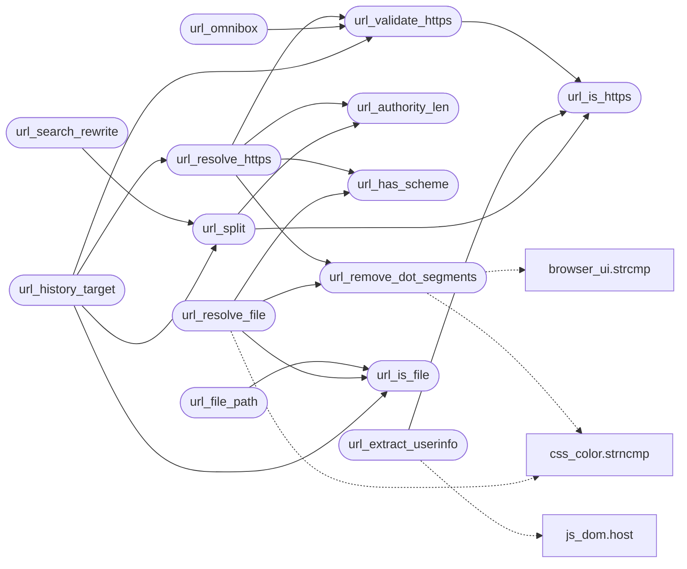

# `src/url.c`

> Source: [src/url.c:1](../../src/url.c#L1) | language `c` | coverage 23.5% | [API index](../index.md)

## Contents

- **Functions:** [`url_has_scheme`](#url_has_scheme), [`url_is_https`](#url_is_https), [`url_validate_https`](#url_validate_https), [`url_authority_len`](#url_authority_len), [`url_remove_dot_segments`](#url_remove_dot_segments), [`url_resolve_https`](#url_resolve_https), [`assumed`](#assumed), [`url_omnibox`](#url_omnibox), [`url_search_rewrite`](#url_search_rewrite), [`url_extract_userinfo`](#url_extract_userinfo), [`url_is_file`](#url_is_file), [`url_file_path`](#url_file_path), [`url_resolve_file`](#url_resolve_file), [`url_split`](#url_split), [`url_history_target`](#url_history_target)
- **Macros:** [`_POSIX_C_SOURCE`](#_posix_c_source)

## Call Graph

Solid arrows stay in this module, dashed arrows leave it.



## Functions

<a id="url_has_scheme"></a>

### `url_has_scheme`

`function` | [src/url.c:59](../../src/url.c#L59)

```c
int url_has_scheme(const char *s)
```

Nonzero iff s begins with "<scheme>:" per RFC 3986 (ALPHA *( ALPHA / DIGIT / "+" / "-" / "." ) ":").

NULL => 0.

**Parameters**

| Name | Type | Default | Description |
|---|---|---|---|
| `s` | `char *` |  |  |

**Returns:** `int`

> **Inherited:** Documentation from [`url_has_scheme`](#url_has_scheme) (include/url.h:46).

*Called by:* [`url_resolve_file`](#url_resolve_file), [`url_resolve_https`](#url_resolve_https)

---

<a id="url_is_https"></a>

### `url_is_https`

`function` | [src/url.c:73](../../src/url.c#L73)

```c
int url_is_https(const char *s)
```

Nonzero iff s begins (case-insensitively) with "https://" and the host is neither empty nor a leading '/'.

NULL => 0.

**Parameters**

| Name | Type | Default | Description |
|---|---|---|---|
| `s` | `char *` |  |  |

**Returns:** `int`

> **Inherited:** Documentation from [`url_is_https`](#url_is_https) (include/url.h:42).

*Called by:* [`url_extract_userinfo`](#url_extract_userinfo), [`url_split`](#url_split), [`url_validate_https`](#url_validate_https)

---

<a id="url_validate_https"></a>

### `url_validate_https`

`function` | [src/url.c:80](../../src/url.c#L80)

```c
url_status url_validate_https(const char *url)
```

**Parameters**

| Name | Type | Default | Description |
|---|---|---|---|
| `url` | `char *` |  |  |

**Returns:** `url_status`

*Calls:* [`url_is_https`](#url_is_https)

*Called by:* [`fm_build`](src.form.c.md#fm_build), [`sf_validate_url`](src.secure_fetch.c.md#sf_validate_url), [`url_history_target`](#url_history_target), [`url_omnibox`](#url_omnibox), [`url_resolve_https`](#url_resolve_https)

---

<a id="url_authority_len"></a>

### `url_authority_len`

`function` | [src/url.c:91](../../src/url.c#L91)

```c
size_t url_authority_len(const char *url)
```

Length of "https://host[:port]" within a validated absolute https URL: the index of the first '/', '?' or '#' after the scheme (RFC 3986 3.2), or the whole length if there is none.

Assumes url passed url_validate_https.

**Parameters**

| Name | Type | Default | Description |
|---|---|---|---|
| `url` | `char *` |  |  |

**Returns:** `size_t`

> **Inherited:** Documentation from [`url_authority_len`](#url_authority_len) (include/url.h:51).

*Called by:* [`url_resolve_https`](#url_resolve_https), [`url_split`](#url_split)

---

<a id="url_remove_dot_segments"></a>

### `url_remove_dot_segments`

`function` | [src/url.c:109](../../src/url.c#L109)

```c
url_status url_remove_dot_segments(const char *path, char *out, size_t outsz)
```

**Parameters**

| Name | Type | Default | Description |
|---|---|---|---|
| `path` | `char *` |  |  |
| `out` | `char *` |  |  |
| `outsz` | `size_t` |  |  |

**Returns:** `url_status`

*Calls:* [`strcmp`](gui.browser_ui.c.md#strcmp), [`strncmp`](src.css_color.c.md#strncmp)

*Called by:* [`url_resolve_file`](#url_resolve_file), [`url_resolve_https`](#url_resolve_https)

---

<a id="url_resolve_https"></a>

### `url_resolve_https`

`function` | [src/url.c:170](../../src/url.c#L170)

```c
url_status url_resolve_https(const char *base, const char *ref, char *out, size_t outsz)
```

**Parameters**

| Name | Type | Default | Description |
|---|---|---|---|
| `base` | `char *` |  |  |
| `ref` | `char *` |  |  |
| `out` | `char *` |  |  |
| `outsz` | `size_t` |  |  |

**Returns:** `url_status`

*Calls:* [`url_authority_len`](#url_authority_len), [`url_has_scheme`](#url_has_scheme), [`url_remove_dot_segments`](#url_remove_dot_segments), [`url_validate_https`](#url_validate_https)

*Called by:* [`ln_resolve`](src.link_nav.c.md#ln_resolve), [`rd_build`](src.render_doc.c.md#rd_build), [`sf_resolve_redirect`](src.secure_fetch.c.md#sf_resolve_redirect), [`url_history_target`](#url_history_target)

---

<a id="assumed"></a>

### `assumed`

`function` | [src/url.c:254](../../src/url.c#L254)

```c
* assumed (the caller already routed whitespace to search). */ static int looks_like_host(const c...
```

**Parameters**

| Name | Type | Default | Description |
|---|---|---|---|
| `search` | `the caller already routed whitespace to` |  |  |

**Returns:** `*`

---

<a id="url_omnibox"></a>

### `url_omnibox`

`function` | [src/url.c:309](../../src/url.c#L309)

```c
url_status url_omnibox(const char *input, url_omni_kind *kind, char *out, size_t outsz)
```

**Parameters**

| Name | Type | Default | Description |
|---|---|---|---|
| `input` | `char *` |  |  |
| `kind` | `url_omni_kind *` |  |  |
| `out` | `char *` |  |  |
| `outsz` | `size_t` |  |  |

**Returns:** `url_status`

*Calls:* [`url_validate_https`](#url_validate_https)

---

<a id="url_search_rewrite"></a>

### `url_search_rewrite`

`function` | [src/url.c:411](../../src/url.c#L411)

```c
url_status url_search_rewrite(const char *url, char *out, size_t outsz)
```

**Parameters**

| Name | Type | Default | Description |
|---|---|---|---|
| `url` | `char *` |  |  |
| `out` | `char *` |  |  |
| `outsz` | `size_t` |  |  |

**Returns:** `url_status`

*Calls:* [`url_split`](#url_split)

*Called by:* [`arrives`](gui.browser_ui.c.md#arrives), [`HL_JS_NAV_MAX`](src.freedom.c.md#hl_js_nav_max)

---

<a id="url_extract_userinfo"></a>

### `url_extract_userinfo`

`function` | [src/url.c:431](../../src/url.c#L431)

```c
url_status url_extract_userinfo(const char *url, char *out, size_t outsz, char **username_out, char **password_out)
```

**Parameters**

| Name | Type | Default | Description |
|---|---|---|---|
| `url` | `char *` |  |  |
| `out` | `char *` |  |  |
| `outsz` | `size_t` |  |  |
| `username_out` | `char **` |  |  |
| `password_out` | `char **` |  |  |

**Returns:** `url_status`

*Calls:* [`host`](include.js_dom.h.md#host), [`url_is_https`](#url_is_https)

*Called by:* [`arrives`](gui.browser_ui.c.md#arrives)

---

<a id="url_is_file"></a>

### `url_is_file`

`function` | [src/url.c:525](../../src/url.c#L525)

```c
int url_is_file(const char *s)
```

**Parameters**

| Name | Type | Default | Description |
|---|---|---|---|
| `s` | `char *` |  |  |

**Returns:** `int`

*Called by:* [`arrives`](gui.browser_ui.c.md#arrives), [`url_file_path`](#url_file_path), [`url_history_target`](#url_history_target), [`url_resolve_file`](#url_resolve_file)

---

<a id="url_file_path"></a>

### `url_file_path`

`function` `const` | [src/url.c:531](../../src/url.c#L531)

```c
const char *url_file_path(const char *s)
```

Returns the absolute filesystem path inside a "file:///path" URL (i.e. the "/path" part), or NULL when s is not a valid file:// URL.

The pointer aliases s (not owned).

**Parameters**

| Name | Type | Default | Description |
|---|---|---|---|
| `s` | `char *` |  |  |

**Returns:** `char *`

> **Inherited:** Documentation from [`url_file_path`](#url_file_path) (include/url.h:121).

*Calls:* [`url_is_file`](#url_is_file)

---

<a id="url_resolve_file"></a>

### `url_resolve_file`

`function` | [src/url.c:535](../../src/url.c#L535)

```c
url_status url_resolve_file(const char *base, const char *ref, char *out, size_t outsz)
```

**Parameters**

| Name | Type | Default | Description |
|---|---|---|---|
| `base` | `char *` |  |  |
| `ref` | `char *` |  |  |
| `out` | `char *` |  |  |
| `outsz` | `size_t` |  |  |

**Returns:** `url_status`

*Calls:* [`strncmp`](src.css_color.c.md#strncmp), [`url_has_scheme`](#url_has_scheme), [`url_is_file`](#url_is_file), [`url_remove_dot_segments`](#url_remove_dot_segments)

---

<a id="url_split"></a>

### `url_split`

`function` | [src/url.c:584](../../src/url.c#L584)

```c
url_status url_split(const char *url, url_parts *out)
```

**Parameters**

| Name | Type | Default | Description |
|---|---|---|---|
| `url` | `char *` |  |  |
| `out` | `url_parts *` |  |  |

**Returns:** `url_status`

*Calls:* [`url_authority_len`](#url_authority_len), [`url_is_https`](#url_is_https)

*Called by:* [`jl_m_hist_target`](src.js_location.c.md#jl_m_hist_target), [`url_history_target`](#url_history_target), [`url_search_rewrite`](#url_search_rewrite)

---

<a id="url_history_target"></a>

### `url_history_target`

`function` | [src/url.c:654](../../src/url.c#L654)

```c
url_status url_history_target(const char *base, const char *ref, char *out, size_t outsz)
```

**Parameters**

| Name | Type | Default | Description |
|---|---|---|---|
| `base` | `char *` |  |  |
| `ref` | `char *` |  |  |
| `out` | `char *` |  |  |
| `outsz` | `size_t` |  |  |

**Returns:** `url_status`

*Calls:* [`url_is_file`](#url_is_file), [`url_resolve_https`](#url_resolve_https), [`url_split`](#url_split), [`url_validate_https`](#url_validate_https)

*Called by:* [`jl_m_hist_target`](src.js_location.c.md#jl_m_hist_target)

---

## Macros

<a id="_posix_c_source"></a>

### `_POSIX_C_SOURCE`

`macro` | [src/url.c:9](../../src/url.c#L9)

```c
#define _POSIX_C_SOURCE
```

---
