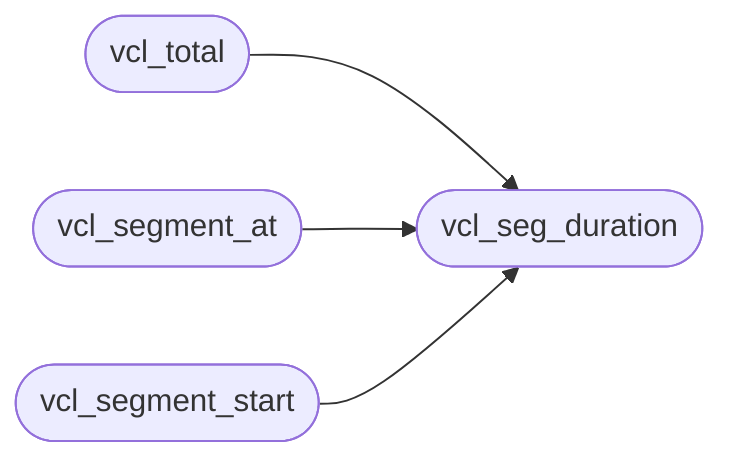

# `src/video_controls.c`

> Source: [src/video_controls.c:1](../../src/video_controls.c#L1) | language `c` | coverage 70.0% | [API index](../index.md)

## Contents

- **Functions:** [`vcl_layout`](#vcl_layout), [`vcl_clamp_frac`](#vcl_clamp_frac), [`vcl_hit`](#vcl_hit), [`vcl_seg_duration`](#vcl_seg_duration), [`vcl_total`](#vcl_total), [`vcl_segment_at`](#vcl_segment_at), [`vcl_segment_start`](#vcl_segment_start), [`vcl_position`](#vcl_position), [`vcl_format_time`](#vcl_format_time)

## Call Graph

Solid arrows stay in this module, dashed arrows leave it.



## Functions

<a id="vcl_layout"></a>

### `vcl_layout`

`function` | [src/video_controls.c:15](../../src/video_controls.c#L15)

```c
int vcl_layout(double x, double y, double w, double h, vcl_geom *g)
```

Lays out the bar inside the video rect (x,y,w,h).

Returns 1 and fills *g, or 0 (and zeroes *g) when the rect is too small or not finite: then there is no bar.

**Parameters**

| Name | Type | Default | Description |
|---|---|---|---|
| `x` | `double` |  |  |
| `y` | `double` |  |  |
| `w` | `double` |  |  |
| `h` | `double` |  |  |
| `g` | `vcl_geom *` |  |  |

**Returns:** `int`

> **Inherited:** Documentation from [`vcl_layout`](#vcl_layout) (include/video_controls.h:47).

---

<a id="vcl_clamp_frac"></a>

### `vcl_clamp_frac`

`function` | [src/video_controls.c:34](../../src/video_controls.c#L34)

```c
double vcl_clamp_frac(double f)
```

Clamps a seek fraction to [0,1]; NaN => 0.

**Parameters**

| Name | Type | Default | Description |
|---|---|---|---|
| `f` | `double` |  |  |

**Returns:** `double`

> **Inherited:** Documentation from [`vcl_clamp_frac`](#vcl_clamp_frac) (include/video_controls.h:71).

---

<a id="vcl_hit"></a>

### `vcl_hit`

`function` | [src/video_controls.c:39](../../src/video_controls.c#L39)

```c
vcl_hit_kind vcl_hit(const vcl_geom *g, const vcl_rect *video, double px, double py, double *frac)
```

**Parameters**

| Name | Type | Default | Description |
|---|---|---|---|
| `g` | `vcl_geom *` |  |  |
| `video` | `vcl_rect *` |  |  |
| `px` | `double` |  |  |
| `py` | `double` |  |  |
| `frac` | `double *` |  |  |

*Called by:* [`LLVMFuzzerTestOneInput`](fuzz.fuzz_video_controls.c.md#llvmfuzzertestoneinput)

---

<a id="vcl_seg_duration"></a>

### `vcl_seg_duration`

`function` | [src/video_controls.c:54](../../src/video_controls.c#L54)

```c
double vcl_seg_duration(double d)
```

Sanitised duration of one segment: non-finite or negative => 0, capped.

**Parameters**

| Name | Type | Default | Description |
|---|---|---|---|
| `d` | `double` |  |  |

**Returns:** `double`

> **Inherited:** Documentation from [`vcl_seg_duration`](#vcl_seg_duration) (include/video_controls.h:55).

*Called by:* [`vcl_segment_at`](#vcl_segment_at), [`vcl_segment_start`](#vcl_segment_start), [`vcl_total`](#vcl_total)

---

<a id="vcl_total"></a>

### `vcl_total`

`function` | [src/video_controls.c:59](../../src/video_controls.c#L59)

```c
double vcl_total(const hls_playlist *pl)
```

Total duration in seconds (0 for NULL/empty).

Always finite.

**Parameters**

| Name | Type | Default | Description |
|---|---|---|---|
| `pl` | `hls_playlist *` |  |  |

**Returns:** `double`

> **Inherited:** Documentation from [`vcl_total`](#vcl_total) (include/video_controls.h:58).

*Calls:* [`vcl_seg_duration`](#vcl_seg_duration)

---

<a id="vcl_segment_at"></a>

### `vcl_segment_at`

`function` | [src/video_controls.c:66](../../src/video_controls.c#L66)

```c
size_t vcl_segment_at(const hls_playlist *pl, double t, double *start)
```

**Parameters**

| Name | Type | Default | Description |
|---|---|---|---|
| `pl` | `hls_playlist *` |  |  |
| `t` | `double` |  |  |
| `start` | `double *` |  |  |

**Returns:** `size_t`

*Calls:* [`vcl_seg_duration`](#vcl_seg_duration)

*Called by:* [`LLVMFuzzerTestOneInput`](fuzz.fuzz_video_controls.c.md#llvmfuzzertestoneinput)

---

<a id="vcl_segment_start"></a>

### `vcl_segment_start`

`function` | [src/video_controls.c:82](../../src/video_controls.c#L82)

```c
double vcl_segment_start(const hls_playlist *pl, size_t idx)
```

Start time (s) of segment idx (clamped).

**Parameters**

| Name | Type | Default | Description |
|---|---|---|---|
| `pl` | `hls_playlist *` |  |  |
| `idx` | `size_t` |  |  |

**Returns:** `double`

> **Inherited:** Documentation from [`vcl_segment_start`](#vcl_segment_start) (include/video_controls.h:65).

*Calls:* [`vcl_seg_duration`](#vcl_seg_duration)

---

<a id="vcl_position"></a>

### `vcl_position`

`function` | [src/video_controls.c:90](../../src/video_controls.c#L90)

```c
double vcl_position(double base_s, int64_t pts0_us, int64_t pts_us, double total)
```

Playback position: base_s + (pts_us - pts0_us)/1e6, clamped to [0,total].

**Parameters**

| Name | Type | Default | Description |
|---|---|---|---|
| `base_s` | `double` |  |  |
| `pts0_us` | `int64_t` |  |  |
| `pts_us` | `int64_t` |  |  |
| `total` | `double` |  |  |

**Returns:** `double`

> **Inherited:** Documentation from [`vcl_position`](#vcl_position) (include/video_controls.h:68).

---

<a id="vcl_format_time"></a>

### `vcl_format_time`

`function` | [src/video_controls.c:99](../../src/video_controls.c#L99)

```c
size_t vcl_format_time(double seconds, char *buf, size_t cap)
```

Writes "m:ss" (or "h:mm:ss" from one hour) into buf; returns the length, or 0 when buf is NULL/too small (buf then holds "" when cap > 0).

Negative/NaN => 0:00.

**Parameters**

| Name | Type | Default | Description |
|---|---|---|---|
| `seconds` | `double` |  |  |
| `buf` | `char *` |  |  |
| `cap` | `size_t` |  |  |

**Returns:** `size_t`

> **Inherited:** Documentation from [`vcl_format_time`](#vcl_format_time) (include/video_controls.h:75).

---
