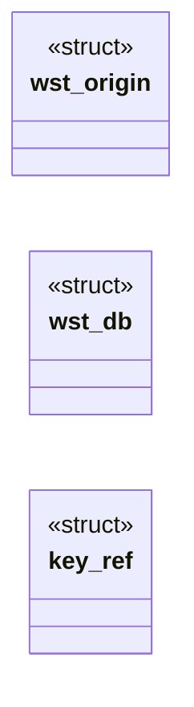

# `src/web_storage.c`

> Source: [src/web_storage.c:1](../../src/web_storage.c#L1) | language `c` | coverage 50.0% | [API index](../index.md)

## Contents

- **Structs:** [`wst_origin`](#wst_origin), [`wst_db`](#wst_db), [`key_ref`](#key_ref)
- **Functions:** [`wst_decode_check`](#wst_decode_check), [`wst_new`](#wst_new), [`wst_free`](#wst_free), [`wst_encode`](#wst_encode), [`wst_replace`](#wst_replace), [`wst_origin_bytes`](#wst_origin_bytes), [`wst_foreach`](#wst_foreach), [`wst_pack`](#wst_pack)

## Type Diagram



## Structs

<a id="wst_origin"></a>

### `wst_origin`

`struct` | [src/web_storage.c:12](../../src/web_storage.c#L12)

```c
typedef struct wst_origin
```

---

<a id="wst_db"></a>

### `wst_db`

`struct` | [src/web_storage.c:20](../../src/web_storage.c#L20)

```c
struct wst_db
```

---

<a id="key_ref"></a>

### `key_ref`

`struct` `const` | [src/web_storage.c:54](../../src/web_storage.c#L54)

```c
typedef struct key_ref { const unsigned char *p; uint32_t n; } key_ref;
```

---

## Functions

<a id="wst_decode_check"></a>

### `wst_decode_check`

`function` | [src/web_storage.c:101](../../src/web_storage.c#L101)

```c
int wst_decode_check(const char *blob, size_t len)
```

Pure validation of a snapshot: 0 when it is complete and well-formed (counts and lengths fit, total <= WST_QUOTA, keys unique, UTF-8 well-formed), else -1.

**Parameters**

| Name | Type | Default | Description |
|---|---|---|---|
| `blob` | `char *` |  |  |
| `len` | `size_t` |  |  |

**Returns:** `int`

> **Inherited:** Documentation from [`wst_decode_check`](#wst_decode_check) (include/web_storage.h:37).

---

<a id="wst_new"></a>

### `wst_new`

`function` | [src/web_storage.c:105](../../src/web_storage.c#L105)

```c
wst_db *wst_new(void)
```

Empty database, or NULL on OOM.

**Returns:** `wst_db *`

> **Inherited:** Documentation from [`wst_new`](#wst_new) (include/web_storage.h:25).

---

<a id="wst_free"></a>

### `wst_free`

`function` | [src/web_storage.c:109](../../src/web_storage.c#L109)

```c
void wst_free(wst_db *db)
```

Frees everything.

NULL is a no-op.

**Parameters**

| Name | Type | Default | Description |
|---|---|---|---|
| `db` | `wst_db *` |  |  |

> **Inherited:** Documentation from [`wst_free`](#wst_free) (include/web_storage.h:28).

---

<a id="wst_encode"></a>

### `wst_encode`

`function` | [src/web_storage.c:125](../../src/web_storage.c#L125)

```c
int wst_encode(const wst_db *db, const char *origin, char **out, size_t *len)
```

Snapshot of origin's pairs ([n:u32]([klen:u32][key][vlen:u32][val])*, little-endian) into an owned *out of *len bytes.

An unknown origin yields a valid empty snapshot. 0, or -1 on NULL args / OOM.

**Parameters**

| Name | Type | Default | Description |
|---|---|---|---|
| `db` | `wst_db *` |  |  |
| `origin` | `char *` |  |  |
| `out` | `char **` |  |  |
| `len` | `size_t *` |  |  |

**Returns:** `int`

> **Inherited:** Documentation from [`wst_encode`](#wst_encode) (include/web_storage.h:33).

---

<a id="wst_replace"></a>

### `wst_replace`

`function` | [src/web_storage.c:140](../../src/web_storage.c#L140)

```c
int wst_replace(wst_db *db, const char *origin, const char *blob, size_t len)
```

Replaces origin's contents with the snapshot after wst_decode_check.

On any failure returns -1 and the database is unchanged. A full origin table evicts the least recently used origin.

**Parameters**

| Name | Type | Default | Description |
|---|---|---|---|
| `db` | `wst_db *` |  |  |
| `origin` | `char *` |  |  |
| `blob` | `char *` |  |  |
| `len` | `size_t` |  |  |

**Returns:** `int`

> **Inherited:** Documentation from [`wst_replace`](#wst_replace) (include/web_storage.h:42).

---

<a id="wst_origin_bytes"></a>

### `wst_origin_bytes`

`function` | [src/web_storage.c:175](../../src/web_storage.c#L175)

```c
size_t wst_origin_bytes(const wst_db *db, const char *origin)
```

Key + value bytes stored for origin (0 if unknown).

**Parameters**

| Name | Type | Default | Description |
|---|---|---|---|
| `db` | `wst_db *` |  |  |
| `origin` | `char *` |  |  |

**Returns:** `size_t`

> **Inherited:** Documentation from [`wst_origin_bytes`](#wst_origin_bytes) (include/web_storage.h:59).

---

<a id="wst_foreach"></a>

### `wst_foreach`

`function` | [src/web_storage.c:181](../../src/web_storage.c#L181)

```c
int wst_foreach(const char *blob, size_t len, void (*fn)(void *ctx, const char *k...
```

**Parameters**

| Name | Type | Default | Description |
|---|---|---|---|
| `blob` | `char *` |  |  |
| `len` | `size_t` |  |  |
| `k` | `void (*fn)(void *ctx, const char * ...` |  |  |

**Returns:** `int`

*Called by:* [`jt_enable_storage`](src.js_trusted.c.md#jt_enable_storage)

---

<a id="wst_pack"></a>

### `wst_pack`

`function` | [src/web_storage.c:206](../../src/web_storage.c#L206)

```c
int wst_pack(const char *const *keys, const size_t *klens, const char *const *vals, const size_t *vlens, size_t n, char **out, size_t *len)
```

**Parameters**

| Name | Type | Default | Description |
|---|---|---|---|
| `keys` | `char *const *` |  |  |
| `klens` | `size_t *` |  |  |
| `vals` | `char *const *` |  |  |
| `vlens` | `size_t *` |  |  |
| `n` | `size_t` |  |  |
| `out` | `char **` |  |  |
| `len` | `size_t *` |  |  |

**Returns:** `int`

*Called by:* [`jt_take_storage`](src.js_trusted.c.md#jt_take_storage)

---
