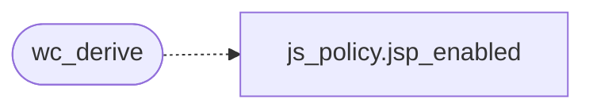

# `src/webcaps.c`

> Source: [src/webcaps.c:1](../../src/webcaps.c#L1) | language `c` | coverage 0.0% | [API index](../index.md)

## Contents

- **Functions:** [`wc_safe`](#wc_safe), [`wc_derive`](#wc_derive), [`wc_from_flags`](#wc_from_flags), [`wc_render_caps`](#wc_render_caps)

## Call Graph

Solid arrows stay in this module, dashed arrows leave it.



## Functions

<a id="wc_safe"></a>

### `wc_safe`

`function` | [src/webcaps.c:10](../../src/webcaps.c#L10)

```c
wc_caps wc_safe(void)
```

**Returns:** `wc_caps`

---

<a id="wc_derive"></a>

### `wc_derive`

`function` | [src/webcaps.c:15](../../src/webcaps.c#L15)

```c
wc_caps wc_derive(wc_input in)
```

**Parameters**

| Name | Type | Default | Description |
|---|---|---|---|
| `in` | `wc_input` |  |  |

**Returns:** `wc_caps`

*Calls:* [`jsp_enabled`](src.js_policy.c.md#jsp_enabled)

*Called by:* [`stylesheets`](gui.browser_ui.c.md#stylesheets)

---

<a id="wc_from_flags"></a>

### `wc_from_flags`

`function` | [src/webcaps.c:35](../../src/webcaps.c#L35)

```c
wc_caps wc_from_flags(bool js, bool css, bool images)
```

**Parameters**

| Name | Type | Default | Description |
|---|---|---|---|
| `js` | `bool` |  |  |
| `css` | `bool` |  |  |
| `images` | `bool` |  |  |

**Returns:** `wc_caps`

---

<a id="wc_render_caps"></a>

### `wc_render_caps`

`function` | [src/webcaps.c:46](../../src/webcaps.c#L46)

```c
rdp_caps wc_render_caps(wc_caps c)
```

**Parameters**

| Name | Type | Default | Description |
|---|---|---|---|
| `c` | `wc_caps` |  |  |

**Returns:** `rdp_caps`

---
