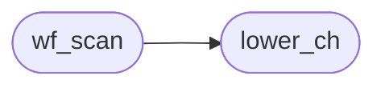

# `src/webfont.c`

> Source: [src/webfont.c:1](../../src/webfont.c#L1) | language `c` | coverage 0.0% | [API index](../index.md)

## Contents

- **Functions:** [`candidates`](#candidates), [`wf_list_free`](#wf_list_free), [`wf_ref_move`](#wf_ref_move), [`wf_supported_format`](#wf_supported_format), [`lower_ch`](#lower_ch), [`wf_scan`](#wf_scan)

## Call Graph

Solid arrows stay in this module, dashed arrows leave it.



## Functions

<a id="candidates"></a>

### `candidates`

`function` | [src/webfont.c:7](../../src/webfont.c#L7)

```c
* understanding just far enough to find candidates (family + first url() per * src entry + weight/style descriptors);
```

**Parameters**

| Name | Type | Default | Description |
|---|---|---|---|
| `descriptors` | `family + first url() per * src entry + weight/style` |  |  |

**Returns:** `* understanding just far enough to find`

---

<a id="wf_list_free"></a>

### `wf_list_free`

`function` | [src/webfont.c:49](../../src/webfont.c#L49)

```c
void wf_list_free(wf_list *l)
```

**Parameters**

| Name | Type | Default | Description |
|---|---|---|---|
| `l` | `wf_list *` |  |  |

---

<a id="wf_ref_move"></a>

### `wf_ref_move`

`function` | [src/webfont.c:64](../../src/webfont.c#L64)

```c
void wf_ref_move(wf_ref *dst, wf_ref *src)
```

**Parameters**

| Name | Type | Default | Description |
|---|---|---|---|
| `dst` | `wf_ref *` |  |  |
| `src` | `wf_ref *` |  |  |

---

<a id="wf_supported_format"></a>

### `wf_supported_format`

`function` | [src/webfont.c:74](../../src/webfont.c#L74)

```c
int wf_supported_format(const char *fmt)
```

**Parameters**

| Name | Type | Default | Description |
|---|---|---|---|
| `fmt` | `char *` |  |  |

**Returns:** `int`

---

<a id="lower_ch"></a>

### `lower_ch`

`function` | [src/webfont.c:306](../../src/webfont.c#L306)

```c
&& lower_ch(s[k]) == 's' && k + 3 < bend && lower_ch(s[k + 1]) == 'r' && lower_ch...
```

**Parameters**

| Name | Type | Default | Description |
|---|---|---|---|
| `k` | `s[ ]` |  |  |

**Returns:** `&&`

*Called by:* [`wf_scan`](#wf_scan)

---

<a id="wf_scan"></a>

### `wf_scan`

`function` | [src/webfont.c:422](../../src/webfont.c#L422)

```c
int wf_scan(const char *css, size_t len, wf_list *out)
```

**Parameters**

| Name | Type | Default | Description |
|---|---|---|---|
| `css` | `char *` |  |  |
| `len` | `size_t` |  |  |
| `out` | `wf_list *` |  |  |

**Returns:** `int`

*Calls:* [`lower_ch`](#lower_ch)

---
