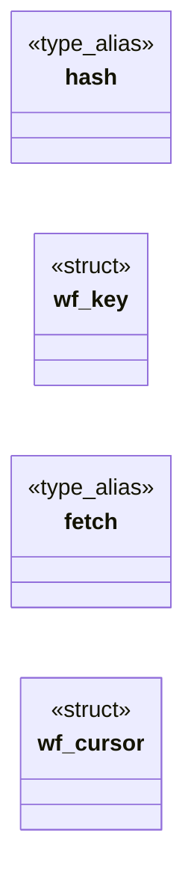
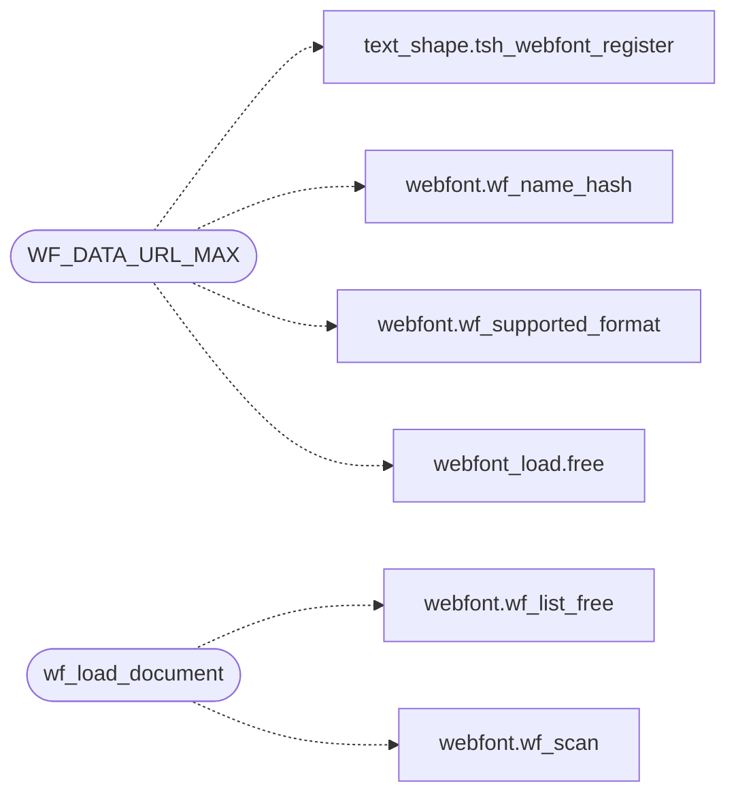

# `src/webfont_load.c`

> Source: [src/webfont_load.c:1](../../src/webfont_load.c#L1) | language `c` | coverage 55.6% | [API index](../index.md)

## Contents

- **Structs:** [`wf_key`](#wf_key), [`wf_cursor`](#wf_cursor)
- **Type Aliases:** [`hash`](#hash), [`fetch`](#fetch)
- **Functions:** [`here`](#here), [`ref`](#ref), [`wf_load_document`](#wf_load_document)
- **Macros:** [`WF_DATA_URL_MAX`](#wf_data_url_max)

## Type Diagram



## Call Graph

Solid arrows stay in this module, dashed arrows leave it.



## Structs

<a id="wf_key"></a>

### `wf_key`

`struct` | [src/webfont_load.c:46](../../src/webfont_load.c#L46)

```c
typedef struct wf_key
```

Per-key attempt state for in-src-list fallback.

---

<a id="wf_cursor"></a>

### `wf_cursor`

`struct` | [src/webfont_load.c:56](../../src/webfont_load.c#L56)

```c
typedef struct wf_cursor
```

Loader cursor: keys, budgets and counters shared across sheets so first-wins and caps hold document-wide, not per sheet.

---

## Type Aliases

<a id="hash"></a>

### `hash`

`type_alias` | [src/webfont_load.c:46](../../src/webfont_load.c#L46)

```c
typedef struct wf_key { unsigned hash;
```

Per-key attempt state for in-src-list fallback.

---

<a id="fetch"></a>

### `fetch`

`type_alias` | [src/webfont_load.c:56](../../src/webfont_load.c#L56)

```c
typedef struct wf_cursor { wf_fetch_fn fetch;
```

Loader cursor: keys, budgets and counters shared across sheets so first-wins and caps hold document-wide, not per sheet.

---

## Functions

<a id="here"></a>

### `here`

`function` | [src/webfont_load.c:22](../../src/webfont_load.c#L22)

```c
* filtered here (a "" hint may still name one);
```

**Parameters**

| Name | Type | Default | Description |
|---|---|---|---|
| `one` | `a "" hint may still name` |  |  |

**Returns:** `* filtered`

---

<a id="ref"></a>

### `ref`

`function` | [src/webfont_load.c:167](../../src/webfont_load.c#L167)

```c
* their ref (the register call copies what it keeps). */ if (!is_data) free(fbytes);
```

**Parameters**

| Name | Type | Default | Description |
|---|---|---|---|
| `keeps` | `the register call copies what it` |  |  |

**Returns:** `* their`

---

<a id="wf_load_document"></a>

### `wf_load_document`

`function` | [src/webfont_load.c:229](../../src/webfont_load.c#L229)

```c
int wf_load_document(wf_fetch_fn fetch, void *fctx, const char *page_url, const wf_sheet *extern_sheets, size_t nextern, const char *html, size_t html_len)
```

**Parameters**

| Name | Type | Default | Description |
|---|---|---|---|
| `fetch` | `wf_fetch_fn` |  |  |
| `fctx` | `void *` |  |  |
| `page_url` | `char *` |  |  |
| `extern_sheets` | `wf_sheet *` |  |  |
| `nextern` | `size_t` |  |  |
| `html` | `char *` |  |  |
| `html_len` | `size_t` |  |  |

**Returns:** `int`

*Calls:* [`wf_list_free`](include.webfont.h.md#wf_list_free), [`wf_scan`](include.webfont.h.md#wf_scan)

*Called by:* [`first`](gui.browser_ui.c.md#first), [`first`](src.freedom.c.md#first)

---

## Macros

<a id="wf_data_url_max"></a>

### `WF_DATA_URL_MAX`

`macro` | [src/webfont_load.c:91](../../src/webfont_load.c#L91)

```c
#define WF_DATA_URL_MAX
```

Upper bound on a data: font URL string: it must decode within the face cap (base64 inflates 4/3), plus scheme/mime slack.

Longer is rejected before decoding (fail closed, no big allocation).

*Calls:* [`tsh_webfont_register`](include.text_shape.h.md#tsh_webfont_register), [`wf_name_hash`](include.webfont.h.md#wf_name_hash), [`wf_supported_format`](include.webfont.h.md#wf_supported_format), [`free`](include.webfont_load.h.md#free)

---
