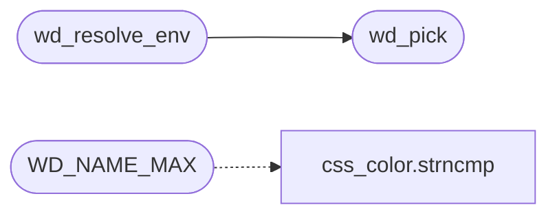

# `src/wl_display.c`

> Source: [src/wl_display.c:1](../../src/wl_display.c#L1) | language `c` | coverage 25.0% | [API index](../index.md)

## Contents

- **Functions:** [`wd_pick`](#wd_pick), [`wd_resolve_env`](#wd_resolve_env)
- **Macros:** [`_POSIX_C_SOURCE`](#_posix_c_source), [`WD_PREFIX`](#wd_prefix), [`WD_PREFIX_LEN`](#wd_prefix_len), [`WD_MAX_NAMES`](#wd_max_names), [`WD_NAME_MAX`](#wd_name_max)

## Call Graph

Solid arrows stay in this module, dashed arrows leave it.



## Functions

<a id="wd_pick"></a>

### `wd_pick`

`function` | [src/wl_display.c:27](../../src/wl_display.c#L27)

```c
int wd_pick(const char *const *names, size_t n, char *out, size_t cap)
```

Choose the lowest-numbered "wayland-N" (N = digits only) from names[0..n).

Writes it NUL-terminated into out; returns WD_NONE (out untouched) if none qualifies or cap is too small.

**Parameters**

| Name | Type | Default | Description |
|---|---|---|---|
| `names` | `char *const *` |  |  |
| `n` | `size_t` |  |  |
| `out` | `char *` |  |  |
| `cap` | `size_t` |  |  |

**Returns:** `int`

> **Inherited:** Documentation from [`wd_pick`](#wd_pick) (include/wl_display.h:16).

*Called by:* [`wd_resolve_env`](#wd_resolve_env)

---

<a id="wd_resolve_env"></a>

### `wd_resolve_env`

`function` | [src/wl_display.c:42](../../src/wl_display.c#L42)

```c
int wd_resolve_env(void)
```

If WAYLAND_DISPLAY is unset/empty, set it from the sockets found in XDG_RUNTIME_DIR.

Returns WD_OK if the variable is set on return, WD_NONE otherwise.

**Returns:** `int`

> **Inherited:** Documentation from [`wd_resolve_env`](#wd_resolve_env) (include/wl_display.h:20).

*Calls:* [`wd_pick`](#wd_pick)

---

## Macros

<a id="_posix_c_source"></a>

### `_POSIX_C_SOURCE`

`macro` | [src/wl_display.c:1](../../src/wl_display.c#L1)

```c
#define _POSIX_C_SOURCE
```

---

<a id="wd_prefix"></a>

### `WD_PREFIX`

`macro` | [src/wl_display.c:8](../../src/wl_display.c#L8)

```c
#define WD_PREFIX
```

---

<a id="wd_prefix_len"></a>

### `WD_PREFIX_LEN`

`macro` | [src/wl_display.c:9](../../src/wl_display.c#L9)

```c
#define WD_PREFIX_LEN
```

---

<a id="wd_max_names"></a>

### `WD_MAX_NAMES`

`macro` | [src/wl_display.c:10](../../src/wl_display.c#L10)

```c
#define WD_MAX_NAMES
```

---

<a id="wd_name_max"></a>

### `WD_NAME_MAX`

`macro` | [src/wl_display.c:11](../../src/wl_display.c#L11)

```c
#define WD_NAME_MAX
```

*Calls:* [`strncmp`](src.css_color.c.md#strncmp)

---
