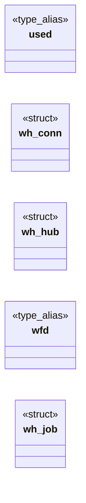
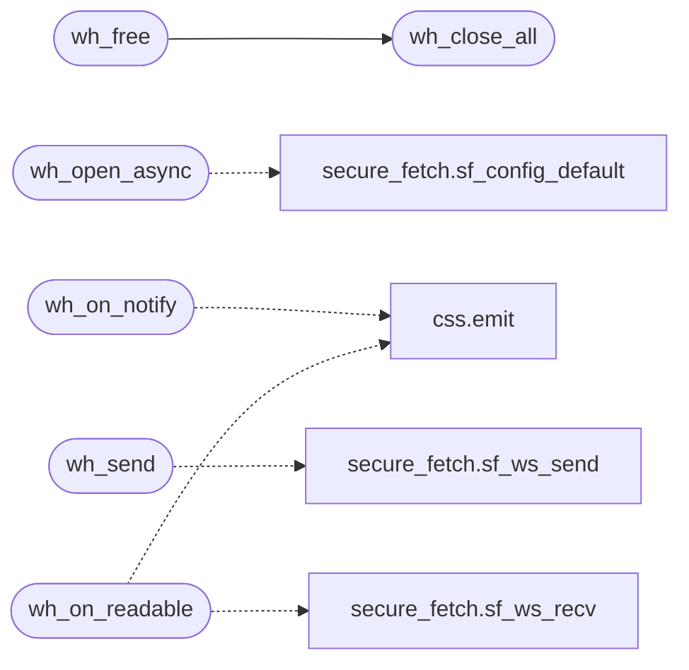

# `src/ws_hub.c`

> Source: [src/ws_hub.c:1](../../src/ws_hub.c#L1) | language `c` | coverage 70.0% | [API index](../index.md)

## Contents

- **Structs:** [`wh_conn`](#wh_conn), [`wh_hub`](#wh_hub), [`wh_job`](#wh_job)
- **Type Aliases:** [`used`](#used), [`wfd`](#wfd)
- **Functions:** [`wh_new`](#wh_new), [`wh_free`](#wh_free), [`wh_notify_fd`](#wh_notify_fd), [`wh_open_async`](#wh_open_async), [`wh_on_notify`](#wh_on_notify), [`wh_send`](#wh_send), [`wh_close`](#wh_close), [`wh_close_all`](#wh_close_all), [`wh_poll_fds`](#wh_poll_fds), [`wh_on_readable`](#wh_on_readable), [`wh_count`](#wh_count)
- **Macros:** [`_POSIX_C_SOURCE`](#_posix_c_source), [`WH_READS_PER_PUMP`](#wh_reads_per_pump), [`WH_RECV_CHUNK`](#wh_recv_chunk)

## Type Diagram



## Call Graph

Solid arrows stay in this module, dashed arrows leave it.



## Structs

<a id="wh_conn"></a>

### `wh_conn`

`struct` | [src/ws_hub.c:24](../../src/ws_hub.c#L24)

```c
typedef struct wh_conn
```

---

<a id="wh_hub"></a>

### `wh_hub`

`struct` | [src/ws_hub.c:35](../../src/ws_hub.c#L35)

```c
struct wh_hub
```

---

<a id="wh_job"></a>

### `wh_job`

`struct` | [src/ws_hub.c:43](../../src/ws_hub.c#L43)

```c
typedef struct wh_job
```

One open, owned by its thread until handed over through the pipe.

Every string of the config is copied: the thread outlives the caller's buffers.

---

## Type Aliases

<a id="used"></a>

### `used`

`type_alias` | [src/ws_hub.c:23](../../src/ws_hub.c#L23)

```c
typedef struct wh_conn { int used;
```

#include <curl/curl.h> #include <errno.h> #include <fcntl.h> #include <pthread.h> #include <sys/socket.h> #include <stdint.h> #include <stdlib.h> #include <string.h> #include <unistd.h> /* Frames read per wh_on_readable call: a flooding peer cannot starve the UI loop. define WH_READS_PER_PUMP 256 define WH_RECV_CHUNK     16384u

---

<a id="wfd"></a>

### `wfd`

`type_alias` | [src/ws_hub.c:43](../../src/ws_hub.c#L43)

```c
typedef struct wh_job { int wfd;
```

One open, owned by its thread until handed over through the pipe.

Every string of the config is copied: the thread outlives the caller's buffers.

---

## Functions

<a id="wh_new"></a>

### `wh_new`

`function` | [src/ws_hub.c:116](../../src/ws_hub.c#L116)

```c
wh_hub *wh_new(void)
```

New empty hub with its notify pipe, or NULL on OOM / pipe failure.

**Returns:** `wh_hub *`

> **Inherited:** Documentation from [`wh_new`](#wh_new) (include/ws_hub.h:34).

---

<a id="wh_free"></a>

### `wh_free`

`function` | [src/ws_hub.c:129](../../src/ws_hub.c#L129)

```c
void wh_free(wh_hub *h)
```

Closes every connection and frees the hub.

Pending opens finish on their own threads and discard their result. NULL is a no-op.

**Parameters**

| Name | Type | Default | Description |
|---|---|---|---|
| `h` | `wh_hub *` |  |  |

> **Inherited:** Documentation from [`wh_free`](#wh_free) (include/ws_hub.h:38).

*Calls:* [`wh_close_all`](#wh_close_all)

---

<a id="wh_notify_fd"></a>

### `wh_notify_fd`

`function` | [src/ws_hub.c:144](../../src/ws_hub.c#L144)

```c
int wh_notify_fd(const wh_hub *h)
```

Read end of the notify channel (a socket pair): poll it for POLLIN and call wh_on_notify.

**Parameters**

| Name | Type | Default | Description |
|---|---|---|---|
| `h` | `wh_hub *` |  |  |

**Returns:** `int`

> **Inherited:** Documentation from [`wh_notify_fd`](#wh_notify_fd) (include/ws_hub.h:41).

---

<a id="wh_open_async"></a>

### `wh_open_async`

`function` | [src/ws_hub.c:148](../../src/ws_hub.c#L148)

```c
int wh_open_async(wh_hub *h, int id, const char *url, const sf_config *cfg)
```

Starts opening url for page socket id on a thread (cfg and all its strings are copied).

Returns 0 when started; -1 (nothing started) on a duplicate id, a full hub, NULL args or OOM -- the caller then reports ERROR + CLOSE to the page.

**Parameters**

| Name | Type | Default | Description |
|---|---|---|---|
| `h` | `wh_hub *` |  |  |
| `id` | `int` |  |  |
| `url` | `char *` |  |  |
| `cfg` | `sf_config *` |  |  |

**Returns:** `int`

> **Inherited:** Documentation from [`wh_open_async`](#wh_open_async) (include/ws_hub.h:46).

*Calls:* [`sf_config_default`](src.secure_fetch.c.md#sf_config_default)

---

<a id="wh_on_notify"></a>

### `wh_on_notify`

`function` | [src/ws_hub.c:192](../../src/ws_hub.c#L192)

```c
void wh_on_notify(wh_hub *h, wh_emit_fn emit, void *ctx)
```

**Parameters**

| Name | Type | Default | Description |
|---|---|---|---|
| `h` | `wh_hub *` |  |  |
| `emit` | `wh_emit_fn` |  |  |
| `ctx` | `void *` |  |  |

*Calls:* [`emit`](src.css.c.md#emit)

---

<a id="wh_send"></a>

### `wh_send`

`function` | [src/ws_hub.c:221](../../src/ws_hub.c#L221)

```c
int wh_send(wh_hub *h, int id, const void *data, size_t len, int binary)
```

Sends one message on an OPEN connection.

0, or -1 (unknown id / broken link).

**Parameters**

| Name | Type | Default | Description |
|---|---|---|---|
| `h` | `wh_hub *` |  |  |
| `id` | `int` |  |  |
| `data` | `void *` |  |  |
| `len` | `size_t` |  |  |
| `binary` | `int` |  |  |

**Returns:** `int`

> **Inherited:** Documentation from [`wh_send`](#wh_send) (include/ws_hub.h:54).

*Calls:* [`sf_ws_send`](src.secure_fetch.c.md#sf_ws_send)

---

<a id="wh_close"></a>

### `wh_close`

`function` | [src/ws_hub.c:228](../../src/ws_hub.c#L228)

```c
void wh_close(wh_hub *h, int id)
```

The page closed socket id: sends a close frame and frees it (also cancels a pending open for that id: its result will be dropped).

**Parameters**

| Name | Type | Default | Description |
|---|---|---|---|
| `h` | `wh_hub *` |  |  |
| `id` | `int` |  |  |

> **Inherited:** Documentation from [`wh_close`](#wh_close) (include/ws_hub.h:58).

---

<a id="wh_close_all"></a>

### `wh_close_all`

`function` | [src/ws_hub.c:234](../../src/ws_hub.c#L234)

```c
void wh_close_all(wh_hub *h)
```

The page is going away: closes everything and bumps the generation.

**Parameters**

| Name | Type | Default | Description |
|---|---|---|---|
| `h` | `wh_hub *` |  |  |

> **Inherited:** Documentation from [`wh_close_all`](#wh_close_all) (include/ws_hub.h:61).

*Called by:* [`wh_free`](#wh_free)

---

<a id="wh_poll_fds"></a>

### `wh_poll_fds`

`function` | [src/ws_hub.c:240](../../src/ws_hub.c#L240)

```c
size_t wh_poll_fds(const wh_hub *h, struct pollfd *out, int *ids, size_t cap)
```

Fills up to cap pollfds (POLLIN) and the matching page ids for the open connections.

Returns the count.

**Parameters**

| Name | Type | Default | Description |
|---|---|---|---|
| `h` | `wh_hub *` |  |  |
| `out` | `struct pollfd *` |  |  |
| `ids` | `int *` |  |  |
| `cap` | `size_t` |  |  |

**Returns:** `size_t`

> **Inherited:** Documentation from [`wh_poll_fds`](#wh_poll_fds) (include/ws_hub.h:65).

---

<a id="wh_on_readable"></a>

### `wh_on_readable`

`function` | [src/ws_hub.c:266](../../src/ws_hub.c#L266)

```c
void wh_on_readable(wh_hub *h, int id, wh_emit_fn emit, void *ctx)
```

Reads everything pending on socket id without blocking, emitting each complete message; a close frame emits WH_EV_CLOSE; an error or an oversized message emits WH_EV_ERROR + WH_EV_CLOSE(WH_CLOSE_ABNORMAL).

The connection is freed on close.

**Parameters**

| Name | Type | Default | Description |
|---|---|---|---|
| `h` | `wh_hub *` |  |  |
| `id` | `int` |  |  |
| `emit` | `wh_emit_fn` |  |  |
| `ctx` | `void *` |  |  |

> **Inherited:** Documentation from [`wh_on_readable`](#wh_on_readable) (include/ws_hub.h:70).

*Calls:* [`emit`](src.css.c.md#emit), [`sf_ws_recv`](src.secure_fetch.c.md#sf_ws_recv)

---

<a id="wh_count"></a>

### `wh_count`

`function` | [src/ws_hub.c:314](../../src/ws_hub.c#L314)

```c
size_t wh_count(const wh_hub *h)
```

Number of live (open) connections.

**Parameters**

| Name | Type | Default | Description |
|---|---|---|---|
| `h` | `wh_hub *` |  |  |

**Returns:** `size_t`

> **Inherited:** Documentation from [`wh_count`](#wh_count) (include/ws_hub.h:73).

---

## Macros

<a id="_posix_c_source"></a>

### `_POSIX_C_SOURCE`

`macro` | [src/ws_hub.c:6](../../src/ws_hub.c#L6)

```c
#define _POSIX_C_SOURCE
```

---

<a id="wh_reads_per_pump"></a>

### `WH_READS_PER_PUMP`

`macro` | [src/ws_hub.c:21](../../src/ws_hub.c#L21)

```c
#define WH_READS_PER_PUMP
```

Frames read per wh_on_readable call: a flooding peer cannot starve the UI loop.

---

<a id="wh_recv_chunk"></a>

### `WH_RECV_CHUNK`

`macro` | [src/ws_hub.c:22](../../src/ws_hub.c#L22)

```c
#define WH_RECV_CHUNK
```

---
