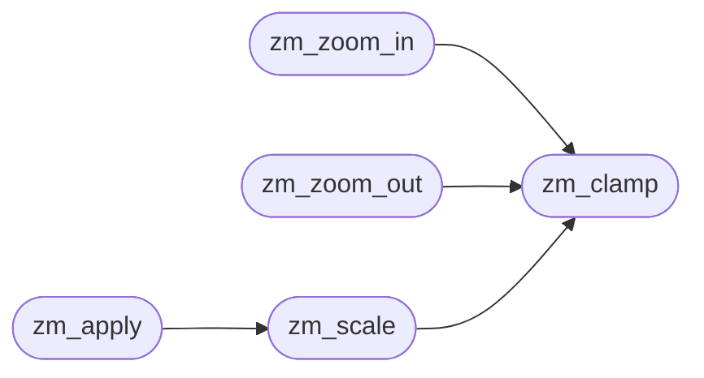

# `src/zoom.c`

> Source: [src/zoom.c:1](../../src/zoom.c#L1) | language `c` | coverage 75.0% | [API index](../index.md)

## Contents

- **Functions:** [`zm_clamp`](#zm_clamp), [`zm_zoom_in`](#zm_zoom_in), [`zm_zoom_out`](#zm_zoom_out), [`zm_reset`](#zm_reset), [`zm_scale`](#zm_scale), [`zm_apply`](#zm_apply)
- **Macros:** [`ZM_LADDER_N`](#zm_ladder_n)

## Call Graph

Solid arrows stay in this module, dashed arrows leave it.



## Functions

<a id="zm_clamp"></a>

### `zm_clamp`

`function` | [src/zoom.c:14](../../src/zoom.c#L14)

```c
int zm_clamp(int pct)
```

Clamp pct to [ZM_MIN_PCT, ZM_MAX_PCT].

**Parameters**

| Name | Type | Default | Description |
|---|---|---|---|
| `pct` | `int` |  |  |

**Returns:** `int`

> **Inherited:** Documentation from [`zm_clamp`](#zm_clamp) (include/zoom.h:26).

*Called by:* [`zm_scale`](#zm_scale), [`zm_zoom_in`](#zm_zoom_in), [`zm_zoom_out`](#zm_zoom_out)

---

<a id="zm_zoom_in"></a>

### `zm_zoom_in`

`function` | [src/zoom.c:20](../../src/zoom.c#L20)

```c
int zm_zoom_in(int pct)
```

Smallest ladder stop strictly greater than zm_clamp(pct); ZM_MAX_PCT if none.

**Parameters**

| Name | Type | Default | Description |
|---|---|---|---|
| `pct` | `int` |  |  |

**Returns:** `int`

> **Inherited:** Documentation from [`zm_zoom_in`](#zm_zoom_in) (include/zoom.h:29).

*Calls:* [`zm_clamp`](#zm_clamp)

---

<a id="zm_zoom_out"></a>

### `zm_zoom_out`

`function` | [src/zoom.c:28](../../src/zoom.c#L28)

```c
int zm_zoom_out(int pct)
```

Largest ladder stop strictly less than zm_clamp(pct); ZM_MIN_PCT if none.

**Parameters**

| Name | Type | Default | Description |
|---|---|---|---|
| `pct` | `int` |  |  |

**Returns:** `int`

> **Inherited:** Documentation from [`zm_zoom_out`](#zm_zoom_out) (include/zoom.h:32).

*Calls:* [`zm_clamp`](#zm_clamp)

---

<a id="zm_reset"></a>

### `zm_reset`

`function` | [src/zoom.c:36](../../src/zoom.c#L36)

```c
int zm_reset(void)
```

The default zoom level (100).

**Returns:** `int`

> **Inherited:** Documentation from [`zm_reset`](#zm_reset) (include/zoom.h:35).

---

<a id="zm_scale"></a>

### `zm_scale`

`function` | [src/zoom.c:40](../../src/zoom.c#L40)

```c
double zm_scale(int pct)
```

Multiplicative factor: zm_clamp(pct) / 100.0.

**Parameters**

| Name | Type | Default | Description |
|---|---|---|---|
| `pct` | `int` |  |  |

**Returns:** `double`

> **Inherited:** Documentation from [`zm_scale`](#zm_scale) (include/zoom.h:38).

*Calls:* [`zm_clamp`](#zm_clamp)

*Called by:* [`zm_apply`](#zm_apply)

---

<a id="zm_apply"></a>

### `zm_apply`

`function` | [src/zoom.c:44](../../src/zoom.c#L44)

```c
double zm_apply(double base_px, int pct)
```

base_px * zm_scale(pct), floored to 1.0 when base_px > 0 so a font can never scale away to nothing. base_px <= 0 returns base_px * scale unfloored.

**Parameters**

| Name | Type | Default | Description |
|---|---|---|---|
| `base_px` | `double` |  |  |
| `pct` | `int` |  |  |

**Returns:** `double`

> **Inherited:** Documentation from [`zm_apply`](#zm_apply) (include/zoom.h:42).

*Calls:* [`zm_scale`](#zm_scale)

---

## Macros

<a id="zm_ladder_n"></a>

### `ZM_LADDER_N`

`macro` | [src/zoom.c:12](../../src/zoom.c#L12)

```c
#define ZM_LADDER_N
```

---
