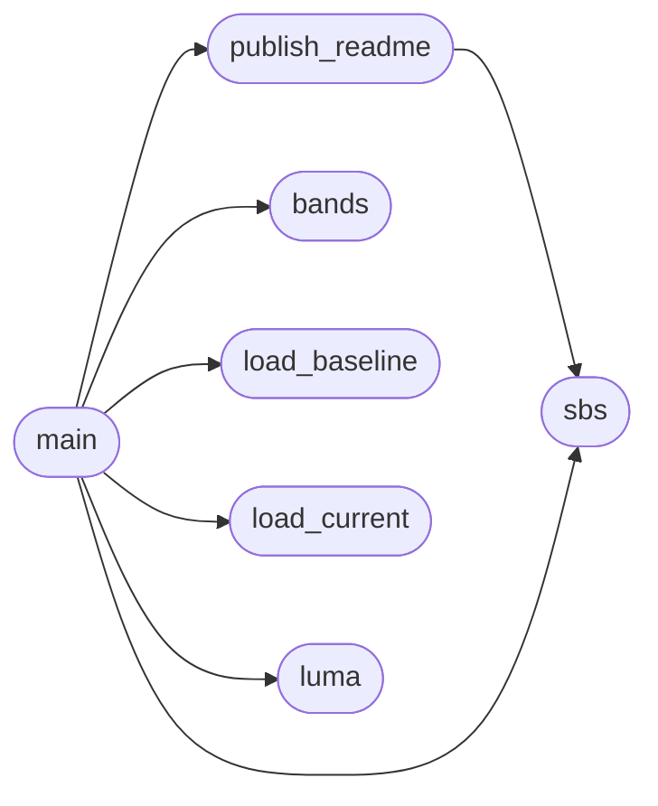

# `tools.fbench`

> Source: [tools/fbench.py:1](../../tools/fbench.py#L1) | language `py` | coverage 25.0% | [API index](../index.md)

fbench -- turn the PNG pairs `make parity` leaves behind into something you can act on.

`make parity` prints one score per page. To fix a page you then need to SEE where the two
engines part ways. This reads build/parity/<name>.fd.png (Freedom) and <name>.ff.png
(Firefox) and, per page:
  * writes build/bench/<name>.sbs.png: Freedom | Firefox side by side, cropped to the
    band you ask for, so one Read shows the difference;
  * prints the first row where the pictures diverge and the worst 100 px bands by mean
    luminance difference, so you know which y to crop next;
  * ranks the pages by score and shows the delta against tests/parity/baseline.tsv.

Every page the README shows (README_PAGES) is also republished: its docs/img/compare-*.png
is rewritten from the fresh pair and its score in the README table is updated, so the
README always carries the latest render. --no-readme skips that.

Usage: fbench.py [--from Y] [--rows N] [--band PX] [--no-readme] [page ...]
  no page  -> every page that has a PNG pair
Run `make fbench PAGES="a b" FROM=1000 ROWS=800` to refresh the pair first.

## Contents

- **Functions:** [`load_baseline`](#load_baseline), [`load_current`](#load_current), [`luma`](#luma), [`bands`](#bands), [`sbs`](#sbs), [`publish_readme`](#publish_readme), [`main`](#main)
- **Constants:** [`PARITY`](#parity), [`README_PAGES`](#readme_pages), [`README_ROWS`](#readme_rows), [`OUT`](#out)

## Call Graph

Solid arrows stay in this module, dashed arrows leave it.



## Functions

<a id="load_baseline"></a>

### `load_baseline`

`function` | [tools/fbench.py:46](../../tools/fbench.py#L46)

```python
def load_baseline()
```

*Called by:* [`main`](#main)

---

<a id="load_current"></a>

### `load_current`

`function` | [tools/fbench.py:59](../../tools/fbench.py#L59)

```python
def load_current()
```

*Called by:* [`main`](#main)

---

<a id="luma"></a>

### `luma`

`function` | [tools/fbench.py:72](../../tools/fbench.py#L72)

```python
def luma(img)
```

**Parameters**

| Name | Type | Default | Description |
|---|---|---|---|
| `img` |  |  |  |

*Called by:* [`main`](#main)

---

<a id="bands"></a>

### `bands`

`function` | [tools/fbench.py:76](../../tools/fbench.py#L76)

```python
def bands(fd, ff, band)
```

**Parameters**

| Name | Type | Default | Description |
|---|---|---|---|
| `fd` |  |  |  |
| `ff` |  |  |  |
| `band` |  |  |  |

*Called by:* [`main`](#main)

---

<a id="sbs"></a>

### `sbs`

`function` | [tools/fbench.py:88](../../tools/fbench.py#L88)

```python
def sbs(name, start, nrows)
```

**Parameters**

| Name | Type | Default | Description |
|---|---|---|---|
| `name` |  |  |  |
| `start` |  |  |  |
| `nrows` |  |  |  |

*Called by:* [`main`](#main), [`publish_readme`](#publish_readme)

---

<a id="publish_readme"></a>

### `publish_readme`

`function` | [tools/fbench.py:107](../../tools/fbench.py#L107)

```python
def publish_readme(name, score)
```

Rewrite the README picture of [`name`](src.text_shape.c.md#name) and the score printed beside its label.

**Parameters**

| Name | Type | Default | Description |
|---|---|---|---|
| `name` |  |  |  |
| `score` |  |  |  |

*Calls:* [`sbs`](#sbs)

*Called by:* [`main`](#main)

---

<a id="main"></a>

### `main`

`function` | [tools/fbench.py:127](../../tools/fbench.py#L127)

```python
def main()
```

*Calls:* [`bands`](#bands), [`load_baseline`](#load_baseline), [`load_current`](#load_current), [`luma`](#luma), [`publish_readme`](#publish_readme), [`sbs`](#sbs)

---

## Constants

<a id="parity"></a>

### `PARITY`

`constant` | [tools/fbench.py:29](../../tools/fbench.py#L29)

```python
PARITY = 'build/parity'
```

---

<a id="readme_pages"></a>

### `README_PAGES`

`constant` | [tools/fbench.py:31](../../tools/fbench.py#L31)

```python
README_PAGES
```

---

<a id="readme_rows"></a>

### `README_ROWS`

`constant` | [tools/fbench.py:42](../../tools/fbench.py#L42)

```python
README_ROWS = 1100
```

---

<a id="out"></a>

### `OUT`

`constant` | [tools/fbench.py:43](../../tools/fbench.py#L43)

```python
OUT = 'build/bench'
```

---
