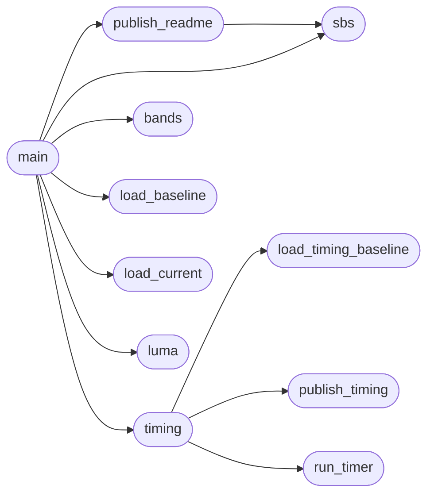

# `tools.fbench`

> Source: [tools/fbench.py:1](../../tools/fbench.py#L1) | language `py` | coverage 33.3% | [API index](../index.md)

fbench -- turn the PNG pairs `make parity` leaves behind into something you can act on.

`make parity` prints one score per page. To fix a page you then need to SEE where the two
engines part ways. This reads build/parity/<name>.fd.png (Freedom) and <name>.ff.png
(Firefox) and, per page:
  * writes build/bench/<name>.sbs.png: Freedom | Firefox side by side, cropped to the
    band you ask for, so one Read shows the difference;
  * prints the first row where the pictures diverge and the worst 100 px bands by mean
    luminance difference, so you know which y to crop next;
  * ranks the pages by score and shows the delta against tests/parity/baseline.tsv.

Every page the README shows (README_PAGES) is also republished: its docs/img/compare-*.png
is rewritten from the fresh pair and its score in the README table is updated, so the
README always carries the latest render. --no-readme skips that.

Render time is measured too (spec/parity.md "Timing"): for the README pages -- or the pages named --
the REAL GUI window (tools/guitime.py: Xvfb + weston, same do_load/paint path as a user) and Firefox
(tools/fftime.py: its own Performance Timeline) each report "navigation request -> painted and idle";
the medians are printed with the ratio and the delta against tests/parity/timing-baseline.tsv, saved
to build/bench/timing.tsv, and written into the README between its fbench-timing markers. If the GUI
cannot be run here (no Xvfb/weston) that is said and nothing is substituted. --no-time skips it.

Usage: fbench.py [--from Y] [--rows N] [--band PX] [--no-readme] [--no-time] [--time-runs N] [page ...]
  no page  -> every page that has a PNG pair (timing: the README pages)
Run `make fbench PAGES="a b" FROM=1000 ROWS=800` to refresh the pair first.

## Contents

- **Functions:** [`load_baseline`](#load_baseline), [`load_current`](#load_current), [`luma`](#luma), [`bands`](#bands), [`sbs`](#sbs), [`publish_readme`](#publish_readme), [`run_timer`](#run_timer), [`load_timing_baseline`](#load_timing_baseline), [`publish_timing`](#publish_timing), [`timing`](#timing), [`main`](#main)
- **Constants:** [`PARITY`](#parity), [`README_PAGES`](#readme_pages), [`README_ROWS`](#readme_rows), [`OUT`](#out), [`TIMING_BASELINE`](#timing_baseline), [`TIMING_OUT`](#timing_out), [`README_TIMING_BEGIN`](#readme_timing_begin), [`README_TIMING_END`](#readme_timing_end)

## Call Graph

Solid arrows stay in this module, dashed arrows leave it.



## Functions

<a id="load_baseline"></a>

### `load_baseline`

`function` | [tools/fbench.py:53](../../tools/fbench.py#L53)

```python
def load_baseline()
```

*Called by:* [`main`](#main)

---

<a id="load_current"></a>

### `load_current`

`function` | [tools/fbench.py:66](../../tools/fbench.py#L66)

```python
def load_current()
```

*Called by:* [`main`](#main)

---

<a id="luma"></a>

### `luma`

`function` | [tools/fbench.py:79](../../tools/fbench.py#L79)

```python
def luma(img)
```

**Parameters**

| Name | Type | Default | Description |
|---|---|---|---|
| `img` |  |  |  |

*Called by:* [`main`](#main)

---

<a id="bands"></a>

### `bands`

`function` | [tools/fbench.py:83](../../tools/fbench.py#L83)

```python
def bands(fd, ff, band)
```

**Parameters**

| Name | Type | Default | Description |
|---|---|---|---|
| `fd` |  |  |  |
| `ff` |  |  |  |
| `band` |  |  |  |

*Called by:* [`main`](#main)

---

<a id="sbs"></a>

### `sbs`

`function` | [tools/fbench.py:95](../../tools/fbench.py#L95)

```python
def sbs(name, start, nrows)
```

**Parameters**

| Name | Type | Default | Description |
|---|---|---|---|
| `name` |  |  |  |
| `start` |  |  |  |
| `nrows` |  |  |  |

*Called by:* [`main`](#main), [`publish_readme`](#publish_readme)

---

<a id="publish_readme"></a>

### `publish_readme`

`function` | [tools/fbench.py:114](../../tools/fbench.py#L114)

```python
def publish_readme(name, score)
```

Rewrite the README picture of `name` and the score printed beside its label.

**Parameters**

| Name | Type | Default | Description |
|---|---|---|---|
| `name` |  |  |  |
| `score` |  |  |  |

*Calls:* [`sbs`](#sbs)

*Called by:* [`main`](#main)

---

<a id="run_timer"></a>

### `run_timer`

`function` | [tools/fbench.py:140](../../tools/fbench.py#L140)

```python
def run_timer(tool, pages, runs)
```

Runs a timing tool over the pages; returns ({name: median ms}, exit code).

**Parameters**

| Name | Type | Default | Description |
|---|---|---|---|
| `tool` |  |  |  |
| `pages` |  |  |  |
| `runs` |  |  |  |

*Called by:* [`timing`](#timing)

---

<a id="load_timing_baseline"></a>

### `load_timing_baseline`

`function` | [tools/fbench.py:158](../../tools/fbench.py#L158)

```python
def load_timing_baseline()
```

*Called by:* [`timing`](#timing)

---

<a id="publish_timing"></a>

### `publish_timing`

`function` | [tools/fbench.py:171](../../tools/fbench.py#L171)

```python
def publish_timing(rows)
```

Rewrites the README timing table (between the markers) for the README pages timed.

**Parameters**

| Name | Type | Default | Description |
|---|---|---|---|
| `rows` |  |  |  |

*Called by:* [`timing`](#timing)

---

<a id="timing"></a>

### `timing`

`function` | [tools/fbench.py:193](../../tools/fbench.py#L193)

```python
def timing(names, runs, readme)
```

**Parameters**

| Name | Type | Default | Description |
|---|---|---|---|
| `names` |  |  |  |
| `runs` |  |  |  |
| `readme` |  |  |  |

*Calls:* [`load_timing_baseline`](#load_timing_baseline), [`publish_timing`](#publish_timing), [`run_timer`](#run_timer)

*Called by:* [`main`](#main)

---

<a id="main"></a>

### `main`

`function` | [tools/fbench.py:227](../../tools/fbench.py#L227)

```python
def main()
```

*Calls:* [`bands`](#bands), [`load_baseline`](#load_baseline), [`load_current`](#load_current), [`luma`](#luma), [`publish_readme`](#publish_readme), [`sbs`](#sbs), [`timing`](#timing)

---

## Constants

<a id="parity"></a>

### `PARITY`

`constant` | [tools/fbench.py:36](../../tools/fbench.py#L36)

```python
PARITY = 'build/parity'
```

---

<a id="readme_pages"></a>

### `README_PAGES`

`constant` | [tools/fbench.py:38](../../tools/fbench.py#L38)

```python
README_PAGES
```

---

<a id="readme_rows"></a>

### `README_ROWS`

`constant` | [tools/fbench.py:49](../../tools/fbench.py#L49)

```python
README_ROWS = 1100
```

---

<a id="out"></a>

### `OUT`

`constant` | [tools/fbench.py:50](../../tools/fbench.py#L50)

```python
OUT = 'build/bench'
```

---

<a id="timing_baseline"></a>

### `TIMING_BASELINE`

`constant` | [tools/fbench.py:134](../../tools/fbench.py#L134)

```python
TIMING_BASELINE = 'tests/parity/timing-baseline.tsv'
```

---

<a id="timing_out"></a>

### `TIMING_OUT`

`constant` | [tools/fbench.py:135](../../tools/fbench.py#L135)

```python
TIMING_OUT = OUT + '/timing.tsv'
```

---

<a id="readme_timing_begin"></a>

### `README_TIMING_BEGIN`

`constant` | [tools/fbench.py:136](../../tools/fbench.py#L136)

```python
README_TIMING_BEGIN = '<!-- fbench-timing:begin -->'
```

---

<a id="readme_timing_end"></a>

### `README_TIMING_END`

`constant` | [tools/fbench.py:137](../../tools/fbench.py#L137)

```python
README_TIMING_END = '<!-- fbench-timing:end -->'
```

---
