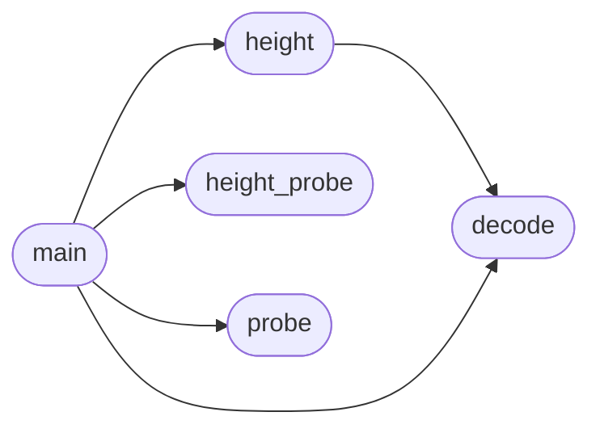

# `tools.ffgeom`

> Source: [tools/ffgeom.py:1](../../tools/ffgeom.py#L1) | language `py` | coverage 25.0% | [API index](../index.md)

ffgeom -- Firefox geometry as TEXT, no image reading.

The `make geom` loop needs Firefox's getBoundingClientRect() numbers, and its only
headless output here is a screenshot. This tool turns that screenshot into a text
dump mechanically: the probe page replaces the body with a BIT-GRID canvas that
encodes every measured rect as black/white cells, this script decodes the cells
back into numbers, and prints one line per rect:

    <index> <tag>.<class> top=<t> left=<l> w=<w> h=<h>

The encoding is a fixed grid, no OCR, no image model:
  - canvas 64px wide, each row 16 cells of 4x4px, one row per 16-bit VALUE
  - row 0: magic 0xC0DE (16 bits) + row count (16 bits)
  - then per rect: 4 rows (top, left, w, h), MSB first
  - rows continue per rect; the decoded count bounds the region read

The decoded values are what `make geom` prints beside Freedom's own --dump-layout,
so a layout difference reads as two columns of numbers instead of being guessed
from pixels. The canvas is white and fixed at the top-left of the viewport, so
the grid region carries no underlying page ink.

Usage:
  ffgeom probe <page.html> <selector> <out.html>
  ffgeom decode <screenshot.png>

Both steps run through `make geom` (the Makefile is the single source of truth);
this script is the thin worker it delegates to. Pure python, no dependencies, no
network. It reads only local files the harness produced.

## Contents

- **Functions:** [`load_rows`](#load_rows), [`lum`](#lum), [`decode`](#decode), [`probe`](#probe), [`height_probe`](#height_probe), [`height`](#height), [`main`](#main)
- **Constants:** [`HEIGHT_SCRIPT`](#height_script), [`PROBE_TMPL`](#probe_tmpl)

## Call Graph

Solid arrows stay in this module, dashed arrows leave it.



## Functions

<a id="load_rows"></a>

### `load_rows`

`function` | [tools/ffgeom.py:116](../../tools/ffgeom.py#L116)

```python
def load_rows(path)
```

**Parameters**

| Name | Type | Default | Description |
|---|---|---|---|
| `path` |  |  |  |

**Raises**

- `ValueError`: (raised in the body, not documented)

---

<a id="lum"></a>

### `lum`

`function` | [tools/ffgeom.py:169](../../tools/ffgeom.py#L169)

```python
def lum(p)
```

**Parameters**

| Name | Type | Default | Description |
|---|---|---|---|
| `p` |  |  |  |

---

<a id="decode"></a>

### `decode`

`function` | [tools/ffgeom.py:239](../../tools/ffgeom.py#L239)

```python
def decode(path)
```

**Parameters**

| Name | Type | Default | Description |
|---|---|---|---|
| `path` |  |  |  |

*Called by:* [`height`](#height), [`main`](#main)

---

<a id="probe"></a>

### `probe`

`function` | [tools/ffgeom.py:265](../../tools/ffgeom.py#L265)

```python
def probe(page, selector, out_html)
```

**Parameters**

| Name | Type | Default | Description |
|---|---|---|---|
| `page` |  |  |  |
| `selector` |  |  |  |
| `out_html` |  |  |  |

*Called by:* [`main`](#main)

---

<a id="height_probe"></a>

### `height_probe`

`function` | [tools/ffgeom.py:279](../../tools/ffgeom.py#L279)

```python
def height_probe(page, out_html)
```

**Parameters**

| Name | Type | Default | Description |
|---|---|---|---|
| `page` |  |  |  |
| `out_html` |  |  |  |

*Called by:* [`main`](#main)

---

<a id="height"></a>

### `height`

`function` | [tools/ffgeom.py:292](../../tools/ffgeom.py#L292)

```python
def height(path)
```

Decodes the scrollHeight carried by the #__ffh sentinel: the probe encodes one rect (its height), which decode() returns as the first element's h value.

**Parameters**

| Name | Type | Default | Description |
|---|---|---|---|
| `path` |  |  |  |

**Raises**

- `ValueError`: (raised in the body, not documented)

*Calls:* [`decode`](#decode)

*Called by:* [`main`](#main)

---

<a id="main"></a>

### `main`

`function` | [tools/ffgeom.py:301](../../tools/ffgeom.py#L301)

```python
def main(argv)
```

**Parameters**

| Name | Type | Default | Description |
|---|---|---|---|
| `argv` |  |  |  |

*Calls:* [`decode`](#decode), [`height`](#height), [`height_probe`](#height_probe), [`probe`](#probe)

---

## Constants

<a id="height_script"></a>

### `HEIGHT_SCRIPT`

`constant` | [tools/ffgeom.py:37](../../tools/ffgeom.py#L37)

```python
HEIGHT_SCRIPT
```

---

<a id="probe_tmpl"></a>

### `PROBE_TMPL`

`constant` | [tools/ffgeom.py:64](../../tools/ffgeom.py#L64)

```python
PROBE_TMPL
```

---
