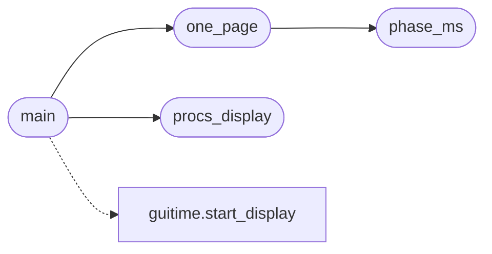

# `tools.guiscroll`

> Source: [tools/guiscroll.py:1](../../tools/guiscroll.py#L1) | language `py` | coverage 40.0% | [API index](../index.md)

guiscroll -- what one frame costs in the REAL Freedom window while the user scrolls.

guitime measures "navigate -> painted and idle"; this measures the frames AFTER that: the
page is loaded in a nested weston (Xvfb + weston, pixman renderer, same harness as guitime),
then xdotool turns the mouse wheel over the content N times, one notch every WHEEL_GAP_S.
The window runs with FREEDOM_JS_PROFILE=1, so every frame prints its phases on stderr
("gui-profile paint(total) ..." and the layout_doc / position_doc lines). Only the frames
painted after the first wheel notch are counted.

With --hover the wheel is replaced by N pointer moves across the content (what a user does
while reading): each move runs the hover hit-tests ("gui-profile hover") and repaints only
when what is under the pointer changed. The fifth column is then the median hover ms.

Usage: guiscroll.py [--bin PATH] [--notches N] [--hover] <page.html> ...
Prints one line per page:  <name>       <frames>        <median frame ms>       <p90 frame ms>  <median layout ms>
Exit 0 when every page was measured, 1 on a failed measurement, 2 when the environment is missing.

## Contents

- **Functions:** [`phase_ms`](#phase_ms), [`one_page`](#one_page), [`main`](#main), [`procs_display`](#procs_display)
- **Constants:** [`LOAD_WAIT_S`](#load_wait_s), [`WHEEL_GAP_S`](#wheel_gap_s), [`SETTLE_S`](#settle_s), [`MARK`](#mark)

## Call Graph

Solid arrows stay in this module, dashed arrows leave it.



## Functions

<a id="phase_ms"></a>

### `phase_ms`

`function` | [tools/guiscroll.py:38](../../tools/guiscroll.py#L38)

```python
def phase_ms(line, phase)
```

**Parameters**

| Name | Type | Default | Description |
|---|---|---|---|
| `line` |  |  |  |
| `phase` |  |  |  |

*Called by:* [`one_page`](#one_page)

---

<a id="one_page"></a>

### `one_page`

`function` | [tools/guiscroll.py:48](../../tools/guiscroll.py#L48)

```python
def one_page(binary, page, env, prof, tmp, notches, hover=False)
```

**Parameters**

| Name | Type | Default | Description |
|---|---|---|---|
| `binary` |  |  |  |
| `page` |  |  |  |
| `env` |  |  |  |
| `prof` |  |  |  |
| `tmp` |  |  |  |
| `notches` |  |  |  |
| `hover` |  | `False` |  |

*Calls:* [`phase_ms`](#phase_ms)

*Called by:* [`main`](#main)

---

<a id="main"></a>

### `main`

`function` | [tools/guiscroll.py:95](../../tools/guiscroll.py#L95)

```python
def main()
```

*Calls:* [`one_page`](#one_page), [`procs_display`](#procs_display), [`start_display`](tools.guitime.py.md#start_display)

---

<a id="procs_display"></a>

### `procs_display`

`function` | [tools/guiscroll.py:149](../../tools/guiscroll.py#L149)

```python
def procs_display(procs)
```

The X display guitime.start_display put Xvfb on (it is the second process's argv).

**Parameters**

| Name | Type | Default | Description |
|---|---|---|---|
| `procs` |  |  |  |

*Called by:* [`main`](#main)

---

## Constants

<a id="load_wait_s"></a>

### `LOAD_WAIT_S`

`constant` | [tools/guiscroll.py:32](../../tools/guiscroll.py#L32)

```python
LOAD_WAIT_S = 6.0
```

---

<a id="wheel_gap_s"></a>

### `WHEEL_GAP_S`

`constant` | [tools/guiscroll.py:33](../../tools/guiscroll.py#L33)

```python
WHEEL_GAP_S = 0.08
```

---

<a id="settle_s"></a>

### `SETTLE_S`

`constant` | [tools/guiscroll.py:34](../../tools/guiscroll.py#L34)

```python
SETTLE_S = 1.5
```

---

<a id="mark"></a>

### `MARK`

`constant` | [tools/guiscroll.py:35](../../tools/guiscroll.py#L35)

```python
MARK = 'guiscroll-start'
```

---
