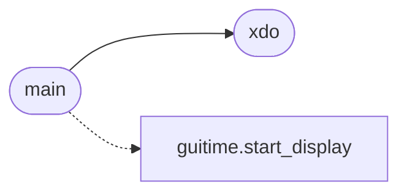

# `tools.guishot`

> Source: [tools/guishot.py:1](../../tools/guishot.py#L1) | language `py` | coverage 33.3% | [API index](../index.md)

guishot -- a picture of the REAL Freedom window for the README.

The window runs in a nested weston (Xvfb + weston, pixman renderer: the same display
harness as guitime/guiscroll). The first URL is opened on the command line; every other
one in a new tab (xdotool: Ctrl+T, type, Enter), then the first tab is brought back to the
front, so the picture shows the tab strip, the omnibox and the connection badge of a real
session. FREEDOM_GUI_SHOT writes what the window's own painter drew (client-side
decorations included), so nothing of the virtual desktop leaks into the image.

The session is throwaway: HOME and FREEDOM_HOSTS_DIR point at a temporary copy of the
repository's config/, so the operator's profile, bookmarks and host lists are never read
or written (the auto-allow of CDN hosts writes to allow.conf). A page pictured with its
author CSS must be in the repository's allow.conf and js.conf (the trusted-host doctrine).

Usage: guishot.py [--bin PATH] [--out PNG] [--wait S] URL [URL...]
Exit 0 when the picture was written, 1 when it was not, 2 when the environment is missing.

## Contents

- **Functions:** [`xdo`](#xdo), [`main`](#main)
- **Constants:** [`TAB_GAP_S`](#tab_gap_s), [`KEY_DELAY_MS`](#key_delay_ms), [`SHOT_PERIOD_S`](#shot_period_s), [`POINTER_PARK`](#pointer_park)

## Call Graph

Solid arrows stay in this module, dashed arrows leave it.



## Functions

<a id="xdo"></a>

### `xdo`

`function` | [tools/guishot.py:38](../../tools/guishot.py#L38)

```python
def xdo(env, *args)
```

**Parameters**

| Name | Type | Default | Description |
|---|---|---|---|
| `env` |  |  |  |
| `*args` |  |  |  |

*Called by:* [`main`](#main)

---

<a id="main"></a>

### `main`

`function` | [tools/guishot.py:43](../../tools/guishot.py#L43)

```python
def main()
```

*Calls:* [`xdo`](#xdo), [`start_display`](tools.guitime.py.md#start_display)

---

## Constants

<a id="tab_gap_s"></a>

### `TAB_GAP_S`

`constant` | [tools/guishot.py:32](../../tools/guishot.py#L32)

```python
TAB_GAP_S = 2.5
```

---

<a id="key_delay_ms"></a>

### `KEY_DELAY_MS`

`constant` | [tools/guishot.py:33](../../tools/guishot.py#L33)

```python
KEY_DELAY_MS = 20
```

---

<a id="shot_period_s"></a>

### `SHOT_PERIOD_S`

`constant` | [tools/guishot.py:34](../../tools/guishot.py#L34)

```python
SHOT_PERIOD_S = 3.5
```

---

<a id="pointer_park"></a>

### `POINTER_PARK`

`constant` | [tools/guishot.py:35](../../tools/guishot.py#L35)

```python
POINTER_PARK = ('1290', '890')
```

---
