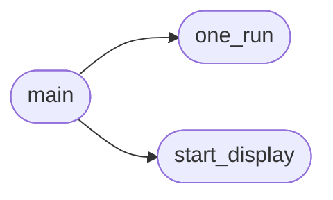

# `tools.guitime`

> Source: [tools/guitime.py:1](../../tools/guitime.py#L1) | language `py` | coverage 50.0% | [API index](../index.md)

guitime -- how long the REAL Freedom window takes from "navigate" to "painted and idle".

Not headless: the browser is the GUI binary running in a nested weston (Xvfb + weston, pixman
renderer), loading the page through the same do_load/render/paint path a user's session takes.
The only addition is FREEDOM_GUI_TIMING=<file>: once the page is loaded, no background job or JS tick
is pending and no new frame was painted for 150 ms, the window writes {"ms": <last paint - navigation
request>} and exits (FREEDOM_GUI_EXIT_AT_IDLE). Nothing is timed in a separate mode (spec/parity.md).

The page is measured under the corpus policy (FREEDOM_AS_HOST=corpus.test with tests/parity/hosts:
presentation trust, JavaScript off), the same one `make parity` and tools/fftime.py use. A scratch
profile directory keeps the user's own preferences out of the measurement. If Xvfb or weston is
missing the tool says so and exits 2: it never falls back to a different, headless measurement.

Usage: guitime.py [--runs N] [--bin PATH] [--hosts DIR] <page.html> ...
Prints one line per page:  <name>       <median ms>     <min>   <max>
Exit 0 when every page was measured, 1 on a failed measurement, 2 when the environment is missing.

## Contents

- **Functions:** [`start_display`](#start_display), [`one_run`](#one_run), [`main`](#main)
- **Constants:** [`PER_RUN_TIMEOUT_S`](#per_run_timeout_s), [`START_ATTEMPTS`](#start_attempts)

## Call Graph

Solid arrows stay in this module, dashed arrows leave it.



## Functions

<a id="start_display"></a>

### `start_display`

`function` | [tools/guitime.py:34](../../tools/guitime.py#L34)

```python
def start_display(workdir)
```

Starts Xvfb and a nested weston; returns (env, processes) or None when unavailable.

**Parameters**

| Name | Type | Default | Description |
|---|---|---|---|
| `workdir` |  |  |  |

*Called by:* [`main`](#main)

---

<a id="one_run"></a>

### `one_run`

`function` | [tools/guitime.py:65](../../tools/guitime.py#L65)

```python
def one_run(binary, page, env, hosts_dir, tmp)
```

**Parameters**

| Name | Type | Default | Description |
|---|---|---|---|
| `binary` |  |  |  |
| `page` |  |  |  |
| `env` |  |  |  |
| `hosts_dir` |  |  |  |
| `tmp` |  |  |  |

*Called by:* [`main`](#main)

---

<a id="main"></a>

### `main`

`function` | [tools/guitime.py:92](../../tools/guitime.py#L92)

```python
def main()
```

*Calls:* [`one_run`](#one_run), [`start_display`](#start_display)

---

## Constants

<a id="per_run_timeout_s"></a>

### `PER_RUN_TIMEOUT_S`

`constant` | [tools/guitime.py:30](../../tools/guitime.py#L30)

```python
PER_RUN_TIMEOUT_S = 90
```

---

<a id="start_attempts"></a>

### `START_ATTEMPTS`

`constant` | [tools/guitime.py:31](../../tools/guitime.py#L31)

```python
START_ATTEMPTS = 20
```

---
