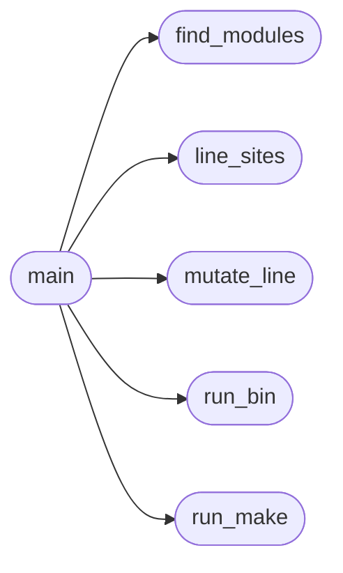

# `tools.mutate`

> Source: [tools/mutate.py:1](../../tools/mutate.py#L1) | language `py` | coverage 14.3% | [API index](../index.md)

mutate -- compile-time mutation testing for the CMocka suites.

One mutant = one operator substitution in one src/ file that has a matching
tests/test_<module>.c. The mutated source replaces the original for a single
`make build/test_<module>` build and run, then the original is restored.

    killed          the suite ran and at least one test failed
    survived        the suite passed on the mutated code (a blind spot)
    killed-by-build the mutation broke -Werror or the link (reported apart,
                    because a syntax error is not the suite's work)

Exit status: 0 when every mutant died, 1 when any mutant survived.

The mutation set is deliberately mechanical (comparison/relational/logical/
arithmetic operators): each is one token swap on a line of the module's own
code, never inside comments or strings. Only the first MUTATE_MAX sites per
file are taken, in line order, so the run stays bounded.

Usage:
    tools/mutate.py [--max N] [--mods a,b,c] [--verbose]

## Contents

- **Functions:** [`line_sites`](#line_sites), [`mutate_line`](#mutate_line), [`find_modules`](#find_modules), [`run_make`](#run_make), [`run_bin`](#run_bin), [`main`](#main)
- **Constants:** [`OPS`](#ops), [`SKIP_EXTRA_OPS`](#skip_extra_ops), [`MUTATE_MAX`](#mutate_max), [`MUTATE_TIMEOUT`](#mutate_timeout)

## Call Graph

Solid arrows stay in this module, dashed arrows leave it.



## Functions

<a id="line_sites"></a>

### `line_sites`

`function` | [tools/mutate.py:41](../../tools/mutate.py#L41)

```python
def line_sites(text)
```

**Parameters**

| Name | Type | Default | Description |
|---|---|---|---|
| `text` |  |  |  |

*Called by:* [`main`](#main)

---

<a id="mutate_line"></a>

### `mutate_line`

`function` | [tools/mutate.py:75](../../tools/mutate.py#L75)

```python
def mutate_line(line, op)
```

**Parameters**

| Name | Type | Default | Description |
|---|---|---|---|
| `line` |  |  |  |
| `op` |  |  |  |

*Called by:* [`main`](#main)

---

<a id="find_modules"></a>

### `find_modules`

`function` | [tools/mutate.py:107](../../tools/mutate.py#L107)

```python
def find_modules(root)
```

**Parameters**

| Name | Type | Default | Description |
|---|---|---|---|
| `root` |  |  |  |

*Called by:* [`main`](#main)

---

<a id="run_make"></a>

### `run_make`

`function` | [tools/mutate.py:116](../../tools/mutate.py#L116)

```python
def run_make(root, target)
```

**Parameters**

| Name | Type | Default | Description |
|---|---|---|---|
| `root` |  |  |  |
| `target` |  |  |  |

*Called by:* [`main`](#main)

---

<a id="run_bin"></a>

### `run_bin`

`function` | [tools/mutate.py:125](../../tools/mutate.py#L125)

```python
def run_bin(path)
```

**Parameters**

| Name | Type | Default | Description |
|---|---|---|---|
| `path` |  |  |  |

*Called by:* [`main`](#main)

---

<a id="main"></a>

### `main`

`function` | [tools/mutate.py:137](../../tools/mutate.py#L137)

```python
def main(argv)
```

**Parameters**

| Name | Type | Default | Description |
|---|---|---|---|
| `argv` |  |  |  |

*Calls:* [`find_modules`](#find_modules), [`line_sites`](#line_sites), [`mutate_line`](#mutate_line), [`run_bin`](#run_bin), [`run_make`](#run_make)

---

## Constants

<a id="ops"></a>

### `OPS`

`constant` | [tools/mutate.py:30](../../tools/mutate.py#L30)

```python
OPS
```

---

<a id="skip_extra_ops"></a>

### `SKIP_EXTRA_OPS`

`constant` | [tools/mutate.py:36](../../tools/mutate.py#L36)

```python
SKIP_EXTRA_OPS = frozenset(('++', '--', '+=', '-=', '->', '->'))
```

---

<a id="mutate_max"></a>

### `MUTATE_MAX`

`constant` | [tools/mutate.py:38](../../tools/mutate.py#L38)

```python
MUTATE_MAX = int(os.environ.get('MUTATE_MAX', '12'))
```

---

<a id="mutate_timeout"></a>

### `MUTATE_TIMEOUT`

`constant` | [tools/mutate.py:122](../../tools/mutate.py#L122)

```python
MUTATE_TIMEOUT = int(os.environ.get('MUTATE_TIMEOUT', '60'))
```

---
