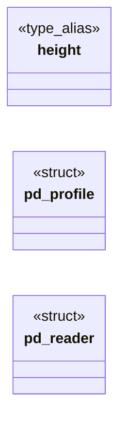

# `tools/pngdiff.c`

> Source: [tools/pngdiff.c:1](../../tools/pngdiff.c#L1) | language `c` | coverage 44.4% | [API index](../index.md)

## Contents

- **Structs:** [`pd_profile`](#pd_profile), [`pd_reader`](#pd_reader)
- **Type Aliases:** [`height`](#height)
- **Functions:** [`png_set_background`](#png_set_background), [`main`](#main)
- **Macros:** [`PD_COLS`](#pd_cols), [`PD_ROWS`](#pd_rows), [`PD_INK_DELTA`](#pd_ink_delta)

## Type Diagram



## Structs

<a id="pd_profile"></a>

### `pd_profile`

`struct` | [tools/pngdiff.c:65](../../tools/pngdiff.c#L65)

```c
typedef struct pd_profile
```

---

<a id="pd_reader"></a>

### `pd_reader`

`struct` | [tools/pngdiff.c:71](../../tools/pngdiff.c#L71)

```c
typedef struct pd_reader
```

---

## Type Aliases

<a id="height"></a>

### `height`

`type_alias` | [tools/pngdiff.c:64](../../tools/pngdiff.c#L64)

```c
typedef struct pd_profile { uint32_t width, height;
```

A pixel counts as ink when its luminance differs from the page background by more than this (0..255).

Below it lies antialiasing fringe and subtle background * banding, which must not read as content. define PD_INK_DELTA 24.0

---

## Functions

<a id="png_set_background"></a>

### `png_set_background`

`function` | [tools/pngdiff.c:116](../../tools/pngdiff.c#L116)

```c
png_set_background(r->png, &(png_color_16)
```

Compose against white rather than dropping alpha: a transparent region of a screenshot is what the viewer would see as page white, and treating it as black would invent ink where the page has none.

**Parameters**

| Name | Type | Default | Description |
|---|---|---|---|
| `png` | `r->` |  |  |
| `png_color_16` |  |  |  |

---

<a id="main"></a>

### `main`

`function` | [tools/pngdiff.c:233](../../tools/pngdiff.c#L233)

```c
int main(int argc, char **argv)
```

**Parameters**

| Name | Type | Default | Description |
|---|---|---|---|
| `argc` | `int` |  |  |
| `argv` | `char **` |  |  |

**Returns:** `int`

---

## Macros

<a id="pd_cols"></a>

### `PD_COLS`

`macro` | [tools/pngdiff.c:57](../../tools/pngdiff.c#L57)

```c
#define PD_COLS
```

Resolution of the two comparison profiles.

Both images are resampled onto these fixed buckets, so renders of differing width or height stay comparable. 200 is fine enough to separate adjacent columns of a real layout and coarse enough that a one-pixel rasterisation difference does not register.

---

<a id="pd_rows"></a>

### `PD_ROWS`

`macro` | [tools/pngdiff.c:58](../../tools/pngdiff.c#L58)

```c
#define PD_ROWS
```

---

<a id="pd_ink_delta"></a>

### `PD_INK_DELTA`

`macro` | [tools/pngdiff.c:63](../../tools/pngdiff.c#L63)

```c
#define PD_INK_DELTA
```

A pixel counts as ink when its luminance differs from the page background by more than this (0..255).

Below it lies antialiasing fringe and subtle background banding, which must not read as content.

---
