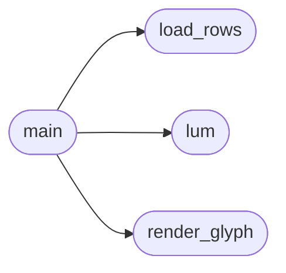

# `tools.pngprof`

> Source: [tools/pngprof.py:1](../../tools/pngprof.py#L1) | language `py` | coverage 20.0% | [API index](../index.md)

pngprof -- structural ink-profile dump for page screenshots.

Build-time tool for Freedom layout work (companion to tools/pngdiff.c). Where
pngdiff reduces two renders to one scalar score, pngprof prints WHERE the ink
sits: the horizontal column profile split into vertical bands, and the
cumulative vertical ink distribution. That is what turns a divergence like
"slashdot col_mae 0.39" into a statement like "the article column spans
x=120..600 in Firefox but x=0..950 in Freedom".

It answers the questions an agent cannot answer by looking at the PNG: with no
image input available (or when the numbers matter more than the picture), the
agent reads these profiles instead. Ink is defined against the image's modal
background luminance, exactly like pngdiff, so a dark author theme and a forced
light theme compare meaningfully.

Decoder: pure python (zlib + the five PNG filters), no third-party packages, so
it runs anywhere the repo runs. RGBA/RGB/grey/16-bit screenshots all normalise
to an 8-bit RGB row buffer. It reads only local files that the harness or the
operator just produced; it never sees remote content and is not part of the
browser's attack surface.

Usage:
  pngprof <image.png> [--bands N] [--cols C] [--rows R]

Output (stdout):
  - image width/height and the background luminance used
  - the column profile: C buckets, each printed as the ink fraction of that
    bucket's cells, repeated per vertical band
  - the cumulative vertical ink distribution over R bands (0..1)

No emojis, no network, deterministic.

## Contents

- **Functions:** [`load_rows`](#load_rows), [`lum`](#lum), [`render_glyph`](#render_glyph), [`main`](#main)

## Call Graph

Solid arrows stay in this module, dashed arrows leave it.



## Functions

<a id="load_rows"></a>

### `load_rows`

`function` | [tools/pngprof.py:41](../../tools/pngprof.py#L41)

```python
def load_rows(path)
```

**Parameters**

| Name | Type | Default | Description |
|---|---|---|---|
| `path` |  |  |  |

**Raises**

- `ValueError`: (raised in the body, not documented)

*Called by:* [`main`](#main)

---

<a id="lum"></a>

### `lum`

`function` | [tools/pngprof.py:95](../../tools/pngprof.py#L95)

```python
def lum(p)
```

**Parameters**

| Name | Type | Default | Description |
|---|---|---|---|
| `p` |  |  |  |

*Called by:* [`main`](#main)

---

<a id="render_glyph"></a>

### `render_glyph`

`function` | [tools/pngprof.py:99](../../tools/pngprof.py#L99)

```python
def render_glyph(v)
```

**Parameters**

| Name | Type | Default | Description |
|---|---|---|---|
| `v` |  |  |  |

*Called by:* [`main`](#main)

---

<a id="main"></a>

### `main`

`function` | [tools/pngprof.py:109](../../tools/pngprof.py#L109)

```python
def main(argv)
```

**Parameters**

| Name | Type | Default | Description |
|---|---|---|---|
| `argv` |  |  |  |

*Calls:* [`load_rows`](#load_rows), [`lum`](#lum), [`render_glyph`](#render_glyph)

---
