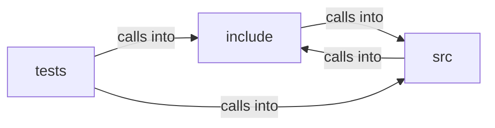

# include: browser

include: browser groups 19 files (c, h) around FREEDOM_HOSTBLOCK_H, hb_set, hb_list, hb_decision, hb_status. browser_free: Zero-initialise or reset a state.

## include (6.1)

include groups 7 files (h) around FREEDOM_HOSTBLOCK_H, hb_set, hb_list, hb_decision, hb_status. browser_free: Zero-initialise or reset a state.

## src (6.2)

src groups 6 files (c) around _POSIX_C_SOURCE, free_page, clear_status, free_history, free_exceptions. clear_status: #include <stdlib.h> #include <string.h> static void...

## tests (6.3)

tests groups 6 files (c) around _POSIX_C_SOURCE, test_init, test_navigate_history, test_navigate_from_middle_discards_future, test_back_forward_bounds. test_url_bar_selection: Omnibar selection model: extend builds a selection, ops...

**Files**:

- include/browser.h
- include/host_conf.h
- include/hostblock.h
- include/media_decoder.h
- include/os_sandbox.h
- include/renderer.h
- include/util.h
- src/browser.c
- src/host_conf.c
- src/hostblock.c
- src/media_decoder.c
- src/os_sandbox.c
- src/renderer.c
- tests/test_browser.c
- tests/test_host_conf.c
- tests/test_hostblock.c
- tests/test_media_decoder.c
- tests/test_os_sandbox.c
- tests/test_renderer.c
