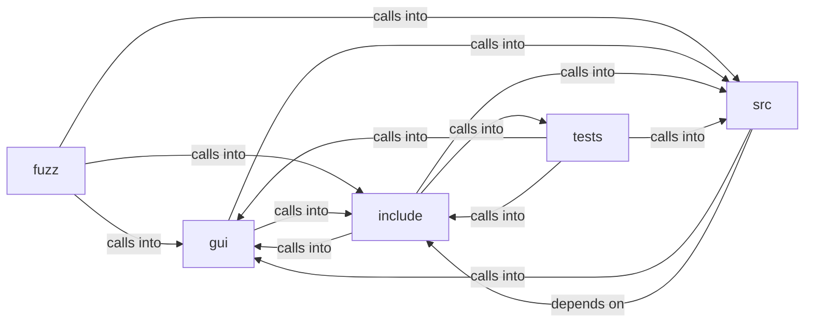

# include: browser_ui

include: browser_ui groups 69 files (c, h) around FREEDOM_SCROLL_REQ_H, SRQ_MAX_COORD, SRQ_WIRE_N, srq_kind, srq_behavior. libFuzzer harness for box_blur (spec/box_blur.md): a hostile mask, size, stride and sigma

## fuzz (2.1)

fuzz groups 11 files (c) around ref_line, LLVMFuzzerTestOneInput, _POSIX_C_SOURCE, SNAP_MAX, pos. libFuzzer harness for box_blur (spec/box_blur.md): a hostile mask, size, stride and sigma

## gui (2.2)

gui groups 1 files (c) around _GNU_SOURCE, UI_TOOLBAR_H, UI_MARGIN, UI_BTN_LEFT, UI_BTN_MIDDLE. ui_input_state: Live editable state for one form text control, aliasing a block of the...

## include (2.3)

include groups 20 files (h) around FREEDOM_SCROLL_REQ_H, SRQ_MAX_COORD, SRQ_WIRE_N, srq_kind, srq_behavior. block_flow (bf_) -- vertical margin collapsing for block-level boxes.

## src (2.4)

src groups 18 files (c) around finite_or_zero, bf_collapse_n, bf_collapse, bf_margins_adjoin, bb_box_sizes. block_flow (bf_) -- vertical margin collapsing.

## tests (2.5)

tests groups 19 files (c) around dbl_eq, test_two_positive_collapse_to_max, test_two_negative_take_the_most_negative, test_non_finite_is_absent, test_collapse_n_matches_binary. test_two_positive_collapse_to_max: Two positive margins collapse to the LARGER, never...

**Files**:

- fuzz/fuzz_box_blur.c
- fuzz/fuzz_browser.c
- fuzz/fuzz_doc_title.c
- fuzz/fuzz_exact_key.c
- fuzz/fuzz_find_text.c
- fuzz/fuzz_frame_broker.c
- fuzz/fuzz_group_index.c
- fuzz/fuzz_mask_cache.c
- fuzz/fuzz_nav_token.c
- fuzz/fuzz_scroll_req.c
- fuzz/fuzz_smooth_scroll.c
- gui/browser_ui.c
- include/block_flow.h
- include/box_blur.h
- include/browser.h
- include/doc_title.h
- include/exact_key.h
- include/find_text.h
- include/form.h
- include/frame_broker.h
- include/frame_clock.h
- include/frame_host.h
- include/group_index.h
- include/interp.h
- include/mask_cache.h
- include/nav_token.h
- include/scroll_req.h
- include/shm_slots.h
- include/smooth_scroll.h
- include/tab.h
- include/textfield.h
- include/wl_guard.h
- src/block_flow.c
- src/box_blur.c
- src/browser.c
- src/doc_title.c
- src/exact_key.c
- src/find_text.c
- src/form.c
- src/frame_broker.c
- src/frame_clock.c
- src/frame_host.c
- src/group_index.c
- src/interp.c
- src/mask_cache.c
- src/nav_token.c
- src/scroll_req.c
- src/smooth_scroll.c
- src/textfield.c
- src/wl_guard.c
- tests/test_block_flow.c
- tests/test_box_blur.c
- tests/test_browser.c
- tests/test_doc_title.c
- tests/test_exact_key.c
- tests/test_find_text.c
- tests/test_form.c
- tests/test_frame_broker.c
- tests/test_frame_clock.c
- tests/test_frame_host.c
- tests/test_group_index.c
- tests/test_interp.c
- tests/test_mask_cache.c
- tests/test_nav_token.c
- tests/test_scroll_req.c
- tests/test_shm_slots.c
- tests/test_smooth_scroll.c
- tests/test_textfield.c
- tests/test_wl_guard.c
