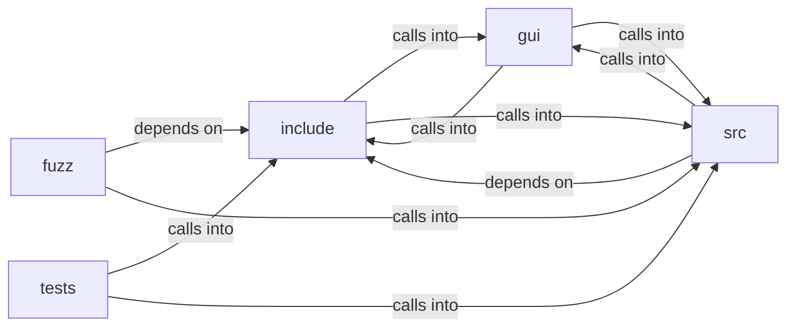

# include: browser_ui

include: browser_ui groups 38 files (c, h) around FREEDOM_IMAGE_DECODE_H, guards, img_format, img_status, img_pixels. poke_and_free: Touch every claimed pixel corner so the sanitizer flags an...

## fuzz (3.1)

fuzz groups 3 files (c) around LLVMFuzzerTestOneInput, poke_and_free, LLVMFuzzerTestOneInput, LLVMFuzzerTestOneInput. poke_and_free: Touch every claimed pixel corner so the sanitizer flags an...

## gui (3.2)

gui groups 1 files (c) around _GNU_SOURCE, UI_TOOLBAR_H, UI_TITLEBAR_H, UI_TABBAR_H, UI_TAB_MIN_W. ui_input_state: Live editable state for one form text control, aliasing a block of the...

## include (3.3)

include groups 11 files (h) around FREEDOM_IMAGE_DECODE_H, guards, img_format, img_status, img_pixels. block_flow (bf_) -- vertical margin collapsing for block-level boxes.

## src (3.4)

src groups 11 files (c) around finite_or_zero, bf_collapse_n, bf_collapse, bf_margins_adjoin, bb_box_sizes. block_flow (bf_) -- vertical margin collapsing.

## tests (3.5)

tests groups 12 files (c) around dbl_eq, test_two_positive_collapse_to_max, test_two_negative_take_the_most_negative, test_non_finite_is_absent, test_collapse_n_matches_binary. test_two_positive_collapse_to_max: Two positive margins collapse to the LARGER, never...

**Files**:

- fuzz/fuzz_download.c
- fuzz/fuzz_image_decode.c
- fuzz/fuzz_pdf_export.c
- gui/browser_ui.c
- include/block_flow.h
- include/box_blur.h
- include/browser.h
- include/download.h
- include/form.h
- include/frame_clock.h
- include/hostedit.h
- include/image_decode.h
- include/interp.h
- include/pdf_export.h
- include/textfield.h
- src/block_flow.c
- src/box_blur.c
- src/browser.c
- src/download.c
- src/form.c
- src/frame_clock.c
- src/hostedit.c
- src/image_decode.c
- src/interp.c
- src/pdf_export.c
- src/textfield.c
- tests/test_block_flow.c
- tests/test_box_blur.c
- tests/test_browser.c
- tests/test_download.c
- tests/test_form.c
- tests/test_frame_clock.c
- tests/test_freedom.c
- tests/test_hostedit.c
- tests/test_image_decode.c
- tests/test_interp.c
- tests/test_pdf_export.c
- tests/test_textfield.c
