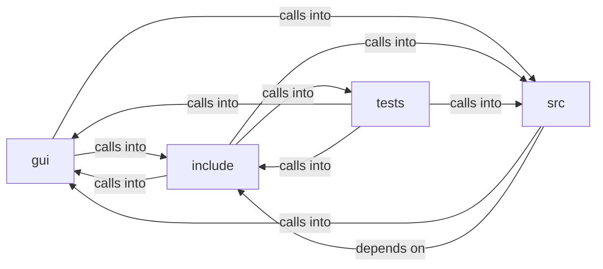

# include: browser_ui

include: browser_ui groups 62 files (c, h) around FREEDOM_PREFS_H, PREFS_VERSION, PREFS_MAX_URL, PREFS_MAX_TITLE, PREFS_MAX_BOOKMARKS. ui_input_state: Live editable state for one form text control, aliasing a block of the...

## gui (2.1)

gui groups 3 files (c) around _GNU_SOURCE, UI_TOOLBAR_H, UI_MARGIN, UI_BTN_LEFT, UI_LIST_INDENT. ui_input_state: Live editable state for one form text control, aliasing a block of the...

## include (2.2)

include groups 21 files (h) around FREEDOM_PREFS_H, PREFS_VERSION, PREFS_MAX_URL, PREFS_MAX_TITLE, PREFS_MAX_BOOKMARKS. block_flow (bf_) -- vertical margin collapsing for block-level boxes.

## src (2.3)

src groups 18 files (c) around finite_or_zero, bf_collapse_n, bf_collapse, bf_margins_adjoin, bb_box_sizes. block_flow (bf_) -- vertical margin collapsing.

## tests (2.4)

tests groups 20 files (c) around dbl_eq, test_two_positive_collapse_to_max, test_two_negative_take_the_most_negative, test_non_finite_is_absent, test_collapse_n_matches_binary. test_two_positive_collapse_to_max: Two positive margins collapse to the LARGER, never...

**Files**:

- gui/browser_ui.c
- gui/freedom_view.c
- gui/ui_render.c
- include/block_flow.h
- include/box_blur.h
- include/browser.h
- include/download.h
- include/exact_key.h
- include/find_text.h
- include/form.h
- include/frame_clock.h
- include/hostedit.h
- include/interp.h
- include/lazy_load.h
- include/mask_cache.h
- include/pdf_export.h
- include/prefs.h
- include/profile.h
- include/shm_slots.h
- include/table_layout.h
- include/textfield.h
- include/ui.h
- include/wl_guard.h
- include/zoom.h
- src/block_flow.c
- src/box_blur.c
- src/browser.c
- src/download.c
- src/exact_key.c
- src/find_text.c
- src/form.c
- src/frame_clock.c
- src/hostedit.c
- src/interp.c
- src/mask_cache.c
- src/pdf_export.c
- src/prefs.c
- src/table_layout.c
- src/textfield.c
- src/ui_layout.c
- src/wl_guard.c
- src/zoom.c
- tests/test_block_flow.c
- tests/test_box_blur.c
- tests/test_browser.c
- tests/test_download.c
- tests/test_exact_key.c
- tests/test_find_text.c
- tests/test_form.c
- tests/test_frame_clock.c
- tests/test_hostedit.c
- tests/test_interp.c
- tests/test_mask_cache.c
- tests/test_pdf_export.c
- tests/test_prefs.c
- tests/test_profile.c
- tests/test_shm_slots.c
- tests/test_table_layout.c
- tests/test_textfield.c
- tests/test_ui.c
- tests/test_wl_guard.c
- tests/test_zoom.c
