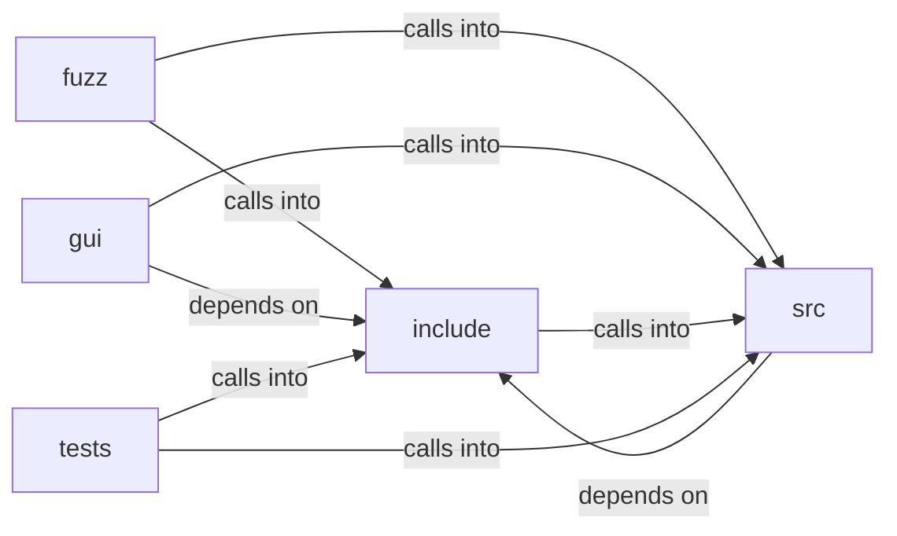

# include: bui_chrome

include: bui_chrome groups 20 files (c, h) around FREEDOM_VIDEO_CONTROLS_H, VCL_BAR_H, VCL_MIN_W, VCL_MIN_H, VCL_PAD. libFuzzer harness for chrome_layout (spec/chrome_layout.md): a hostile URL (a page

## fuzz (8.1)

fuzz groups 4 files (c) around take_double, check_rect, LLVMFuzzerTestOneInput, LLVMFuzzerTestOneInput, check_split. libFuzzer harness for chrome_layout (spec/chrome_layout.md): a hostile URL (a page

## gui (8.2)

gui groups 4 files (c, h) around FREEDOM_BROWSER_UI_INTERNAL_H, UI_FONT_SIZE, UI_TEXT_MARGIN, UI_HEADING_LEVELS, b. bui_chrome_view: ui_theme ui_theme_for(int mode);          /* maps a ui_theme_mode to...

## include (8.3)

include groups 4 files (h) around FREEDOM_VIDEO_CONTROLS_H, VCL_BAR_H, VCL_MIN_W, VCL_MIN_H, VCL_PAD. chl_tab_rect: Computes the layout. tab_count >= 1 and 0 <= active < tab_count, else...

## src (8.4)

src groups 4 files (c) around CHL_TAB_CLOSE_INSET, CHL_URL_GAP, CHL_ID_INSET, CHL_WIDTH_MAX, rect. chrome_layout -- browser chrome geometry + identity badge. spec/chrome_layout.md

## tests (8.5)

tests groups 4 files (c) around overlaps, cx, cy, test_rejects_bad_input, test_csd_single_tab. Suite for chrome_layout (spec/chrome_layout.md).

**Files**:

- fuzz/fuzz_chrome_layout.c
- fuzz/fuzz_link_preview.c
- fuzz/fuzz_url.c
- fuzz/fuzz_video_controls.c
- gui/browser_ui_internal.h
- gui/bui_chrome.c
- gui/bui_mask_img.c
- gui/bui_theme.c
- include/chrome_layout.h
- include/link_nav.h
- include/link_preview.h
- include/video_controls.h
- src/chrome_layout.c
- src/link_nav.c
- src/link_preview.c
- src/video_controls.c
- tests/test_chrome_layout.c
- tests/test_link_nav.c
- tests/test_link_preview.c
- tests/test_video_controls.c
