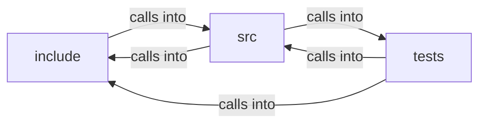

# include: css

include: css groups 35 files (c, h) around FREEDOM_CSS_COLOR_H, b, cc_rgb, cc_status, cc_pack. car_ops: The questions @supports asks the caller's own engine. prop is lowercased and...

## include (5.1)

include groups 13 files (h) around FREEDOM_CSS_COLOR_H, b, cc_rgb, cc_status, cc_pack. car_ops: The questions @supports asks the caller's own engine. prop is lowercased and...

## src (5.2)

src groups 13 files (c) around CSS_INIT_SELS, CSS_INIT_DECLS, emit, CSS_DECL_SLOTS_MIN, CSS_INIT_RULES. len_rebase_ctx: int r = snprintf(out + *o, space, "%.4f", px); if (r < 0 || (size_t)r...

## tests (5.3)

tests groups 9 files (c) around test_inline_text_align, test_inline_font_size, test_inline_font_size_absolute_flag, test_inline_line_height, test_inline_font_weight_style. test_inline_font_size_absolute_flag: 2026-07-31: a font-size carries whether its...

**Files**:

- include/css_atrule.h
- include/css_box.h
- include/css_color.h
- include/css_decl.h
- include/css_gradient.h
- include/css_index.h
- include/css_length.h
- include/css_mask.h
- include/css_mq.h
- include/css_select.h
- include/css_text.h
- include/css_values.h
- include/css_vars.h
- src/css.c
- src/css_atrule.c
- src/css_box.c
- src/css_chain.c
- src/css_color.c
- src/css_gradient.c
- src/css_index.c
- src/css_mask.c
- src/css_mq.c
- src/css_select.c
- src/css_text.c
- src/css_values.c
- src/css_vars.c
- tests/test_css.c
- tests/test_css_atrule.c
- tests/test_css_box.c
- tests/test_css_color.c
- tests/test_css_index.c
- tests/test_css_mask.c
- tests/test_css_mq.c
- tests/test_css_text.c
- tests/test_css_vars.c
