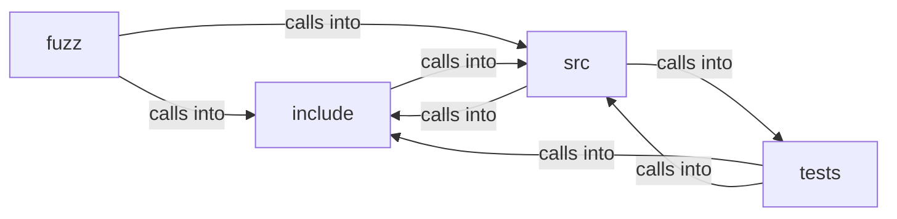

# include: css

include: css groups 44 files (c, h) around FREEDOM_CSS_COLOR_H, b, cc_rgb, cc_status, cc_pack. fuzz_root_match: Root matcher for the attribute-scoped custom-property path: a fixed...

## fuzz (3.1)

fuzz groups 1 files (c) around fuzz_root_match, LLVMFuzzerTestOneInput. fuzz_root_match: Root matcher for the attribute-scoped custom-property path: a fixed...

## include (3.2)

include groups 15 files (h) around FREEDOM_CSS_COLOR_H, b, cc_rgb, cc_status, cc_pack. cx_style: A box's resolved style, in the SAME value-spaces as css.h: position uses...

## src (3.3)

src groups 15 files (c) around BT_LEN_AUTO, layout_block, bt_nn, BT_WRAP_EPS, wrap_reverse. layout_block: Block container: stack non-none children vertically, collapsing each...

## tests (3.4)

tests groups 13 files (c) around test_sc_opacity, test_sc_mix_blend, test_sc_isolation, test_sc_transform, test_sc_positioned_z. test_sort_matches_zindex_only_ordering: The positioned subset the painter already...

**Files**:

- fuzz/fuzz_css.c
- include/compositor.h
- include/css.h
- include/css_atrule.h
- include/css_box.h
- include/css_chain.h
- include/css_color.h
- include/css_decl.h
- include/css_gradient.h
- include/css_index.h
- include/css_length.h
- include/css_mq.h
- include/css_select.h
- include/css_text.h
- include/css_values.h
- include/css_vars.h
- src/box_tree.c
- src/compositor.c
- src/css.c
- src/css_atrule.c
- src/css_box.c
- src/css_chain.c
- src/css_color.c
- src/css_gradient.c
- src/css_index.c
- src/css_length.c
- src/css_mq.c
- src/css_select.c
- src/css_text.c
- src/css_values.c
- src/css_vars.c
- tests/test_compositor.c
- tests/test_css.c
- tests/test_css_atrule.c
- tests/test_css_box.c
- tests/test_css_color.c
- tests/test_css_drops.c
- tests/test_css_gradient.c
- tests/test_css_index.c
- tests/test_css_length.c
- tests/test_css_mq.c
- tests/test_css_text.c
- tests/test_css_values.c
- tests/test_css_vars.c
