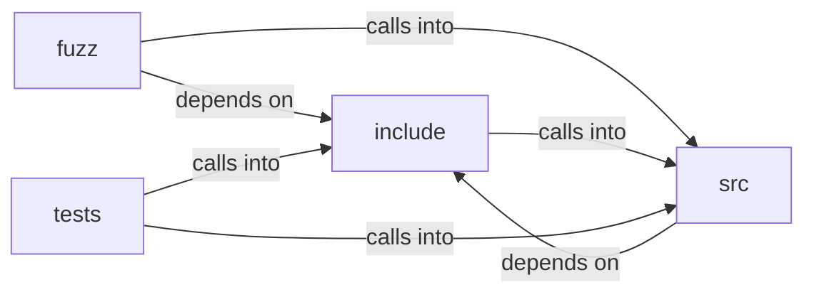

# include: download

include: download groups 8 files (c, h) around FREEDOM_PDF_EXPORT_H, PE_NAME_MAX, PE_EXT, PE_EXT_PNG, PE_FALLBACK_NAME. dl_should_download: 1 if the response should be saved (attachment, or a non-renderable...

## fuzz (9.1)

fuzz groups 2 files (c) around LLVMFuzzerTestOneInput, LLVMFuzzerTestOneInput.

## include (9.2)

include groups 2 files (h) around FREEDOM_PDF_EXPORT_H, PE_NAME_MAX, PE_EXT, PE_EXT_PNG, PE_FALLBACK_NAME. dl_should_download: 1 if the response should be saved (attachment, or a non-renderable...

## src (9.3)

src groups 2 files (c) around lc, ci_find, media_type, dl_should_download, dl_ext_for_type. lc: download — pure helpers for "save this resource to disk".

## tests (9.4)

tests groups 2 files (c) around builder, test_should_renderable_types, test_should_binary_types, test_ext_known_types, test_ext_unknown_type.

**Files**:

- fuzz/fuzz_download.c
- fuzz/fuzz_pdf_export.c
- include/download.h
- include/pdf_export.h
- src/download.c
- src/pdf_export.c
- tests/test_download.c
- tests/test_pdf_export.c
