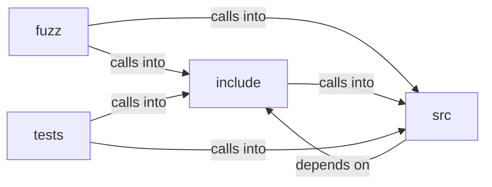

# include: fb_cmdline

include: fb_cmdline groups 11 files (c, h) around FREEDOM_FREEBUG_H, fb_level, fb_entry, level, fb_buffer. LLVMFuzzerTestOneInput: include <stdint.h> include <stdlib.h> include <string.h>...

## fuzz (10.1)

fuzz groups 2 files (c) around LLVMFuzzerTestOneInput, LLVMFuzzerTestOneInput. LLVMFuzzerTestOneInput: include <stdint.h> include <stdlib.h> include <string.h>...

## include (10.2)

include groups 3 files (h) around FREEDOM_FREEBUG_H, fb_level, fb_entry, level, fb_buffer. fbc_history_push: #define FBC_BASE_MAX   256    /* bytes of a completion base path...

## src (10.3)

src groups 3 files (c) around dup_n, fbc_history_init, fbc_history_free, fbc_history_push, fbc_history_prev.

## tests (10.4)

tests groups 3 files (c) around test_history_walks_and_restores_the_draft, test_history_is_bounded_and_push_returns_to_live, test_complete_split, test_names_expr_quotes_the_base, test_pick_common_prefix_and_list. test_net_pane_shows_timing_and_headers: assert_int_equal(fbp_expr(FBP_CONSOLE, "", 0...

**Files**:

- fuzz/fuzz_fb_cmdline.c
- fuzz/fuzz_freebug.c
- include/fb_cmdline.h
- include/fb_panes.h
- include/freebug.h
- src/fb_cmdline.c
- src/fb_panes.c
- src/freebug.c
- tests/test_fb_cmdline.c
- tests/test_fb_panes.c
- tests/test_freebug.c
