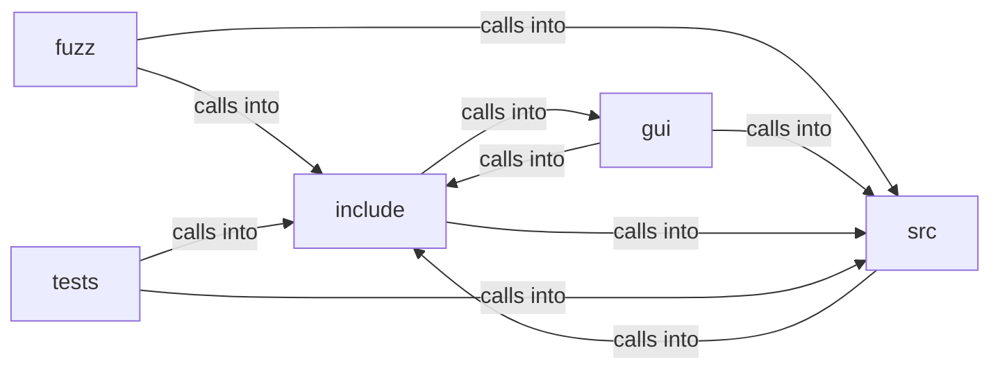

# include: http_cache

include: http_cache groups 28 files (c, h) around FREEDOM_LOCAL_STORE_H, LS_KEY_LEN, LS_SALT_LEN, LS_NONCE_LEN, LS_TAG_LEN. sanitize_utf8_inplace: Rewrites s in place to well-formed UTF-8, replacing any byte...

## fuzz (6.1)

fuzz groups 1 files (c) around LLVMFuzzerTestOneInput.

## gui (6.2)

gui groups 2 files (c) around _POSIX_C_SOURCE, main, _GNU_SOURCE, UI_FONT_SIZE, UI_MARGIN. sanitize_utf8_inplace: Rewrites s in place to well-formed UTF-8, replacing any byte...

## include (6.3)

include groups 9 files (h) around FREEDOM_LOCAL_STORE_H, LS_KEY_LEN, LS_SALT_LEN, LS_NONCE_LEN, LS_TAG_LEN. ds_free: Reads and decrypts path.

## src (6.4)

src groups 8 files (c) around _POSIX_C_SOURCE, fsync_dir, map_ls, ds_write, ds_read. fsync_dir: Best-effort fsync of the directory holding path, for crash durability of...

## tests (6.5)

tests groups 8 files (c) around _POSIX_C_SOURCE, dir, fixture, setup, teardown.

**Files**:

- fuzz/fuzz_prefs.c
- gui/freedom_view.c
- gui/ui_render.c
- include/disk_store.h
- include/http_cache.h
- include/lazy_load.h
- include/local_store.h
- include/pq_seal.h
- include/prefs.h
- include/profile.h
- include/ui.h
- include/zoom.h
- src/disk_store.c
- src/http_cache.c
- src/local_store.c
- src/pq_seal.c
- src/prefs.c
- src/profile.c
- src/ui_layout.c
- src/zoom.c
- tests/test_disk_store.c
- tests/test_http_cache.c
- tests/test_local_store.c
- tests/test_pq_seal.c
- tests/test_prefs.c
- tests/test_profile.c
- tests/test_ui.c
- tests/test_zoom.c
