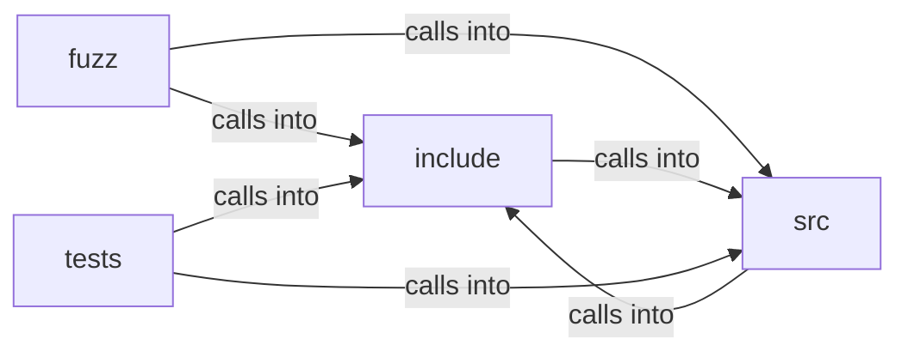

# include: local_store

include: local_store groups 16 files (c, h) around FREEDOM_LOCAL_STORE_H, LS_KEY_LEN, LS_SALT_LEN, LS_NONCE_LEN, LS_TAG_LEN. ds_free: Reads and decrypts path.

## fuzz (7.1)

fuzz groups 1 files (c) around LLVMFuzzerTestOneInput.

## include (7.2)

include groups 5 files (h) around FREEDOM_LOCAL_STORE_H, LS_KEY_LEN, LS_SALT_LEN, LS_NONCE_LEN, LS_TAG_LEN. ds_free: Reads and decrypts path.

## src (7.3)

src groups 5 files (c) around _POSIX_C_SOURCE, fsync_dir, map_ls, ds_write, ds_read. fsync_dir: Best-effort fsync of the directory holding path, for crash durability of...

## tests (7.4)

tests groups 5 files (c) around _POSIX_C_SOURCE, dir, fixture, setup, teardown.

**Files**:

- fuzz/fuzz_prefs.c
- include/disk_store.h
- include/local_store.h
- include/prefs.h
- include/profile.h
- include/zoom.h
- src/disk_store.c
- src/local_store.c
- src/prefs.c
- src/profile.c
- src/zoom.c
- tests/test_disk_store.c
- tests/test_local_store.c
- tests/test_prefs.c
- tests/test_profile.c
- tests/test_zoom.c
