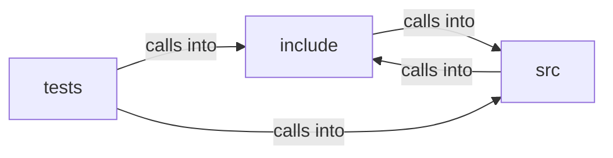

# include: local_store

include: local_store groups 20 files (c, h) around FREEDOM_LOCAL_STORE_H, LS_KEY_LEN, LS_SALT_LEN, LS_NONCE_LEN, LS_TAG_LEN. browser_free: Zero-initialise or reset a state.

## include (5.1)

include groups 7 files (h) around FREEDOM_LOCAL_STORE_H, LS_KEY_LEN, LS_SALT_LEN, LS_NONCE_LEN, LS_TAG_LEN. browser_free: Zero-initialise or reset a state.

## src (5.2)

src groups 7 files (c) around _POSIX_C_SOURCE, free_page, clear_status, free_history, free_exceptions. clear_status: #include <stdlib.h> #include <string.h> static void...

## tests (5.3)

tests groups 6 files (c) around _POSIX_C_SOURCE, test_init, test_navigate_history, test_navigate_from_middle_discards_future, test_back_forward_bounds. test_url_bar_selection: Omnibar selection model: extend builds a selection, ops...

**Files**:

- include/browser.h
- include/disk_store.h
- include/local_store.h
- include/media_decoder.h
- include/os_sandbox.h
- include/renderer.h
- include/util.h
- src/browser.c
- src/disk_store.c
- src/local_store.c
- src/media_decoder.c
- src/os_sandbox.c
- src/profile.c
- src/renderer.c
- tests/test_browser.c
- tests/test_disk_store.c
- tests/test_local_store.c
- tests/test_media_decoder.c
- tests/test_os_sandbox.c
- tests/test_renderer.c
