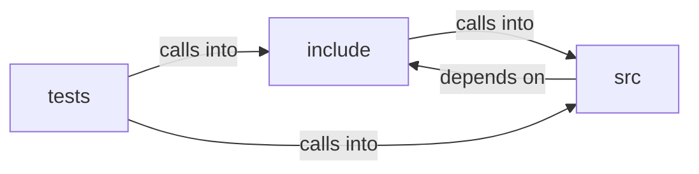

# include: os_sandbox

include: os_sandbox groups 6 files (c, h) around FREEDOM_OS_SANDBOX_H, os_status, os_violation, flags, os_policy_size. os_violation: function (os_policy_allows) that mirrors the installed BPF program.

## include (11.1)

include groups 2 files (h) around FREEDOM_OS_SANDBOX_H, os_status, os_violation, flags, os_policy_size. os_violation: function (os_policy_allows) that mirrors the installed BPF program.

## src (11.2)

src groups 2 files (c) around _GNU_SOURCE, OS_ALLOWED_N, os_policy_allows, os_policy_size, os_prot_allowed. os_prot_allowed: W^X mirror: mmap/mprotect keep their membership but lose any request...

## tests (11.3)

tests groups 2 files (c) around _GNU_SOURCE, test_policy_allows_safe, test_policy_denies_dangerous, test_policy_denies_io_uring, test_policy_size. test_policy_denies_io_uring: io_uring is a seccomp-bypass primitive (its IORING_OP_*...

**Files**:

- include/os_sandbox.h
- include/renderer.h
- src/os_sandbox.c
- src/renderer.c
- tests/test_os_sandbox.c
- tests/test_renderer.c
