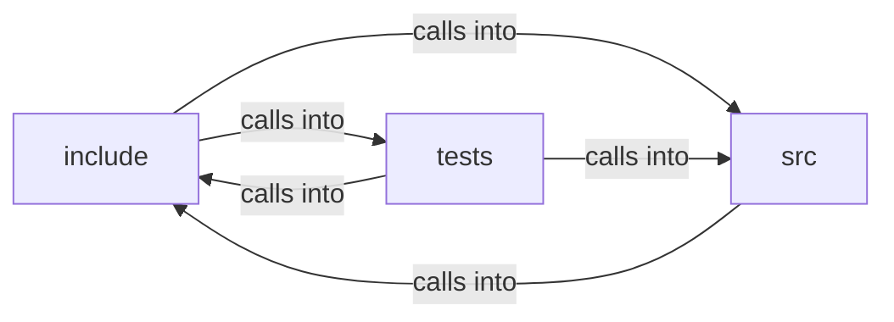

# include: page_view

include: page_view groups 36 files (c, h) around FREEDOM_CSS_H, css_status, css_align, css_display, css_justify. bx_edges: anything longer fails closed instead of truncating into a wrong match....

## include (4.1)

include groups 12 files (h) around FREEDOM_CSS_H, css_status, css_align, css_display, css_justify. bx_edges: anything longer fails closed instead of truncating into a wrong match....

## src (4.2)

src groups 10 files (c) around BX_TAG_MAX, BX_DISPLAY_MAX, is_ws, copy_lower_trim, name_cmp. tag_row: One row of the user-agent sheet.

## tests (4.3)

tests groups 14 files (c) around dbl_eq, assert_edges, test_body_has_no_margin, test_paragraph, test_heading_ladder. dbl_eq: #include <setjmp.h> #include <stdarg.h> #include <stddef.h> #include...

**Files**:

- include/box_style.h
- include/box_tree.h
- include/compositor.h
- include/css.h
- include/css_chain.h
- include/css_computed.h
- include/dom_debug.h
- include/flex_layout.h
- include/page_view.h
- include/render_doc.h
- include/render_policy.h
- include/text_case.h
- src/box_style.c
- src/box_tree.c
- src/compositor.c
- src/css_computed.c
- src/css_length.c
- src/dom_debug.c
- src/flex_layout.c
- src/page_view.c
- src/render_doc.c
- src/text_case.c
- tests/test_box_style.c
- tests/test_box_tree.c
- tests/test_compositor.c
- tests/test_css_computed.c
- tests/test_css_drops.c
- tests/test_css_gradient.c
- tests/test_css_length.c
- tests/test_css_values.c
- tests/test_dom_debug.c
- tests/test_flex_layout.c
- tests/test_page_view.c
- tests/test_render_doc.c
- tests/test_render_policy.c
- tests/test_text_case.c
