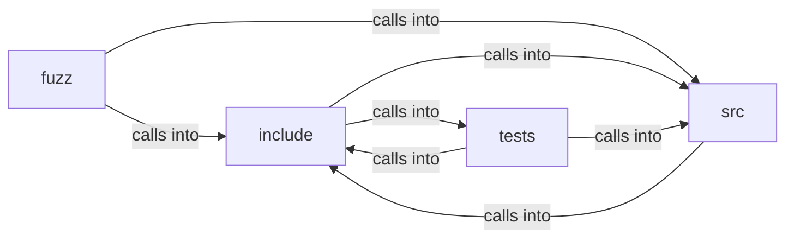

# include: page_view

include: page_view groups 31 files (c, h) around FREEDOM_RENDER_POLICY_H, RDP_TRACKER_MAX_DIM, images, rdp_caps, rdp_img_decision. bx_edges: anything longer fails closed instead of truncating into a wrong match....

## fuzz (4.1)

fuzz groups 1 files (c) around pass.

## include (4.2)

include groups 10 files (h) around FREEDOM_RENDER_POLICY_H, RDP_TRACKER_MAX_DIM, images, rdp_caps, rdp_img_decision. bx_edges: anything longer fails closed instead of truncating into a wrong match....

## src (4.3)

src groups 10 files (c) around BX_TAG_MAX, BX_DISPLAY_MAX, is_ws, copy_lower_trim, name_cmp. tag_row: One row of the user-agent sheet.

## tests (4.4)

tests groups 10 files (c) around dbl_eq, assert_edges, test_body_has_no_margin, test_paragraph, test_heading_ladder. dbl_eq: the display-name helper.  #include <setjmp.h> #include <stdarg.h> #include...

**Files**:

- fuzz/fuzz_dom_debug.c
- include/box_style.h
- include/box_tree.h
- include/dom_debug.h
- include/flex_layout.h
- include/js_policy.h
- include/page_view.h
- include/perf_trace.h
- include/render_doc.h
- include/render_policy.h
- include/webcaps.h
- src/box_style.c
- src/box_tree.c
- src/dom_debug.c
- src/flex_layout.c
- src/freedom.c
- src/js_policy.c
- src/page_view.c
- src/perf_trace.c
- src/render_doc.c
- src/webcaps.c
- tests/test_box_style.c
- tests/test_box_tree.c
- tests/test_dom_debug.c
- tests/test_flex_layout.c
- tests/test_js_policy.c
- tests/test_page_view.c
- tests/test_perf_trace.c
- tests/test_render_doc.c
- tests/test_render_policy.c
- tests/test_webcaps.c
