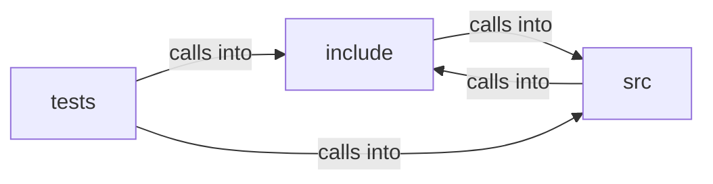

# include: prefetch

include: prefetch groups 6 files (c, h) around FREEDOM_IMPORT_MAP_H, algorithm, IM_MAX_TEXT, IM_MAX_ENTRIES, IM_MAX_SCOPES. im_resolve: Resolves specifier as imported from base (the importing module's URL).

## include (8.1)

include groups 2 files (h) around FREEDOM_IMPORT_MAP_H, algorithm, IM_MAX_TEXT, IM_MAX_ENTRIES, IM_MAX_SCOPES. im_resolve: Resolves specifier as imported from base (the importing module's URL).

## src (8.2)

src groups 2 files (c) around IM_MAX_DEPTH, IM_URL_MAX, scope, im_entry, im_map. str: A JSON string into an owned UTF-8 buffer (escapes decoded; a lone surrogate or a...

## tests (8.3)

tests groups 2 files (c) around tres, DOC, expect_res, test_exact_and_prefix_imports, test_scopes_win_by_longest_prefix. tres: Test URL resolver: absolute https passes, "/x" is origin-relative, "./x" and...

**Files**:

- include/import_map.h
- include/prefetch.h
- src/import_map.c
- src/prefetch.c
- tests/test_import_map.c
- tests/test_prefetch.c
