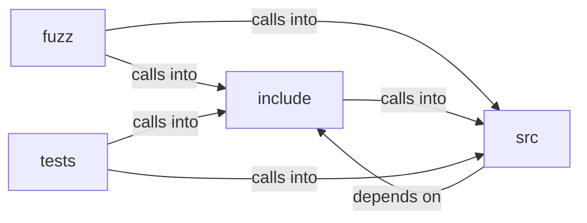

# include: pres_hints

include: pres_hints groups 7 files (c, h) around FREEDOM_TABLE_LAYOUT_H, TL_MAX_COLS, TL_WIDTH_MAX, TL_PER_MILLE, col. libFuzzer harness for table_layout and pres_hints (spec/table_layout.md...

## fuzz (13.1)

fuzz groups 1 files (c) around attr_src, attr_get, LLVMFuzzerTestOneInput. libFuzzer harness for table_layout and pres_hints (spec/table_layout.md...

## include (13.2)

include groups 2 files (h) around FREEDOM_TABLE_LAYOUT_H, TL_MAX_COLS, TL_WIDTH_MAX, TL_PER_MILLE, col. pres_hints (ph_) -- HTML presentational attributes as zero-specificity style.

## src (13.3)

src groups 2 files (c) around PH_PER_MILLE_MAX, ph_is_space, ph_parse_dimension, ph_ci_eq, ph_align. pres_hints (ph_) -- see include/pres_hints.h and spec/pres_hints.md.

## tests (13.4)

tests groups 2 files (c) around kv, get, fresh, test_dimension, test_table_width_and_centering. test_pres_hints -- HTML presentational attributes (spec/pres_hints.md).

**Files**:

- fuzz/fuzz_table_layout.c
- include/pres_hints.h
- include/table_layout.h
- src/pres_hints.c
- src/table_layout.c
- tests/test_pres_hints.c
- tests/test_table_layout.c
