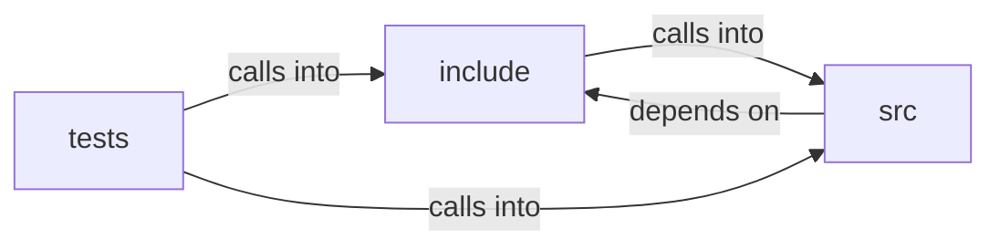

# include: secure_fetch

include: secure_fetch groups 10 files (c, h) around FREEDOM_ANTI_FP_H, FP_TIMER_RESOLUTION_MS, FP_USER_AGENT, FP_ACCEPT_LANGUAGE, FP_ACCEPT_LANGUAGE_HEADER. fp_accept_language_header: #define FP_SEC_FETCH_DEST_NAV  "document" #define...

## include (9.1)

include groups 3 files (h) around FREEDOM_ANTI_FP_H, FP_TIMER_RESOLUTION_MS, FP_USER_AGENT, FP_ACCEPT_LANGUAGE, FP_ACCEPT_LANGUAGE_HEADER. fp_accept_language_header: #define FP_SEC_FETCH_DEST_NAV  "document" #define...

## src (9.2)

src groups 3 files (c) around fp_coarsen_time_ms, fp_user_agent, fp_accept_language, fp_accept_language_header, fp_timezone. tls_capture: Snapshot of the negotiated TLS state. curl exposes the live SSL* only...

## tests (9.3)

tests groups 4 files (c) around CHECK, main, test_coarsen_time, test_identity_is_fixed, test_legacy_identity_fixed. test_origin_key_unlinks_readback: The property that actually matters: the same canvas...

**Files**:

- include/anti_fp.h
- include/secure_fetch.h
- include/ws_hub.h
- src/anti_fp.c
- src/secure_fetch.c
- src/ws_hub.c
- tests/itest_secure_fetch.c
- tests/test_anti_fp.c
- tests/test_secure_fetch.c
- tests/test_ws_hub.c
