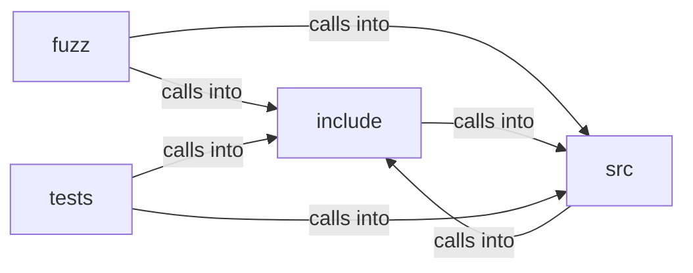

# include: secure_fetch

include: secure_fetch groups 24 files (c, h) around FREEDOM_ANTI_FP_H, FP_TIMER_RESOLUTION_MS, FP_USER_AGENT, FP_ACCEPT_LANGUAGE, FP_ACCEPT_LANGUAGE_HEADER. libFuzzer harness for identity (spec/identity.md) and he_cdn_kind (spec/hostedit.md):

## fuzz (7.1)

fuzz groups 2 files (c) around LLVMFuzzerTestOneInput, private, LLVMFuzzerTestOneInput. libFuzzer harness for identity (spec/identity.md) and he_cdn_kind (spec/hostedit.md):

## include (7.2)

include groups 7 files (h) around FREEDOM_ANTI_FP_H, FP_TIMER_RESOLUTION_MS, FP_USER_AGENT, FP_ACCEPT_LANGUAGE, FP_ACCEPT_LANGUAGE_HEADER. fp_accept_language_header: #define FP_SEC_FETCH_DEST_NAV  "document" #define...

## src (7.3)

src groups 7 files (c) around fp_coarsen_time_ms, fp_user_agent, fp_accept_language, fp_accept_language_header, fp_timezone. trace: fetcher, and so the same policy, as an uncached request.  #define...

## tests (7.4)

tests groups 8 files (c) around always_cancel, CHECK, main, test_coarsen_time, test_identity_is_fixed. test_origin_key_unlinks_readback: The property that actually matters: the same canvas...

**Files**:

- fuzz/fuzz_identity.c
- fuzz/fuzz_net_guard.c
- include/anti_fp.h
- include/cached_fetch.h
- include/hostedit.h
- include/identity.h
- include/net_guard.h
- include/secure_fetch.h
- include/ws_hub.h
- src/anti_fp.c
- src/cached_fetch.c
- src/hostedit.c
- src/identity.c
- src/net_guard.c
- src/secure_fetch.c
- src/ws_hub.c
- tests/itest_secure_fetch.c
- tests/test_anti_fp.c
- tests/test_cached_fetch.c
- tests/test_hostedit.c
- tests/test_identity.c
- tests/test_net_guard.c
- tests/test_secure_fetch.c
- tests/test_ws_hub.c
