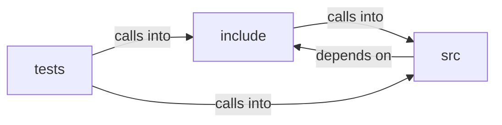

# include: svg_render

include: svg_render groups 12 files (c, h) around FREEDOM_IMAGE_DECODE_H, guards, img_format, img_status, img_pixels. img_pixels: A decoded bitmap that owns its pixel buffer.

## include (9.1)

include groups 4 files (h) around FREEDOM_IMAGE_DECODE_H, guards, img_format, img_status, img_pixels. img_pixels: A decoded bitmap that owns its pixel buffer.

## src (9.2)

src groups 4 files (c) around exit, PNG_IHDR_MIN, read_be32, img_png_dimensions, img_dimensions_ok. jpeg_err_ctx: libjpeg error manager that longjmps instead of calling exit(), so a...

## tests (9.3)

tests groups 4 files (c) around _DEFAULT_SOURCE, _POSIX_C_SOURCE, FREEDOM_BIN, OUT_FILE, ERR_FILE. run_freedom_raw: Runs the binary with a raw argument string (no implicit --headless)...

**Files**:

- include/image_decode.h
- include/svg_paint.h
- include/svg_raster.h
- include/svg_render.h
- src/image_decode.c
- src/svg_paint.c
- src/svg_raster.c
- src/svg_render.c
- tests/test_freedom.c
- tests/test_image_decode.c
- tests/test_svg_raster.c
- tests/test_svg_render.c
