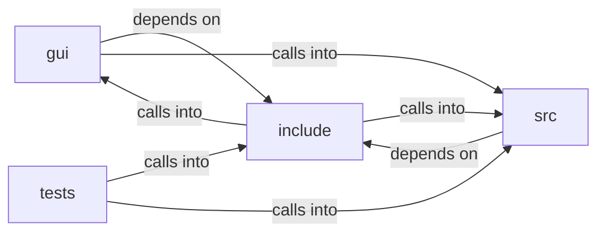

# include: svg_render

include: svg_render groups 14 files (c, h) around FREEDOM_SVG_RENDER_H, sv_status, SV_MAX_SHAPES, SV_MAX_POINTS, SV_MAX_SEGS. ui_theme_mode: ui_rgb button_text; ui_rgb menu_bg; ui_rgb menu_border; ui_rgb...

## gui (8.1)

gui groups 5 files (c, h) around FREEDOM_BROWSER_UI_INTERNAL_H, UI_FONT_SIZE, UI_TEXT_MARGIN, UI_HEADING_LEVELS, b. ui_theme_mode: ui_rgb button_text; ui_rgb menu_bg; ui_rgb menu_border; ui_rgb...

## include (8.2)

include groups 5 files (h) around FREEDOM_SVG_RENDER_H, sv_status, SV_MAX_SHAPES, SV_MAX_POINTS, SV_MAX_SEGS. svp_draw: Paints `img` into the rect [x, y, w, h] of `cr`, scaled uniformly and...

## src (8.3)

src groups 2 files (c) around sv_is_space, sv_is_digit, sv_lower, sv_span_eq, sv_sep. svg_render — inline <svg> markup -> a bounded list of geometric shapes.

## tests (8.4)

tests groups 2 files (c) around parse, test_null_args, test_empty_and_garbage_do_not_parse, test_dimensions_and_viewbox, test_basic_shapes. tests/test_svg_render.c — CMocka suite for the pure inline-SVG parser (sv_).

**Files**:

- gui/browser_ui_internal.h
- gui/bui_theme.c
- gui/freedom_view.c
- gui/svg_paint.c
- gui/ui_render.c
- include/freedom_config.h
- include/lazy_load.h
- include/svg_paint.h
- include/svg_render.h
- include/ui.h
- src/svg_render.c
- src/ui_layout.c
- tests/test_svg_render.c
- tests/test_ui.c
