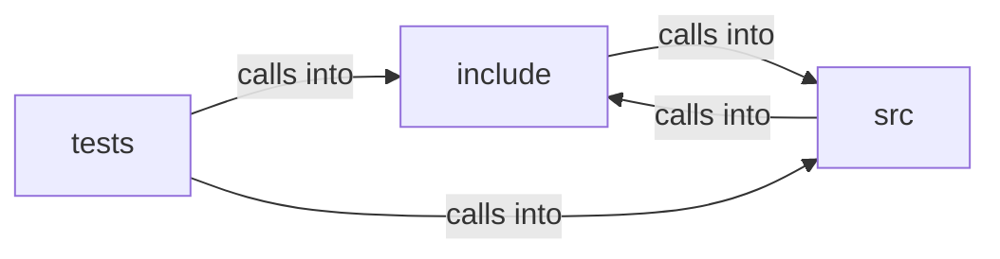

# include: tab

include: tab groups 7 files (c, h) around FREEDOM_FRAME_BROKER_H, FBK_MAX_FRAMES, FBK_MAX_DEPTH, FBK_MAX_MSG, FBK_ORIGIN_MAX. fbk_origin_of: Serialized origin ("https://host[:port]", lowercase) or "null" for...

## include (9.1)

include groups 3 files (h) around FREEDOM_FRAME_BROKER_H, FBK_MAX_FRAMES, FBK_MAX_DEPTH, FBK_MAX_MSG, FBK_ORIGIN_MAX. fbk_origin_of: Serialized origin ("https://host[:port]", lowercase) or "null" for...

## src (9.2)

src groups 2 files (c) around lc, host_char_ok, fbk_origin_of, fbk_init, live. target_admits: int changed = 1;                                  /* fixpoint: slots...

## tests (9.3)

tests groups 2 files (c) around test_origin_of, build, test_parent_top_child_routes, test_siblings_not_addressable, test_target_origin. test_frame_broker -- CMocka suite for the pure iframe tree + postMessage router.

**Files**:

- include/frame_broker.h
- include/frame_host.h
- include/tab.h
- src/frame_broker.c
- src/frame_host.c
- tests/test_frame_broker.c
- tests/test_frame_host.c
