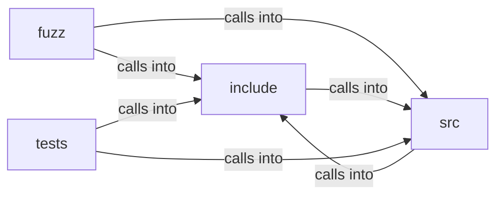

# include: text_shape

include: text_shape groups 20 files (c, h) around FREEDOM_DATA_URL_H, allocation, du_status, DU_MAX_ENCODED_LEN, du_is_data_url. libFuzzer harness for the webfont lookahead scanner (spec/webfont.md).

## fuzz (6.1)

fuzz groups 3 files (c) around worker, FZ_CAP, LLVMFuzzerTestOneInput, glyph, ASCII. libFuzzer harness for the webfont lookahead scanner (spec/webfont.md).

## include (6.2)

include groups 6 files (h) around FREEDOM_DATA_URL_H, allocation, du_status, DU_MAX_ENCODED_LEN, du_is_data_url. du_is_data_url: 16 MiB of encoded text (~12 MiB decoded) -- generous for any real...

## src (6.3)

src groups 6 files (c) around lower, ci_starts_with, du_is_data_url, du_base64_payload, b64_val. b64_val: 0-63 for a base64 alphabet character, -1 otherwise.

## tests (6.4)

tests groups 5 files (c) around test_is_data_url_true, test_is_data_url_false, test_payload_basic, test_payload_no_mediatype, test_payload_empty. test_site_of_psl: } static void test_site_of_multi_suffix(void **state) { (void)state...

**Files**:

- fuzz/fuzz_data_url.c
- fuzz/fuzz_text_shape.c
- fuzz/fuzz_webfont.c
- include/data_url.h
- include/psl_data.h
- include/request_policy.h
- include/text_shape.h
- include/webfont.h
- include/webfont_load.h
- src/data_url.c
- src/render_policy.c
- src/request_policy.c
- src/text_shape.c
- src/webfont.c
- src/webfont_load.c
- tests/test_data_url.c
- tests/test_request_policy.c
- tests/test_text_shape.c
- tests/test_webfont.c
- tests/test_webfont_load.c
