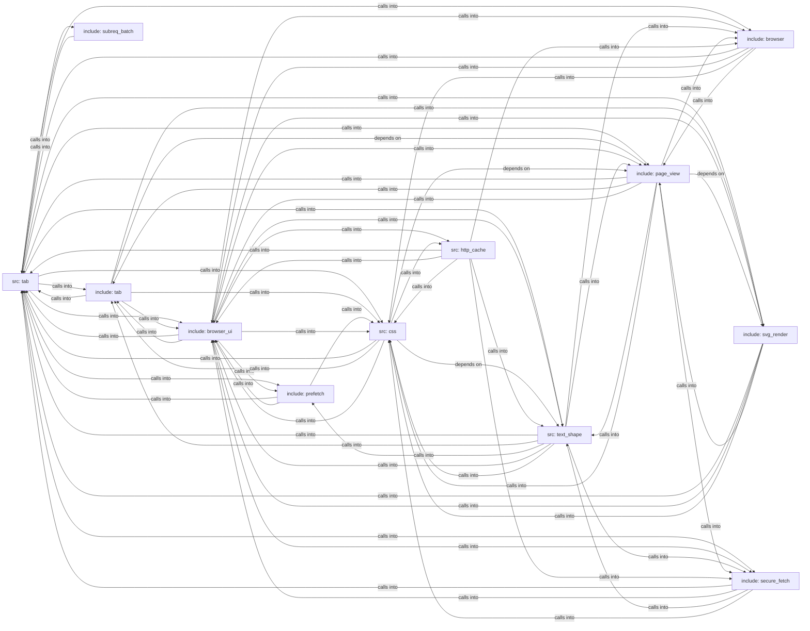

## Details

Static architecture map of 312 files (c, h, py, sh) in 12 components: src: tab, include: browser_ui, src: text_shape, src: css, include: page_view, include: browser, include: svg_render, src: http_cache. Structure is extracted statically without LLM calls; component prose may be enriched locally.

### src: tab (1)

src: tab groups 51 files (c, h) around FREEDOM_HTML_PARSE_H, hp_status, max_bytes, hp_config, hp_document. dom_place: Where dom_move_children places the moved nodes (insertAdjacent* needs all...

**Related Classes/Methods**:

- <a href="../include/html_parse.h#L2-L21">include/html_parse.h::FREEDOM_HTML_PARSE_H</a>
- <a href="../include/html_parse.h#L22-L30">include/html_parse.h::hp_status</a>
- <a href="../include/html_parse.h">include/html_parse.h::max_bytes</a>
- <a href="../include/html_parse.h#L32-L38">include/html_parse.h::hp_config</a>
- <a href="../include/html_parse.h#L39-L40">include/html_parse.h::hp_document</a>
- <a href="../include/html_parse.h#L41-L46">include/html_parse.h::HP_DEFAULT_MAX_BYTES</a>
- <a href="../include/html_parse.h">include/html_parse.h::dropped</a>
- <a href="../include/html_parse.h#L48-L56">include/html_parse.h::HP_MAX_SCRIPTS</a>

### include: browser_ui (2)

include: browser_ui groups 46 files (c, h) around FREEDOM_PREFS_H, PREFS_VERSION, PREFS_MAX_URL, PREFS_MAX_TITLE, PREFS_MAX_BOOKMARKS. ui_input_state: Live editable state for one form text control, aliasing a block of the...

**Related Classes/Methods**:

- <a href="../include/prefs.h#L2-L25">include/prefs.h::FREEDOM_PREFS_H</a>
- <a href="../include/prefs.h">include/prefs.h::PREFS_VERSION</a>
- <a href="../include/prefs.h">include/prefs.h::PREFS_MAX_URL</a>
- <a href="../include/prefs.h">include/prefs.h::PREFS_MAX_TITLE</a>
- <a href="../include/prefs.h">include/prefs.h::PREFS_MAX_BOOKMARKS</a>
- <a href="../include/prefs.h">include/prefs.h::PREFS_MAX_HISTORY</a>
- <a href="../include/prefs.h#L31-L33">include/prefs.h::PREFS_MAX_TEXT</a>
- <a href="../include/prefs.h#L34-L35">include/prefs.h::PREFS_PAGE_HISTORY</a>

### src: text_shape (3)

src: text_shape groups 42 files (c, h) around FREEDOM_JS_POLICY_H, membership, jsp_mode, allowlist, jsp_trusted. du_is_data_url: 16 MiB of encoded text (~12 MiB decoded) -- generous for any real...

**Related Classes/Methods**:

- <a href="../include/js_policy.h#L2-L15">include/js_policy.h::FREEDOM_JS_POLICY_H</a>
- <a href="../include/js_policy.h#L16-L26">include/js_policy.h::membership</a>
- <a href="../include/js_policy.h#L27-L33">include/js_policy.h::jsp_mode</a>
- <a href="../include/js_policy.h#L34-L44">include/js_policy.h::allowlist</a>
- <a href="../include/js_policy.h#L45-L53">include/js_policy.h::jsp_trusted</a>
- <a href="../include/js_policy.h#L54-L63">include/js_policy.h::jsp_present_trusted</a>
- <a href="../include/js_policy.h#L64-L66">include/js_policy.h::jsp_mode_str</a>
- <a href="../include/data_url.h#L2-L20">include/data_url.h::FREEDOM_DATA_URL_H</a>

### src: css (4)

src: css groups 38 files (c, h) around FREEDOM_CSS_COLOR_H, b, cc_rgb, cc_status, cc_pack. car_ops: The questions @supports asks the caller's own engine. prop is lowercased and...

**Related Classes/Methods**:

- <a href="../include/css_color.h#L2-L25">include/css_color.h::FREEDOM_CSS_COLOR_H</a>
- <a href="../include/css_color.h">include/css_color.h::b</a>
- <a href="../include/css_color.h#L27-L30">include/css_color.h::cc_rgb</a>
- <a href="../include/css_color.h#L31-L48">include/css_color.h::cc_status</a>
- <a href="../include/css_color.h#L49-L58">include/css_color.h::cc_pack</a>
- <a href="../include/css_color.h">include/css_color.h::CC_COLOR_CURRENT</a>
- <a href="../include/css_color.h#L60-L62">include/css_color.h::CC_COLOR_TRANSPARENT</a>
- <a href="../include/css_select.h#L2-L26">include/css_select.h::FREEDOM_CSS_SELECT_H</a>

### include: page_view (5)

include: page_view groups 37 files (c, h) around FREEDOM_CSS_H, css_status, css_align, css_display, css_justify. bui_mask_img -- paints a mask-image: url() layer into a mask surface.

**Related Classes/Methods**:

- <a href="../include/css.h#L2-L28">include/css.h::FREEDOM_CSS_H</a>
- <a href="../include/css.h#L29-L34">include/css.h::css_status</a>
- <a href="../include/css.h#L35-L42">include/css.h::css_align</a>
- <a href="../include/css.h#L43-L69">include/css.h::css_display</a>
- <a href="../include/css.h#L70-L80">include/css.h::css_justify</a>
- <a href="../include/css.h">include/css.h::CSS_GAP_MAX</a>
- <a href="../include/css.h">include/css.h::CSS_GRID_COLS_MAX</a>
- <a href="../include/css.h#L83-L84">include/css.h::CSS_GRID_TRACKS_MAX</a>

### include: browser (6)

include: browser groups 19 files (c, h) around FREEDOM_HOSTBLOCK_H, hb_set, hb_list, hb_decision, hb_status. browser_free: Zero-initialise or reset a state.

**Related Classes/Methods**:

- <a href="../include/hostblock.h#L2-L28">include/hostblock.h::FREEDOM_HOSTBLOCK_H</a>
- <a href="../include/hostblock.h#L29-L31">include/hostblock.h::hb_set</a>
- <a href="../include/hostblock.h#L32-L36">include/hostblock.h::hb_list</a>
- <a href="../include/hostblock.h#L37-L41">include/hostblock.h::hb_decision</a>
- <a href="../include/hostblock.h#L42-L48">include/hostblock.h::hb_status</a>
- <a href="../include/hostblock.h#L49-L51">include/hostblock.h::hb_new</a>
- <a href="../include/hostblock.h#L52-L64">include/hostblock.h::hb_free</a>
- <a href="../include/hostblock.h#L65-L74">include/hostblock.h::walked</a>

### include: svg_render (7)

include: svg_render groups 16 files (c, h) around FREEDOM_IMAGE_DECODE_H, guards, img_format, img_status, img_pixels. ui_theme_mode: ui_rgb button_text; ui_rgb menu_bg; ui_rgb menu_border; ui_rgb...

**Related Classes/Methods**:

- <a href="../include/image_decode.h#L2-L24">include/image_decode.h::FREEDOM_IMAGE_DECODE_H</a>
- <a href="../include/image_decode.h#L25-L32">include/image_decode.h::guards</a>
- <a href="../include/image_decode.h#L33-L40">include/image_decode.h::img_format</a>
- <a href="../include/image_decode.h#L41-L55">include/image_decode.h::img_status</a>
- <a href="../include/image_decode.h">include/image_decode.h::img_pixels</a>
- <a href="../include/image_decode.h#L56-L66">include/image_decode.h::width</a>
- <a href="../include/image_decode.h#L67-L70">include/image_decode.h::IMG_MAX_SCALE</a>
- <a href="../include/image_decode.h">include/image_decode.h::IMG_MAX_DIM</a>

### src: http_cache (8)

src: http_cache groups 16 files (c, h) around FREEDOM_LOCAL_STORE_H, LS_KEY_LEN, LS_SALT_LEN, LS_NONCE_LEN, LS_TAG_LEN. cf_set_store: Cache-aware GET.

**Related Classes/Methods**:

- <a href="../include/local_store.h#L2-L25">include/local_store.h::FREEDOM_LOCAL_STORE_H</a>
- <a href="../include/local_store.h">include/local_store.h::LS_KEY_LEN</a>
- <a href="../include/local_store.h">include/local_store.h::LS_SALT_LEN</a>
- <a href="../include/local_store.h">include/local_store.h::LS_NONCE_LEN</a>
- <a href="../include/local_store.h">include/local_store.h::LS_TAG_LEN</a>
- <a href="../include/local_store.h">include/local_store.h::LS_HEADER_LEN</a>
- <a href="../include/local_store.h">include/local_store.h::LS_OVERHEAD</a>
- <a href="../include/local_store.h#L32-L33">include/local_store.h::LS_MAX_PLAINTEXT</a>

### include: secure_fetch (9)

include: secure_fetch groups 13 files (c, h) around FREEDOM_ANTI_FP_H, FP_TIMER_RESOLUTION_MS, FP_USER_AGENT, FP_ACCEPT_LANGUAGE, FP_ACCEPT_LANGUAGE_HEADER. fp_accept_language_header: #define FP_SEC_FETCH_DEST_NAV  "document" #define...

**Related Classes/Methods**:

- <a href="../include/anti_fp.h#L2-L21">include/anti_fp.h::FREEDOM_ANTI_FP_H</a>
- <a href="../include/anti_fp.h#L22-L30">include/anti_fp.h::FP_TIMER_RESOLUTION_MS</a>
- <a href="../include/anti_fp.h#L31-L32">include/anti_fp.h::FP_USER_AGENT</a>
- <a href="../include/anti_fp.h">include/anti_fp.h::FP_ACCEPT_LANGUAGE</a>
- <a href="../include/anti_fp.h#L34-L39">include/anti_fp.h::FP_ACCEPT_LANGUAGE_HEADER</a>
- <a href="../include/anti_fp.h#L40-L44">include/anti_fp.h::FP_ACCEPT_HEADER_NAV</a>
- <a href="../include/anti_fp.h">include/anti_fp.h::FP_SEC_FETCH_DEST_NAV</a>
- <a href="../include/anti_fp.h">include/anti_fp.h::FP_SEC_FETCH_MODE_NAV</a>

### include: tab (10)

include: tab groups 7 files (c, h) around FREEDOM_FRAME_BROKER_H, FBK_MAX_FRAMES, FBK_MAX_DEPTH, FBK_MAX_MSG, FBK_ORIGIN_MAX. fbk_origin_of: Serialized origin ("https://host[:port]", lowercase) or "null" for...

**Related Classes/Methods**:

- <a href="../include/frame_broker.h#L2-L15">include/frame_broker.h::FREEDOM_FRAME_BROKER_H</a>
- <a href="../include/frame_broker.h">include/frame_broker.h::FBK_MAX_FRAMES</a>
- <a href="../include/frame_broker.h">include/frame_broker.h::FBK_MAX_DEPTH</a>
- <a href="../include/frame_broker.h">include/frame_broker.h::FBK_MAX_MSG</a>
- <a href="../include/frame_broker.h">include/frame_broker.h::FBK_ORIGIN_MAX</a>
- <a href="../include/frame_broker.h#L20-L21">include/frame_broker.h::FBK_URL_MAX</a>
- <a href="../include/frame_broker.h#L22-L23">include/frame_broker.h::fbk_rel</a>
- <a href="../include/frame_broker.h#L24-L29">include/frame_broker.h::fbk_verdict</a>

### include: prefetch (11)

include: prefetch groups 6 files (c, h) around FREEDOM_IMPORT_MAP_H, algorithm, IM_MAX_TEXT, IM_MAX_ENTRIES, IM_MAX_SCOPES. im_resolve: Resolves specifier as imported from base (the importing module's URL).

**Related Classes/Methods**:

- <a href="../include/import_map.h#L2-L12">include/import_map.h::FREEDOM_IMPORT_MAP_H</a>
- <a href="../include/import_map.h#L13-L16">include/import_map.h::algorithm</a>
- <a href="../include/import_map.h">include/import_map.h::IM_MAX_TEXT</a>
- <a href="../include/import_map.h">include/import_map.h::IM_MAX_ENTRIES</a>
- <a href="../include/import_map.h#L19-L22">include/import_map.h::IM_MAX_SCOPES</a>
- <a href="../include/import_map.h#L23-L27">include/import_map.h::im_map</a>
- <a href="../include/import_map.h#L28-L32">include/import_map.h::map</a>
- <a href="../include/import_map.h#L33-L36">include/import_map.h::im_resolve</a>

### include: subreq_batch (12)

include: subreq_batch groups 3 files (c, h) around SUBREQ_BATCH_H, SQB_MAX_JOBS, sqb_req, ok, sqb_res. sqb_res: #ifndef SUBREQ_BATCH_H #define SUBREQ_BATCH_H #include <stddef.h> #define...

**Related Classes/Methods**:

- <a href="../include/subreq_batch.h#L10-L13">include/subreq_batch.h::SUBREQ_BATCH_H</a>
- <a href="../include/subreq_batch.h#L14-L15">include/subreq_batch.h::SQB_MAX_JOBS</a>
- <a href="../include/subreq_batch.h#L16-L22">include/subreq_batch.h::sqb_req</a>
- <a href="../include/subreq_batch.h">include/subreq_batch.h::ok</a>
- <a href="../include/subreq_batch.h#L23-L33">include/subreq_batch.h::sqb_res</a>
- <a href="../include/subreq_batch.h#L34-L36">include/subreq_batch.h::sqb</a>
- <a href="../include/subreq_batch.h#L37-L40">include/subreq_batch.h::sqb_new</a>
- <a href="../include/subreq_batch.h">include/subreq_batch.h::sqb_submit</a>
