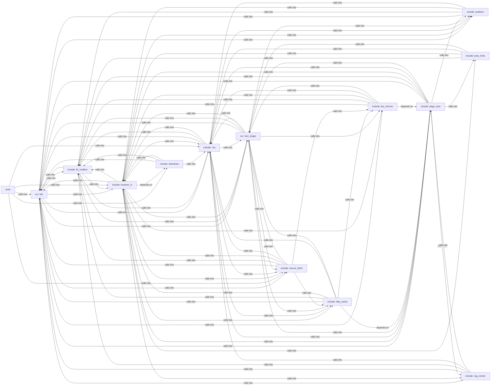

## Details

Static architecture map of 427 files (c, h, py, sh) in 14 components: src: tab, include: browser_ui, include: css, src: text_shape, include: page_view, include: http_cache, include: secure_fetch, include: bui_chrome. Structure is extracted statically without LLM calls; component prose may be enriched locally.

### src: tab (1)

src: tab groups 72 files (c, h) around FREEDOM_HTML_PARSE_H, hp_status, max_bytes, hp_config, hp_document. Fuzzer for anchor (spec/anchor.md) and url_split_location: a hostile document x a

**Related Classes/Methods**:

- <a href="../include/html_parse.h#L2-L21">include/html_parse.h::FREEDOM_HTML_PARSE_H</a>
- <a href="../include/html_parse.h#L22-L30">include/html_parse.h::hp_status</a>
- <a href="../include/html_parse.h">include/html_parse.h::max_bytes</a>
- <a href="../include/html_parse.h#L32-L38">include/html_parse.h::hp_config</a>
- <a href="../include/html_parse.h#L39-L40">include/html_parse.h::hp_document</a>
- <a href="../include/html_parse.h#L41-L46">include/html_parse.h::HP_DEFAULT_MAX_BYTES</a>
- <a href="../include/html_parse.h">include/html_parse.h::dropped</a>
- <a href="../include/html_parse.h#L48-L56">include/html_parse.h::HP_MAX_SCRIPTS</a>

### include: browser_ui (2)

include: browser_ui groups 69 files (c, h) around FREEDOM_SCROLL_REQ_H, SRQ_MAX_COORD, SRQ_WIRE_N, srq_kind, srq_behavior. libFuzzer harness for box_blur (spec/box_blur.md): a hostile mask, size, stride and sigma

**Related Classes/Methods**:

- <a href="../include/scroll_req.h#L2-L20">include/scroll_req.h::FREEDOM_SCROLL_REQ_H</a>
- <a href="../include/scroll_req.h">include/scroll_req.h::SRQ_MAX_COORD</a>
- <a href="../include/scroll_req.h#L22-L23">include/scroll_req.h::SRQ_WIRE_N</a>
- <a href="../include/scroll_req.h#L24-L30">include/scroll_req.h::srq_kind</a>
- <a href="../include/scroll_req.h#L31-L32">include/scroll_req.h::srq_behavior</a>
- <a href="../include/scroll_req.h#L33-L35">include/scroll_req.h::srq_block</a>
- <a href="../include/scroll_req.h">include/scroll_req.h::kind</a>
- <a href="../include/scroll_req.h#L37-L45">include/scroll_req.h::srq_req</a>

### include: css (3)

include: css groups 58 files (c, h) around FREEDOM_CSS_H, css_status, css_align, css_display, CSS_DISP_INLINE_OUTER. fuzz_root_match: Root matcher for the attribute-scoped custom-property path: a fixed...

**Related Classes/Methods**:

- <a href="../include/css.h#L2-L29">include/css.h::FREEDOM_CSS_H</a>
- <a href="../include/css.h#L30-L35">include/css.h::css_status</a>
- <a href="../include/css.h#L36-L43">include/css.h::css_align</a>
- <a href="../include/css.h#L44-L73">include/css.h::css_display</a>
- <a href="../include/css.h">include/css.h::CSS_DISP_INLINE_OUTER</a>
- <a href="../include/css.h#L75-L76">include/css.h::CSS_DISP_INNER_MASK</a>
- <a href="../include/css.h#L77-L87">include/css.h::css_justify</a>
- <a href="../include/css.h">include/css.h::CSS_GAP_MAX</a>

### src: text_shape (4)

src: text_shape groups 55 files (c, h) around FREEDOM_HLS_H, hls_status, hls_segment, hls_variant, hls_playlist. libFuzzer harness for hls (spec/hls.md): hostile playlist text, hostile

**Related Classes/Methods**:

- <a href="../include/hls.h#L2-L20">include/hls.h::FREEDOM_HLS_H</a>
- <a href="../include/hls.h#L21-L28">include/hls.h::hls_status</a>
- <a href="../include/hls.h#L29-L35">include/hls.h::hls_segment</a>
- <a href="../include/hls.h#L36-L44">include/hls.h::hls_variant</a>
- <a href="../include/hls.h#L45-L64">include/hls.h::hls_playlist</a>
- <a href="../include/hls.h#L65-L67">include/hls.h::hls_select_variant</a>
- <a href="../include/hls.h#L68-L73">include/hls.h::resolved</a>
- <a href="../include/hls.h#L74-L76">include/hls.h::hls_playlist_free</a>

### include: page_view (5)

include: page_view groups 30 files (c, h) around FREEDOM_PAGE_VIEW_H, pv_status, PV_BSHADOW_LAYERS, PV_MAUTO_LEFT, PV_MAUTO_RIGHT. Hostile box trees (any parent graph, cycles included) through the positioned paint

**Related Classes/Methods**:

- <a href="../include/page_view.h#L2-L33">include/page_view.h::FREEDOM_PAGE_VIEW_H</a>
- <a href="../include/page_view.h#L34-L43">include/page_view.h::pv_status</a>
- <a href="../include/page_view.h#L44-L45">include/page_view.h::PV_BSHADOW_LAYERS</a>
- <a href="../include/page_view.h">include/page_view.h::PV_MAUTO_LEFT</a>
- <a href="../include/page_view.h">include/page_view.h::PV_MAUTO_RIGHT</a>
- <a href="../include/page_view.h">include/page_view.h::PV_MAUTO_TOP</a>
- <a href="../include/page_view.h#L49-L52">include/page_view.h::PV_MAUTO_BOTTOM</a>
- <a href="../include/page_view.h">include/page_view.h::PV_LEN_UNSET</a>

### include: http_cache (6)

include: http_cache groups 28 files (c, h) around FREEDOM_LOCAL_STORE_H, LS_KEY_LEN, LS_SALT_LEN, LS_NONCE_LEN, LS_TAG_LEN. sanitize_utf8_inplace: Rewrites s in place to well-formed UTF-8, replacing any byte...

**Related Classes/Methods**:

- <a href="../include/local_store.h#L2-L25">include/local_store.h::FREEDOM_LOCAL_STORE_H</a>
- <a href="../include/local_store.h">include/local_store.h::LS_KEY_LEN</a>
- <a href="../include/local_store.h">include/local_store.h::LS_SALT_LEN</a>
- <a href="../include/local_store.h">include/local_store.h::LS_NONCE_LEN</a>
- <a href="../include/local_store.h">include/local_store.h::LS_TAG_LEN</a>
- <a href="../include/local_store.h">include/local_store.h::LS_HEADER_LEN</a>
- <a href="../include/local_store.h">include/local_store.h::LS_OVERHEAD</a>
- <a href="../include/local_store.h#L32-L33">include/local_store.h::LS_MAX_PLAINTEXT</a>

### include: secure_fetch (7)

include: secure_fetch groups 24 files (c, h) around FREEDOM_ANTI_FP_H, FP_TIMER_RESOLUTION_MS, FP_USER_AGENT, FP_ACCEPT_LANGUAGE, FP_ACCEPT_LANGUAGE_HEADER. libFuzzer harness for identity (spec/identity.md) and he_cdn_kind (spec/hostedit.md):

**Related Classes/Methods**:

- <a href="../include/anti_fp.h#L2-L21">include/anti_fp.h::FREEDOM_ANTI_FP_H</a>
- <a href="../include/anti_fp.h#L22-L30">include/anti_fp.h::FP_TIMER_RESOLUTION_MS</a>
- <a href="../include/anti_fp.h#L31-L32">include/anti_fp.h::FP_USER_AGENT</a>
- <a href="../include/anti_fp.h">include/anti_fp.h::FP_ACCEPT_LANGUAGE</a>
- <a href="../include/anti_fp.h#L34-L39">include/anti_fp.h::FP_ACCEPT_LANGUAGE_HEADER</a>
- <a href="../include/anti_fp.h#L40-L44">include/anti_fp.h::FP_ACCEPT_HEADER_NAV</a>
- <a href="../include/anti_fp.h">include/anti_fp.h::FP_SEC_FETCH_DEST_NAV</a>
- <a href="../include/anti_fp.h">include/anti_fp.h::FP_SEC_FETCH_MODE_NAV</a>

### include: bui_chrome (8)

include: bui_chrome groups 20 files (c, h) around FREEDOM_VIDEO_CONTROLS_H, VCL_BAR_H, VCL_MIN_W, VCL_MIN_H, VCL_PAD. libFuzzer harness for chrome_layout (spec/chrome_layout.md): a hostile URL (a page

**Related Classes/Methods**:

- <a href="../include/video_controls.h#L2-L17">include/video_controls.h::FREEDOM_VIDEO_CONTROLS_H</a>
- <a href="../include/video_controls.h">include/video_controls.h::VCL_BAR_H</a>
- <a href="../include/video_controls.h">include/video_controls.h::VCL_MIN_W</a>
- <a href="../include/video_controls.h">include/video_controls.h::VCL_MIN_H</a>
- <a href="../include/video_controls.h">include/video_controls.h::VCL_PAD</a>
- <a href="../include/video_controls.h">include/video_controls.h::VCL_TEXT_W</a>
- <a href="../include/video_controls.h">include/video_controls.h::VCL_TRACK_H</a>
- <a href="../include/video_controls.h">include/video_controls.h::VCL_MAX_SEGMENT_S</a>

### include: svg_render (9)

include: svg_render groups 14 files (c, h) around FREEDOM_IMAGE_DECODE_H, guards, img_format, img_status, img_pixels. poke_and_free: Touch every claimed pixel corner so the sanitizer flags an...

**Related Classes/Methods**:

- <a href="../include/image_decode.h#L2-L24">include/image_decode.h::FREEDOM_IMAGE_DECODE_H</a>
- <a href="../include/image_decode.h#L25-L32">include/image_decode.h::guards</a>
- <a href="../include/image_decode.h#L33-L40">include/image_decode.h::img_format</a>
- <a href="../include/image_decode.h#L41-L55">include/image_decode.h::img_status</a>
- <a href="../include/image_decode.h">include/image_decode.h::img_pixels</a>
- <a href="../include/image_decode.h#L56-L66">include/image_decode.h::width</a>
- <a href="../include/image_decode.h#L67-L70">include/image_decode.h::IMG_MAX_SCALE</a>
- <a href="../include/image_decode.h">include/image_decode.h::IMG_MAX_DIM</a>

### include: fb_cmdline (10)

include: fb_cmdline groups 11 files (c, h) around FREEDOM_FREEBUG_H, fb_level, fb_entry, level, fb_buffer. LLVMFuzzerTestOneInput: include <stdint.h> include <stdlib.h> include <string.h>...

**Related Classes/Methods**:

- <a href="../include/freebug.h#L2-L23">include/freebug.h::FREEDOM_FREEBUG_H</a>
- <a href="../include/freebug.h#L24-L35">include/freebug.h::fb_level</a>
- <a href="../include/freebug.h">include/freebug.h::fb_entry</a>
- <a href="../include/freebug.h#L36-L45">include/freebug.h::level</a>
- <a href="../include/freebug.h#L46-L55">include/freebug.h::fb_buffer</a>
- <a href="../include/freebug.h">include/freebug.h::FB_MAX_ENTRIES</a>
- <a href="../include/freebug.h">include/freebug.h::FB_MAX_ENTRY_BYTES</a>
- <a href="../include/freebug.h#L58-L61">include/freebug.h::FB_MAX_TOTAL_BYTES</a>

### include: download (11)

include: download groups 8 files (c, h) around FREEDOM_PDF_EXPORT_H, PE_NAME_MAX, PE_EXT, PE_EXT_PNG, PE_FALLBACK_NAME. dl_should_download: 1 if the response should be saved (attachment, or a non-renderable...

**Related Classes/Methods**:

- <a href="../include/pdf_export.h#L2-L27">include/pdf_export.h::FREEDOM_PDF_EXPORT_H</a>
- <a href="../include/pdf_export.h">include/pdf_export.h::PE_NAME_MAX</a>
- <a href="../include/pdf_export.h">include/pdf_export.h::PE_EXT</a>
- <a href="../include/pdf_export.h">include/pdf_export.h::PE_EXT_PNG</a>
- <a href="../include/pdf_export.h#L31-L32">include/pdf_export.h::PE_FALLBACK_NAME</a>
- <a href="../include/pdf_export.h#L33-L45">include/pdf_export.h::pe_status</a>
- <a href="../include/pdf_export.h#L46-L50">include/pdf_export.h::fallback</a>
- <a href="../include/pdf_export.h">include/pdf_export.h::trusted</a>

### include: prefetch (12)

include: prefetch groups 8 files (c, h) around FREEDOM_IMPORT_MAP_H, algorithm, IM_MAX_TEXT, IM_MAX_ENTRIES, IM_MAX_SCOPES. libFuzzer harness for the prefetch lookahead scanner (Hito 29).

**Related Classes/Methods**:

- <a href="../include/import_map.h#L2-L12">include/import_map.h::FREEDOM_IMPORT_MAP_H</a>
- <a href="../include/import_map.h#L13-L16">include/import_map.h::algorithm</a>
- <a href="../include/import_map.h">include/import_map.h::IM_MAX_TEXT</a>
- <a href="../include/import_map.h">include/import_map.h::IM_MAX_ENTRIES</a>
- <a href="../include/import_map.h#L19-L22">include/import_map.h::IM_MAX_SCOPES</a>
- <a href="../include/import_map.h#L23-L27">include/import_map.h::im_map</a>
- <a href="../include/import_map.h#L28-L32">include/import_map.h::map</a>
- <a href="../include/import_map.h#L33-L36">include/import_map.h::im_resolve</a>

### include: pres_hints (13)

include: pres_hints groups 7 files (c, h) around FREEDOM_TABLE_LAYOUT_H, TL_MAX_COLS, TL_WIDTH_MAX, TL_PER_MILLE, col. libFuzzer harness for table_layout and pres_hints (spec/table_layout.md...

**Related Classes/Methods**:

- <a href="../include/table_layout.h#L11-L19">include/table_layout.h::FREEDOM_TABLE_LAYOUT_H</a>
- <a href="../include/table_layout.h#L20-L22">include/table_layout.h::TL_MAX_COLS</a>
- <a href="../include/table_layout.h#L23-L25">include/table_layout.h::TL_WIDTH_MAX</a>
- <a href="../include/table_layout.h">include/table_layout.h::TL_PER_MILLE</a>
- <a href="../include/table_layout.h">include/table_layout.h::col</a>
- <a href="../include/table_layout.h#L28-L40">include/table_layout.h::tl_cell</a>
- <a href="../include/table_layout.h#L41-L52">include/table_layout.h::px</a>
- <a href="../include/table_layout.h#L53-L56">include/table_layout.h::tl_intrinsic</a>

### tools (14)

tools groups 3 files (py) around start_display, one_run, main, phase_ms, one_page. guiscroll -- what one frame costs in the REAL Freedom window while the user scrolls....

**Related Classes/Methods**:

- <a href="../tools/guitime.py#L34-L66">tools/guitime.py::start_display</a>
- <a href="../tools/guitime.py#L67-L95">tools/guitime.py::one_run</a>
- <a href="../tools/guitime.py#L96-L151">tools/guitime.py::main</a>
- <a href="../tools/guiscroll.py#L38-L47">tools/guiscroll.py::phase_ms</a>
- <a href="../tools/guiscroll.py#L48-L94">tools/guiscroll.py::one_page</a>
- <a href="../tools/guiscroll.py#L95-L148">tools/guiscroll.py::main</a>
- <a href="../tools/guiscroll.py#L149-L156">tools/guiscroll.py::procs_display</a>
- <a href="../tools/guishot.py#L38-L42">tools/guishot.py::xdo</a>
