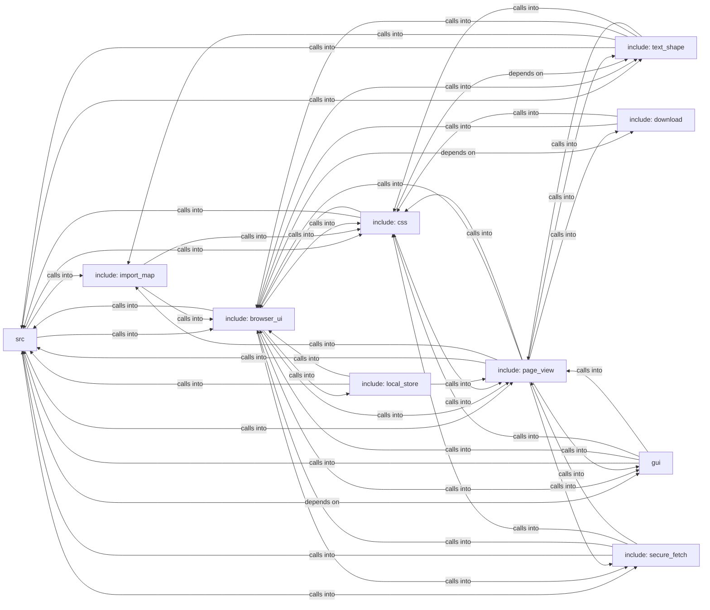

## Details

Static architecture map of 262 files (c, h, py, sh) in 10 components: src, include: browser_ui, include: css, include: page_view, include: text_shape, include: local_store, gui, include: secure_fetch. Structure is extracted statically without LLM calls; component prose may be enriched locally.

### src (1)

src groups 59 files (c, h) around FREEDOM_HTML_PARSE_H, hp_status, max_bytes, hp_config, hp_document.

**Related Classes/Methods**:

- <a href="../include/html_parse.h#L2-L21">include/html_parse.h::FREEDOM_HTML_PARSE_H</a>
- <a href="../include/html_parse.h#L22-L30">include/html_parse.h::hp_status</a>
- <a href="../include/html_parse.h">include/html_parse.h::max_bytes</a>
- <a href="../include/html_parse.h#L32-L38">include/html_parse.h::hp_config</a>
- <a href="../include/html_parse.h#L39-L40">include/html_parse.h::hp_document</a>
- <a href="../include/html_parse.h#L41-L46">include/html_parse.h::HP_DEFAULT_MAX_BYTES</a>
- <a href="../include/html_parse.h">include/html_parse.h::dropped</a>
- <a href="../include/html_parse.h#L48-L56">include/html_parse.h::HP_MAX_SCRIPTS</a>

### include: browser_ui (2)

include: browser_ui groups 47 files (c, h) around FREEDOM_IMAGE_DECODE_H, guards, img_format, img_status, img_pixels. poke_and_free: Touch every claimed pixel corner so the sanitizer flags an...

**Related Classes/Methods**:

- <a href="../include/image_decode.h#L2-L24">include/image_decode.h::FREEDOM_IMAGE_DECODE_H</a>
- <a href="../include/image_decode.h#L25-L32">include/image_decode.h::guards</a>
- <a href="../include/image_decode.h#L33-L40">include/image_decode.h::img_format</a>
- <a href="../include/image_decode.h#L41-L55">include/image_decode.h::img_status</a>
- <a href="../include/image_decode.h">include/image_decode.h::img_pixels</a>
- <a href="../include/image_decode.h#L56-L64">include/image_decode.h::width</a>
- <a href="../include/image_decode.h">include/image_decode.h::IMG_MAX_DIM</a>
- <a href="../include/image_decode.h#L66-L77">include/image_decode.h::IMG_MAX_PIXELS</a>

### include: css (3)

include: css groups 40 files (c, h) around FREEDOM_CSS_COLOR_H, b, cc_rgb, cc_status, cc_pack. fuzz_root_match: Root matcher for the attribute-scoped custom-property path: a fixed...

**Related Classes/Methods**:

- <a href="../include/css_color.h#L2-L25">include/css_color.h::FREEDOM_CSS_COLOR_H</a>
- <a href="../include/css_color.h">include/css_color.h::b</a>
- <a href="../include/css_color.h#L27-L30">include/css_color.h::cc_rgb</a>
- <a href="../include/css_color.h#L31-L48">include/css_color.h::cc_status</a>
- <a href="../include/css_color.h#L49-L58">include/css_color.h::cc_pack</a>
- <a href="../include/css_color.h">include/css_color.h::CC_COLOR_CURRENT</a>
- <a href="../include/css_color.h#L60-L62">include/css_color.h::CC_COLOR_TRANSPARENT</a>
- <a href="../include/css.h#L2-L27">include/css.h::FREEDOM_CSS_H</a>

### include: page_view (4)

include: page_view groups 31 files (c, h) around FREEDOM_RENDER_POLICY_H, RDP_TRACKER_MAX_DIM, images, rdp_caps, rdp_img_decision. bx_edges: anything longer fails closed instead of truncating into a wrong match....

**Related Classes/Methods**:

- <a href="../include/render_policy.h#L2-L26">include/render_policy.h::FREEDOM_RENDER_POLICY_H</a>
- <a href="../include/render_policy.h#L27-L31">include/render_policy.h::RDP_TRACKER_MAX_DIM</a>
- <a href="../include/render_policy.h">include/render_policy.h::images</a>
- <a href="../include/render_policy.h#L32-L38">include/render_policy.h::rdp_caps</a>
- <a href="../include/render_policy.h#L39-L52">include/render_policy.h::rdp_img_decision</a>
- <a href="../include/render_policy.h#L53-L55">include/render_policy.h::rdp_is_tracking_pixel</a>
- <a href="../include/render_policy.h#L56-L65">include/render_policy.h::size</a>
- <a href="../include/render_policy.h#L66-L68">include/render_policy.h::rdp_img_reason</a>

### include: text_shape (5)

include: text_shape groups 20 files (c, h) around FREEDOM_DATA_URL_H, allocation, du_status, DU_MAX_ENCODED_LEN, du_is_data_url. libFuzzer harness for the webfont lookahead scanner (spec/webfont.md).

**Related Classes/Methods**:

- <a href="../include/data_url.h#L2-L20">include/data_url.h::FREEDOM_DATA_URL_H</a>
- <a href="../include/data_url.h#L21-L26">include/data_url.h::allocation</a>
- <a href="../include/data_url.h#L27-L42">include/data_url.h::du_status</a>
- <a href="../include/data_url.h#L43-L45">include/data_url.h::DU_MAX_ENCODED_LEN</a>
- <a href="../include/data_url.h#L46-L58">include/data_url.h::du_is_data_url</a>
- <a href="../include/data_url.h#L59-L72">include/data_url.h::closed</a>
- <a href="../include/webfont.h#L2-L19">include/webfont.h::FREEDOM_WEBFONT_H</a>
- <a href="../include/webfont.h">include/webfont.h::WF_FAMILY_MAX</a>

### include: local_store (6)

include: local_store groups 16 files (c, h) around FREEDOM_LOCAL_STORE_H, LS_KEY_LEN, LS_SALT_LEN, LS_NONCE_LEN, LS_TAG_LEN. ds_free: Reads and decrypts path.

**Related Classes/Methods**:

- <a href="../include/local_store.h#L2-L25">include/local_store.h::FREEDOM_LOCAL_STORE_H</a>
- <a href="../include/local_store.h">include/local_store.h::LS_KEY_LEN</a>
- <a href="../include/local_store.h">include/local_store.h::LS_SALT_LEN</a>
- <a href="../include/local_store.h">include/local_store.h::LS_NONCE_LEN</a>
- <a href="../include/local_store.h">include/local_store.h::LS_TAG_LEN</a>
- <a href="../include/local_store.h">include/local_store.h::LS_HEADER_LEN</a>
- <a href="../include/local_store.h">include/local_store.h::LS_OVERHEAD</a>
- <a href="../include/local_store.h#L32-L33">include/local_store.h::LS_MAX_PLAINTEXT</a>

### gui (7)

gui groups 15 files (c, h) around FREEDOM_SVG_RENDER_H, sv_status, SV_MAX_SHAPES, SV_MAX_POINTS, SV_MAX_SEGS. ui_theme_mode: ui_rgb button_text; ui_rgb menu_bg; ui_rgb menu_border; ui_rgb...

**Related Classes/Methods**:

- <a href="../include/svg_render.h#L2-L24">include/svg_render.h::FREEDOM_SVG_RENDER_H</a>
- <a href="../include/svg_render.h#L25-L31">include/svg_render.h::sv_status</a>
- <a href="../include/svg_render.h">include/svg_render.h::SV_MAX_SHAPES</a>
- <a href="../include/svg_render.h">include/svg_render.h::SV_MAX_POINTS</a>
- <a href="../include/svg_render.h">include/svg_render.h::SV_MAX_SEGS</a>
- <a href="../include/svg_render.h">include/svg_render.h::SV_MAX_DEPTH</a>
- <a href="../include/svg_render.h">include/svg_render.h::SV_TEXT_MAX</a>
- <a href="../include/svg_render.h#L37-L40">include/svg_render.h::SV_MAX_INPUT</a>

### include: secure_fetch (8)

include: secure_fetch groups 10 files (c, h) around FREEDOM_ANTI_FP_H, FP_TIMER_RESOLUTION_MS, FP_USER_AGENT, FP_ACCEPT_LANGUAGE, FP_ACCEPT_LANGUAGE_HEADER. fp_accept_language_header: #define FP_SEC_FETCH_DEST_NAV  "document" #define...

**Related Classes/Methods**:

- <a href="../include/anti_fp.h#L2-L21">include/anti_fp.h::FREEDOM_ANTI_FP_H</a>
- <a href="../include/anti_fp.h#L22-L30">include/anti_fp.h::FP_TIMER_RESOLUTION_MS</a>
- <a href="../include/anti_fp.h#L31-L32">include/anti_fp.h::FP_USER_AGENT</a>
- <a href="../include/anti_fp.h">include/anti_fp.h::FP_ACCEPT_LANGUAGE</a>
- <a href="../include/anti_fp.h#L34-L39">include/anti_fp.h::FP_ACCEPT_LANGUAGE_HEADER</a>
- <a href="../include/anti_fp.h#L40-L44">include/anti_fp.h::FP_ACCEPT_HEADER_NAV</a>
- <a href="../include/anti_fp.h">include/anti_fp.h::FP_SEC_FETCH_DEST_NAV</a>
- <a href="../include/anti_fp.h">include/anti_fp.h::FP_SEC_FETCH_MODE_NAV</a>

### include: download (9)

include: download groups 8 files (c, h) around FREEDOM_PDF_EXPORT_H, PE_NAME_MAX, PE_EXT, PE_EXT_PNG, PE_FALLBACK_NAME. dl_should_download: 1 if the response should be saved (attachment, or a non-renderable...

**Related Classes/Methods**:

- <a href="../include/pdf_export.h#L2-L27">include/pdf_export.h::FREEDOM_PDF_EXPORT_H</a>
- <a href="../include/pdf_export.h">include/pdf_export.h::PE_NAME_MAX</a>
- <a href="../include/pdf_export.h">include/pdf_export.h::PE_EXT</a>
- <a href="../include/pdf_export.h">include/pdf_export.h::PE_EXT_PNG</a>
- <a href="../include/pdf_export.h#L31-L32">include/pdf_export.h::PE_FALLBACK_NAME</a>
- <a href="../include/pdf_export.h#L33-L45">include/pdf_export.h::pe_status</a>
- <a href="../include/pdf_export.h#L46-L50">include/pdf_export.h::fallback</a>
- <a href="../include/pdf_export.h">include/pdf_export.h::trusted</a>

### include: import_map (10)

include: import_map groups 4 files (c, h) around FREEDOM_IMPORT_MAP_H, algorithm, IM_MAX_TEXT, IM_MAX_ENTRIES, IM_MAX_SCOPES. im_resolve: Resolves specifier as imported from base (the importing module's URL).

**Related Classes/Methods**:

- <a href="../include/import_map.h#L2-L12">include/import_map.h::FREEDOM_IMPORT_MAP_H</a>
- <a href="../include/import_map.h#L13-L16">include/import_map.h::algorithm</a>
- <a href="../include/import_map.h">include/import_map.h::IM_MAX_TEXT</a>
- <a href="../include/import_map.h">include/import_map.h::IM_MAX_ENTRIES</a>
- <a href="../include/import_map.h#L19-L22">include/import_map.h::IM_MAX_SCOPES</a>
- <a href="../include/import_map.h#L23-L27">include/import_map.h::im_map</a>
- <a href="../include/import_map.h#L28-L32">include/import_map.h::map</a>
- <a href="../include/import_map.h#L33-L36">include/import_map.h::im_resolve</a>
