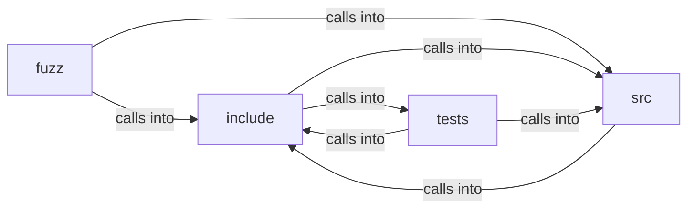

# src

src groups 59 files (c, h) around FREEDOM_HTML_PARSE_H, hp_status, max_bytes, hp_config, hp_document.

## fuzz (1.1)

fuzz groups 8 files (c) around ensure_built, LLVMFuzzerTestOneInput, LLVMFuzzerTestOneInput, fz_dom_parent, FUZZ_JSDOM_MAX_NODES.

## include (1.2)

include groups 16 files (h) around FREEDOM_HTML_PARSE_H, hp_status, max_bytes, hp_config, hp_document. dom_place: Where dom_move_children places the moved nodes (insertAdjacent* needs all...

## src (1.3)

src groups 22 files (c, h) around FREEDOM_JS_DOM_EXT_H, jdx_install, FREEDOM_JS_DOM_INTERNAL_H, jd_opaque_get, jd_idx. to_lower_buf: #include <stdint.h> #include <stdlib.h> #include <string.h> #include...

## tests (1.4)

tests groups 13 files (c) around setup_doc, teardown_doc, DOC, IDX, test_build_null_args. setup_doc: #include "dom.h" #include "html_parse.h" static const char HTML[] =...

**Files**:

- fuzz/fuzz_dom.c
- fuzz/fuzz_freebug.c
- fuzz/fuzz_html_parse.c
- fuzz/fuzz_js_dom.c
- fuzz/fuzz_js_geom.c
- fuzz/fuzz_js_sandbox.c
- fuzz/fuzz_url.c
- fuzz/fuzz_web_storage.c
- include/dom.h
- include/freebug.h
- include/html_parse.h
- include/js_dom.h
- include/js_env.h
- include/js_geom.h
- include/js_location.h
- include/js_sandbox.h
- include/js_trusted.h
- include/link_nav.h
- include/os_sandbox.h
- include/renderer.h
- include/tab.h
- include/url.h
- include/util.h
- include/web_storage.h
- src/dom.c
- src/freebug.c
- src/html_parse.c
- src/js_dom.c
- src/js_dom_ext.c
- src/js_dom_ext.h
- src/js_dom_internal.h
- src/js_embed.c
- src/js_env.c
- src/js_events.c
- src/js_fetch.c
- src/js_geom.c
- src/js_location.c
- src/js_location_internal.h
- src/js_sandbox.c
- src/js_trusted.c
- src/link_nav.c
- src/os_sandbox.c
- src/renderer.c
- src/tab.c
- src/url.c
- src/web_storage.c
- tests/test_dom.c
- tests/test_freebug.c
- tests/test_html_parse.c
- tests/test_js_dom.c
- tests/test_js_env.c
- tests/test_js_geom.c
- tests/test_js_sandbox.c
- tests/test_link_nav.c
- tests/test_os_sandbox.c
- tests/test_renderer.c
- tests/test_tab.c
- tests/test_url.c
- tests/test_web_storage.c
