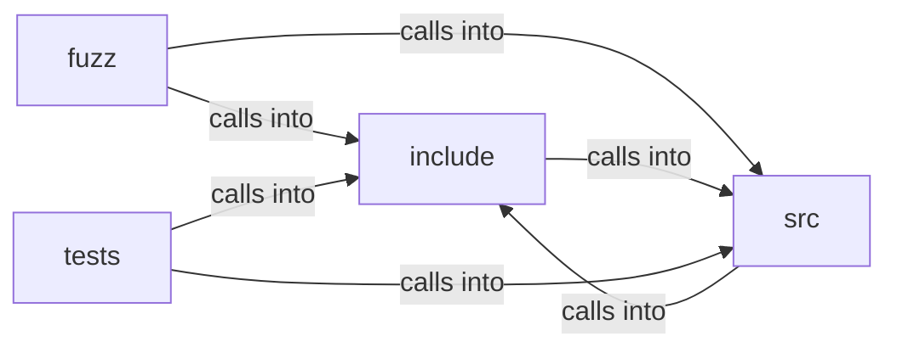

# src: freedom

src: freedom groups 36 files (c, h) around FREEDOM_HOSTBLOCK_H, hb_set, hb_list, hb_decision, hb_status. hls_segment: or variant info.

## fuzz (4.1)

fuzz groups 2 files (c) around check_split, LLVMFuzzerTestOneInput.

## include (4.2)

include groups 11 files (h) around FREEDOM_HOSTBLOCK_H, hb_set, hb_list, hb_decision, hb_status. hls_segment: or variant info.

## src (4.3)

src groups 12 files (c) around _POSIX_C_SOURCE, _DEFAULT_SOURCE, EXIT_OK, EXIT_ERROR, EXIT_USAGE. is_overlay_http: fprintf(fp, "  --dump-video-url: headless, print the first detected...

## tests (4.4)

tests groups 11 files (c) around test_not_m3u8_returns_parse_error, test_empty_m3u8_is_ok, test_single_segment, test_multiple_segments, test_target_duration_is_parsed.

**Files**:

- fuzz/fuzz_tls_impersonate.c
- fuzz/fuzz_url.c
- include/hls.h
- include/host_conf.h
- include/hostblock.h
- include/js_policy.h
- include/link_nav.h
- include/media_decoder.h
- include/net_realm.h
- include/perf_trace.h
- include/tls_impersonate.h
- include/webcaps.h
- include/wl_display.h
- src/freedom.c
- src/hls.c
- src/host_conf.c
- src/hostblock.c
- src/js_policy.c
- src/link_nav.c
- src/media_decoder.c
- src/net_realm.c
- src/perf_trace.c
- src/tls_impersonate.c
- src/webcaps.c
- src/wl_display.c
- tests/test_hls.c
- tests/test_host_conf.c
- tests/test_hostblock.c
- tests/test_js_policy.c
- tests/test_link_nav.c
- tests/test_media_decoder.c
- tests/test_net_realm.c
- tests/test_perf_trace.c
- tests/test_tls_impersonate.c
- tests/test_webcaps.c
- tests/test_wl_display.c
